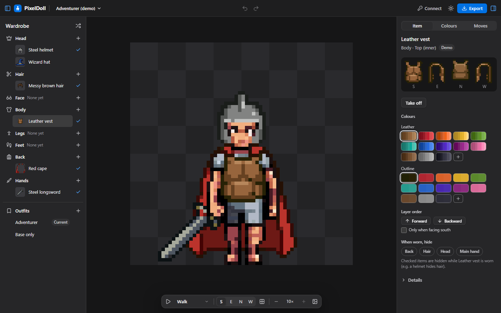
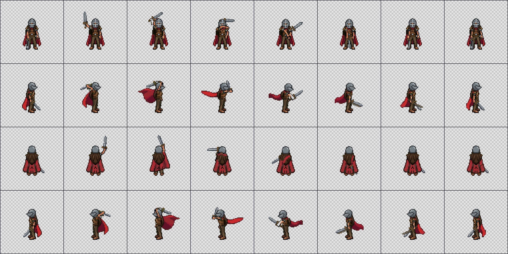
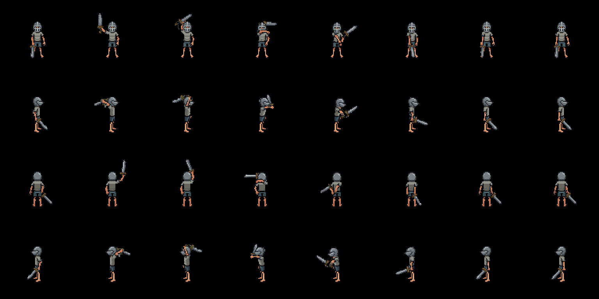

# PixelDoll

**Dress up your 2D game characters with pixel-perfect paper dolling.** Generate swappable, frame-aligned equipment layers
with PixelLab AI and export them to any game engine. · [Open PixelDoll](https://pixeldoll.app/)

<p>
  
  
</p>
<p>
  
</p>

Paper dolling for [PixelLab](https://pixellab.ai). Describe a pixel-art character, add hats, armor, hair and weapons as
**separate frame-aligned layers**, recolor them, and export sprite sheets plus a manifest for **Godot, Unity, Phaser, GDevelop** or any
engine (PNG + JSON). Source artwork comes from PixelLab; PixelDoll extracts layers, cleans keyed pixels and applies exact
color changes to turn PixelLab's one-image-per-call output into a
consistent, layered, slot-based paperdoll: one base body, N directions, M moves, and a transparent layer per item on the same
grid and pivot.

Client-side only (Svelte 5 + Vite 8 + TypeScript, no backend). The browser calls the PixelLab REST v2 API directly with your own
key.

The immersive Studio and its design prototype use [Bronze UI](https://github.com/Shilo/bronze-ui), our MIT theme with native light/dark modes ([component showcase](https://shilo.github.io/bronze-ui/)). It is a versioned dependency in `app/package.json`; application layout and gameplay stay local. The [production design contract](docs/design/production-experience.md) documents the integration.

## Status

Live at https://pixeldoll.app/ (the version is in the More menu). See the [roadmap](https://github.com/users/Shilo/projects/7) (planned, in progress and done), [PLAN.md](PLAN.md) (status, decisions) and
[known issues](docs/known-issues.md).

- Proven: base character (48 px, padded to a 64 px cell) → skeleton-v3 moves → items dressed on a chroma mannequin and posed per
  move → automatic checks → layers. Held items use a 96 px canvas with the same pivot.
- Godot 4.7.1 and Phaser 3.80 / 3.90 / 4.2.1 render the exports pixel-identical to PixelDoll's own compositor.
  Unity: the C# importer compiles, live import not yet verified.
- New characters default to the **Top-down 8** preset, which mirrors the three western views from their eastern partners
  (mirrored views and older mirrored rigs swap held-item handedness); **Unique 8** or turning off a view's mirror draws it
  independently. Automated direction/persistence/export checks pass; live independent
  full creation stopped safely on unknown skeleton-estimation outcomes. Idle-only recovery passed with 16 genuinely measured frames. A primary 96px sword passed reload, keyless ZIP reimport and engine runtime checks with a west-profile grip warning retained; targeted Slash repairs now pass every body gate and manual review of all 32 sword frames; automated item review warnings remain visible.
- Known quality limits: two shield east-walk drafts remain unaccepted; generated artwork still needs visual review.
  PWA is deferred (see PLAN.md). The bundled demo uses the team's own PixelLab outputs.

## Run locally

Use **Node.js 24.22.1** (`.nvmrc`) with its bundled **npm 11.19.1**. Dependency versions and the lockfile are pinned.

```sh
cd app
npm ci
npm run dev        # http://localhost:5173
```

Open `#/` for character selection; the bundled demo needs no key. Choose **Customize** to dress it or try **Top-down** and **Side-scroller** movement. To generate, open **More options → Connect PixelLab** and paste a key from
<https://pixellab.ai/account>. It stays in memory unless you check *Remember on this device*, and is only sent to
`api.pixellab.ai`. `npm run dev` handles the key exactly like the deployed site: there is no key file, endpoint or button.

Remembered keys use `localStorage['pixellabApiKey']`, shared with every app on the same origin. `https://pixeldoll.app/`
is its own origin, so it no longer shares a key with PixelLab Backpack at `https://shilo.github.io/pixellab-backpack/`.
Only this name is used; older saved names are ignored and are
not migrated. Forget removes the shared saved key. Other open apps read it on their next load.

**Agent mode (AI agents only).** Automated agents (Claude, Codex, …) that test generations use a separate dev server:

```sh
npm --prefix app run dev:agent   # http://localhost:5199, Vite mode "agent" (launch config "app-dev-agent")
```

It reads `PIXELLAB_API_KEY_AGENT_DEV` from a git-ignored `.env` at the repo root, server-side, and serves it at `/__dev/pixellab-key`
only to same-origin requests from localhost (`cache-control: no-store`). The app connects automatically and shows an
**Agent mode** badge. Humans don't use it. None of it exists outside `vite --mode agent`: Vite loads no `.env` files at all
(`envDir: false`, no `VITE_` variables), `vite build --mode agent` refuses to run, and CI fails if `dist/` mentions it. Never
commit `.env` and never print the key. See [AGENTS.md](AGENTS.md).

Developer pages: `#/m1` … `#/m5` (the M1–M5 harnesses), `#/selftest` (browser self-tests). Their extra fixtures (s1, s4rig, s5)
live in `app/dev-fixtures/` and are served by the dev server only; the build ships just the demo fixture `s2`.

## Build and test

All commands run from the repo root.

```sh
npm --prefix app ci
npm --prefix app run build      # -> app/dist (base './', works under any sub-path)
npm --prefix app run preview    # serves app/dist on http://localhost:4173
npm --prefix app run check      # strict Svelte, build-config and test type checks
npm --prefix app test           # Vitest: existing module assertions + runner failure checks
npm --prefix app run selftest   # compatibility alias for npm test
```

**Browser regression tests** use `@playwright/test` **1.64.1** with managed Chromium. They build the app, start their own local servers, exercise Studio workflows against the production build and run browser-only PNG/IndexedDB self-tests against the dev harness. Tests use the bundled demo, isolated storage and blocked PixelLab API requests: no key or credits are needed.

```sh
npx --prefix app playwright install chromium   # first time only; add --with-deps on Linux CI
npm --prefix app run e2e                       # builds + dist guard, then Studio flows and browser self-tests
```

Set `PLAYWRIGHT_CHANNEL=msedge` for an optional installed-Edge run. That is a separate check; a Chromium pass does not establish cross-browser compatibility. The legacy `node app/scripts/e2e-studio.mjs` entry point delegates to the Studio Playwright project and expects an existing build. `E2E_PREVIEW_PORT` and `E2E_DEV_PORT` select unused local ports when testing multiple checkouts. `BASE` can point it at an already-running normal local server; keyless regressions do not need the agent server.

`node app/scripts/shoot-mvp.mjs` remains a separate screenshot utility (local-only output in `docs/testing/img/`). The production UI keeps its existing custom CSS and Lucide icons; no GlassKit is used. See [toolchain validation](docs/testing/toolchain-standardization-2026-10-22.md).

## Export targets

The Studio's **Export** sheet groups **Engines and frameworks** separately from **Assets**, and builds one zip per selected
target, on your device, for free. Each zip contains `README.txt` (quick start), `manifest.json` ([spec](docs/manifest-spec.md)),
`CREDITS.txt` (CSV text with PixelLab provenance), `layers/` (one sheet per item layer and
move; rows = directions, columns = frames) and, optionally, `baked/` (finished characters per outfit).

| Target | In the zip | Import |
|---|---|---|
| Godot 4 | `godot/Paperdoll.tscn`, `.gd`, SpriteFrames `.tres` | Copy the folder into the project, instance `godot/Paperdoll.tscn`; `play_anim(anim, dir)`, `equip(slot, item_id)`. See `godot/README.txt`. |
| Unity 6 | Editor importer + `unity/pixeldoll_unity.json` | Copy under `Assets/`; the importer builds sliced sheets, clips, a controller and a prefab in `unity/Generated/`. See `unity/README.txt`. |
| Phaser 3.80+ / 4 | `phaser/PaperdollContainer.js` + TexturePacker-hash atlases | Copy into your assets, `loadPaperdoll(scene, dir)` then `new Paperdoll(...)`; serve over http. See `phaser/README.txt`. |
| GDevelop | `gdevelop/game.json`, registered Sprite frames and an embedded controller event | Open the native project and Preview, or copy its Sprite objects and controller event into an existing project. See `gdevelop/README.txt`. |
| Aseprite | `aseprite/<character>.aseprite`: layered file, move/direction tags, frame timing and pivot slice | Open in Aseprite 1.3+; colors and visibility match the exported current look. |
| PNG + JSON | `generic/` strips per layer, move and direction | Any engine: one sprite per layer, same grid and pivot, one clock. See `generic/README.txt`. |

GameMaker is deferred by user decision until a modern runtime is available for native compile/render verification.
Unreal support is possible through Paper2D plus a dedicated importer/component, but is not currently implemented.
See the [native export decisions](docs/research/native-export-expansion-2026-10-23.md).

Use nearest-neighbor filtering and whole-pixel positions in every engine.

## CI and deploy to GitHub Pages

[.github/workflows/pages.yml](.github/workflows/pages.yml) runs on every push and pull request that changes `app/` or the workflow: `npm ci`, `npm run check`,
`npm test` and `npm run e2e` in `app/`; the browser command includes a build and a **dist guard** that fails the run if `app/dist` contains `__dev`,
`pixellab-key`, `PIXELLAB_API_KEY_AGENT_DEV`, agent-mode code, any `.env*` file or any source map. On a push to `main` it also deploys
`app/dist` to GitHub Pages. A manual workflow run performs the checks; deployment requires a push to `main`. The workflow
requires no PixelLab secret or key environment variable. Enable Pages once: **Settings → Pages → Build and deployment → Source: GitHub
Actions**. The site is served at <https://pixeldoll.app/>, a custom domain verified on the GitHub account with HTTPS
enforced; `https://shilo.github.io/PixelDoll/` redirects there. The same build also works under a sub-path (a fork's
`<user>.github.io/PixelDoll/`) because Vite's `base` is `./` and the router uses `#/` hashes.

GitHub Pages cannot set response headers, so the Content-Security-Policy is a `<meta>` tag in `app/index.html`. It allows
scripts from `'self'` only and network calls to `api.pixellab.ai` and PixelLab's image hosts. Add any new origin there.

**Serve PixelDoll from its own origin.** Browsers isolate storage per origin (scheme + host + port), not per path. Every
project site of an account (`https://<user>.github.io/<repo>/`) shares the origin `https://<user>.github.io`. Any page on it
(another repo, a demo with third-party scripts, an XSS anywhere) can read PixelDoll's IndexedDB (projects, prompts, job
ledger), a key saved with "Remember on this device" (`localStorage`), and its same-origin `BroadcastChannel`. So deploy to
either:

- a custom domain (Settings → Pages → Custom domain), **recommended**, or
- a user or organization root site (`<name>.github.io`) that hosts nothing else.

The official site uses the custom domain `https://pixeldoll.app/`. A fork deployed as a project path is fine for trying
the demo, but for real work (your key, saved projects) use a custom domain. Never deploy it as a project path next to pages you do not control. PixelDoll keeps the key
in memory per tab by default and never broadcasts it to other tabs. Connect in the active queue tab, or close that tab to
run work here. The Connect sheet warns when "Remember" is turned on at a `*.github.io` project path.

## Repo layout

| Path | What |
|---|---|
| `app/` | The Studio (Svelte 5 + Vite 8 + TS). `src/studio/` UI, `src/lib/` pipeline (pixellab, rig, items, dress, compose, export, store), `src/ui/` M1–M5 harnesses, `public/fixtures/s2/` demo data, `dev-fixtures/` dev-server-only fixtures, `scripts/` selftest, e2e, screenshots, fixture builders. |
| `spikes/` | Node spikes S1–S5 against the live API (`spikes/api/*.mjs`). |
| `docs/` | Research, spikes, architecture, manifest spec, design, test reports. Start at [docs/README.md](docs/README.md). `docs/media/` holds the README images. |

Evidence media (spike outputs `spikes/api/out/`, test screenshots `docs/testing/img/`, design screenshots
`docs/design/screenshots/`) and the D2 mockup app `design-mockups/` are no longer tracked on `main`. They live at commit
[1f95029](https://github.com/Shilo/PixelDoll/tree/1f950291f90d43f5c6f27572445664f757f5716e); report links point there.

## Key docs

- [User guide](docs/user-guide.md): the Studio in plain language
- [Docs index](docs/README.md)
- [Architecture v1.3](docs/architecture.md) and [manifest spec](docs/manifest-spec.md)
- [Roadmap](https://github.com/users/Shilo/projects/7), [PLAN.md](PLAN.md) and [known issues](docs/known-issues.md)

## License

[MIT](LICENSE). The bundled demo art and the spike outputs were generated with PixelLab by the team.

## Credits

Powered by [PixelLab](https://pixellab.ai): every character, item and move is generated through the PixelLab API with your
own account. Icons: [Lucide](https://lucide.dev).
