# PixelDoll — immersive simulation worlds

2026-10-22. **Image-only design round.** The user's correction supersedes round two's recommendation and the earlier decision to treat the world as a static backdrop.

The priority is an immersive, beautiful game character creator. The UI should belong to the world. Moonlit Camp supplies the spatial hierarchy, floating typography and character emphasis; Quiet Stage supplies restraint. Asemulator supplies the idea of trying the character in a prototype world, not a visual template.

The existing first and second rounds were committed before this work as `66bacdd` (`docs(design): preserve character creator research and mockup rounds`). This round adds raster mockups and documentation only. No new HTML, CSS, prototype app, runtime gameplay or production changes.

## Lead recommendation

**Obsidian Holodeck** is the strongest main direction: an expansive dark simulation chamber, muted bronze material grid, large character, floating information on the left, and one coherent equipment zone on the right. It restores a game atmosphere without adding scenery or objects. **Quiet Meridian** is the cooler open-world alternative; **Porcelain Dawn** is the luminous alternative.

The recommendation is based on the rendered images, not a claim of usability validation. The holodeck has the quietest background behind the hero's head and the clearest simulation identity. Its floor texture and reflections should be reduced further in final asset production, especially for top-down play. The other worlds are alternatives, not required separate workflows or new product features.

## Three HD world directions

### Obsidian Holodeck — recommended

Dark charcoal volume, continuous ground, restrained bronze seams, soft distant light. Equipment controls occupy the right zone. Name and information float on the left. Projection controls stay near the center; no Grid, Bounds or Proof buttons.

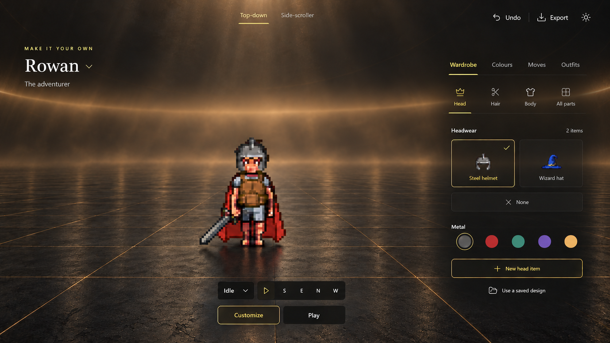

### Quiet Meridian

Cool slate, an open atmospheric horizon, fine material seams and blue-silver light. Closest to the emotional openness of Camp. The bright cloud cavity is more visually competitive than Holodeck; retain this as the atmospheric alternative rather than the inspection-first recommendation.

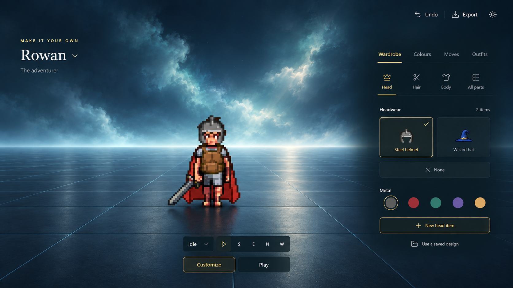

### Porcelain Dawn

Warm ceramic, peach/lilac sky and diffuse light. The useful bright counterpart, with dark text. The sunrise and reflections exert more influence over outfit colors, so this is not a neutral proofing claim or a complete light-theme specification.

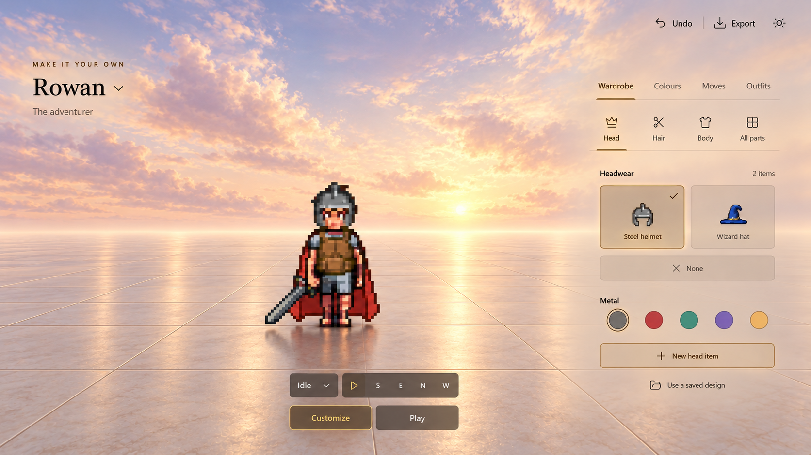

The alternative-world images establish art direction. The final Holodeck image adds the shared Top-down / Side-scroller selector after review; the two earlier alternatives do not yet show that refinement. Their production shell would use the same final controls.

## Character selection and fresh-body creation

The cast stands in the world, rather than in a grid of project cards. The selected actor is prominent. A searchable library, clear selection and paging preserve access to a larger collection. The six-character count is example content, not a storage limit.

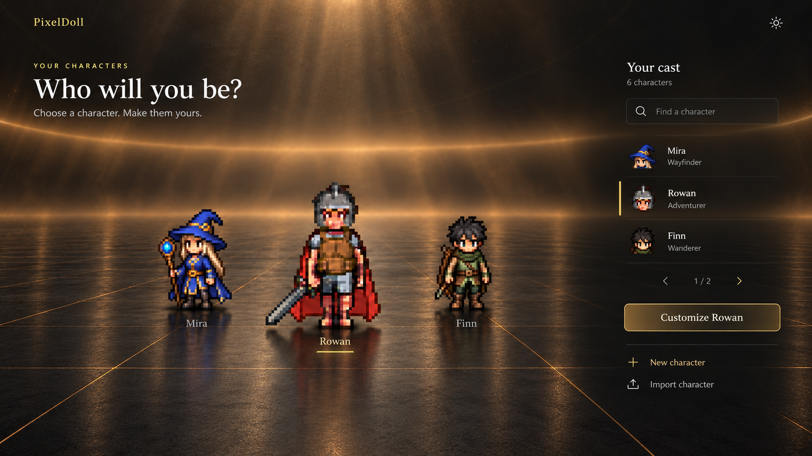

Fresh-body creation remains a focused form: describe, review the drawing quote, approve the appearance, then animate. The example is explicitly labeled. This initial form precedes the shared customization/play studio; it is not an alternate test-world dashboard.

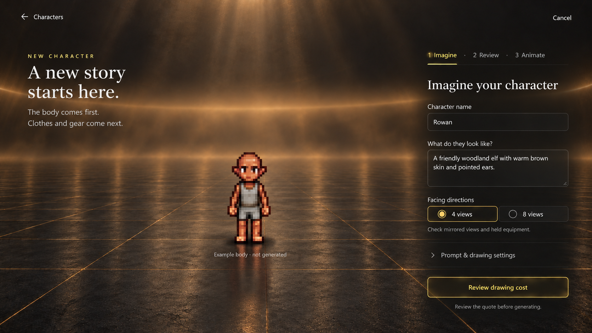

## One studio, two states

Customization and gameplay share the same identity, wardrobe, equipment, palette and projection-control locations. Entering Play hides authoring controls rather than replacing the UI. The central actor changes from inspection framing to world locomotion; the camera follows the actor while the interface stays anchored.

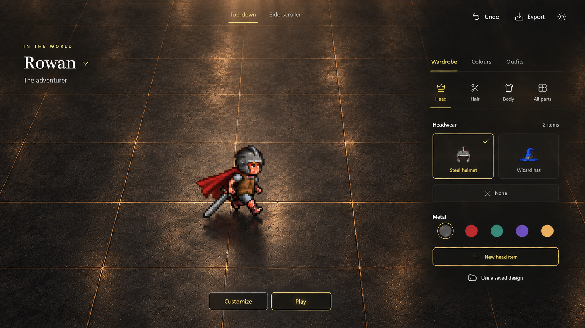

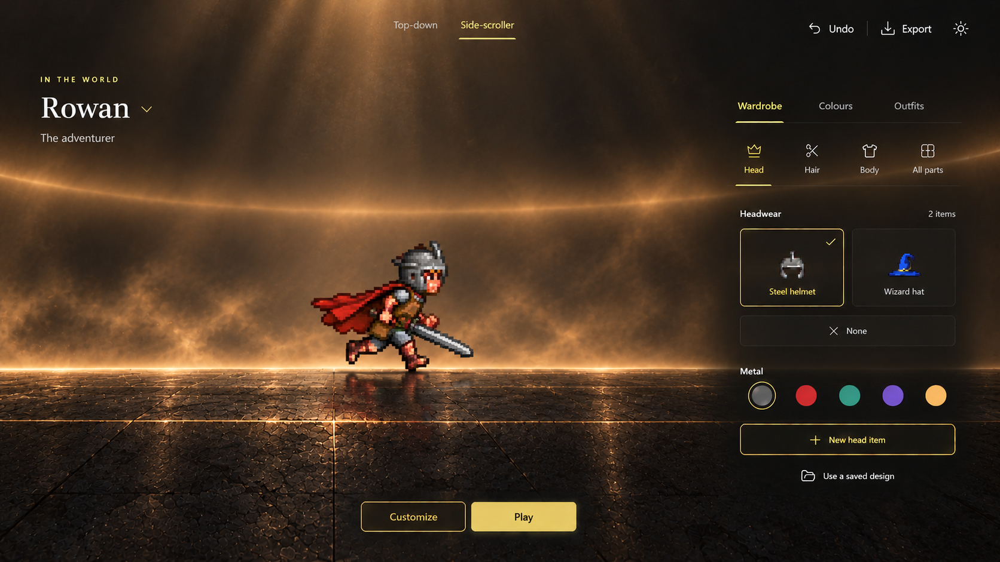

| Element | Customize | Play |
| --- | --- | --- |
| Rowan name + chevron | Opens the character switcher | Same switcher in the same position |
| Wardrobe, Colors, Outfits | Available | Available; equipment changes remain immediate |
| Equipment categories and item choices | Right zone | Same right zone |
| New item, saved designs, local color | Available | Available |
| Moves authoring | Available | Hidden |
| Idle/clip selector, facing, playback | Small central strip | Hidden entirely |
| Top-down / Side-scroller | Central projection selector | Same selector and position |
| Actor | Large inspection view, optional clip playback | Continuous input-driven locomotion with following camera |
| Grid | Surface material | Surface material; no toggle |
| Movement UI | None | No onscreen pad, arrows, keycaps or move-button bank |

The intended gameplay is **continuous**, including time-driven animation, held-key movement and camera following. The screenshots are static design artifacts; they do not implement or validate movement. See the [gameplay and interaction contract](gameplay-contract.md) for the required behavior and asset prerequisites. Do not carry round two's per-press frame stepping into implementation.

## Mobile

The same equipment hierarchy becomes one bottom area on phones. The hero and world retain the upper portion. Play removes the animation strip and Moves tab while keeping equipment in place. The character name remains a switcher.

| Selection | New character |
| --- | --- |
| 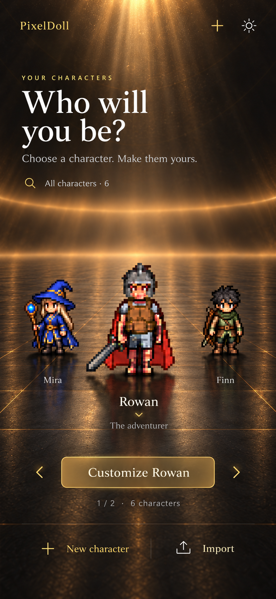 | 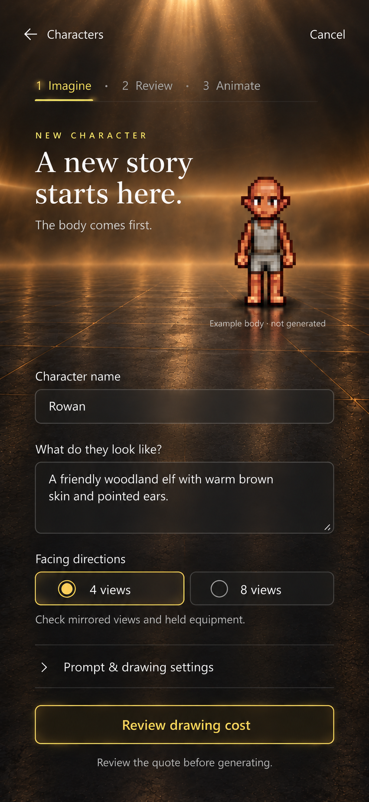 |

| Customization | Gameplay |
| --- | --- |
| 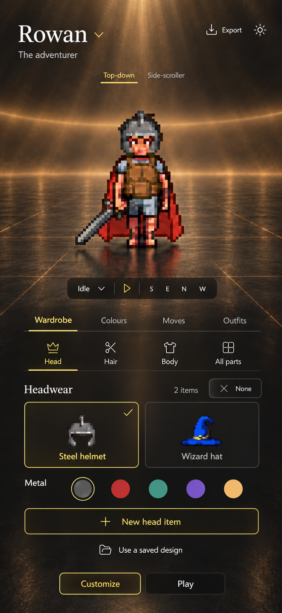 | 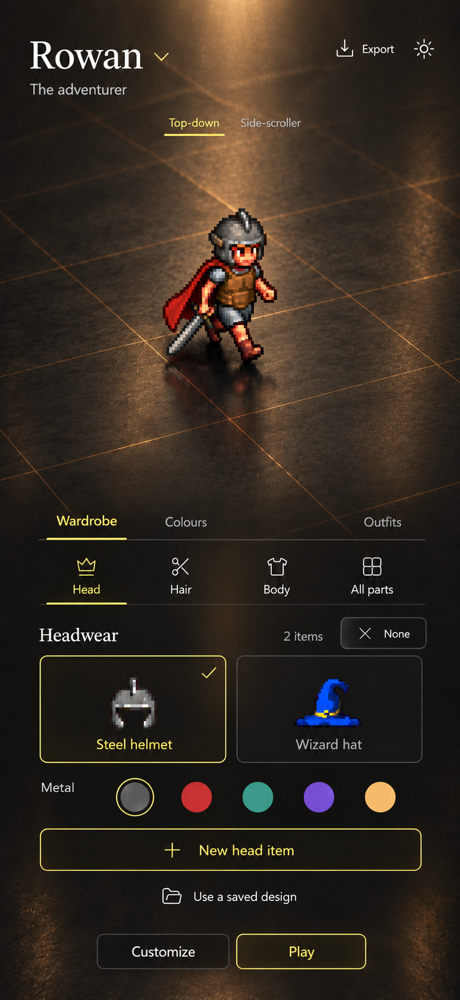 |

The phone gameplay view establishes appearance, not an approved touch locomotion mechanism. The user specified WASD/arrows and rejected onscreen movement controls. A touch gesture and its discoverability still need a focused interaction pass; no joystick is silently introduced here.

## Lead review and decisions

Two **GPT-6.1 Sol / High** subagents researched and critiqued. The lead authored all image prompts, curated the worlds, reviewed every generated result, chose the direction and expanded the screens. Researchers did not implement or generate the designs.

| Challenge | Decision |
| --- | --- |
| Round two looked like an editor pretending to be a world | Remove the solid header, identity box, left category rail, bottom equipment dock and bounded stage. Restore full-bleed space and larger actor. |
| The first Meridian draft looked like a wet outdoor courtyard | Replace the literal moon/mountains and irregular floor with a virtual horizon and regular modular material. Preserve the successful UI composition. |
| The first Holodeck horizon cut across the head/neck | Raise and soften the distant illumination before expanding the flow. |
| Prototype diagrams had become the visual goal | Use HD material, atmospheric depth and contact shadows. A grid is part of the ground, not a feature to expose in the UI. |
| Equipment required crossing the screen | Group modes, categories, choices, palette and new-item action together on the right; one bottom area on phone. |
| Research suggested seven permanently visible category labels | Retain Head/Hair/Body plus explicit **All parts** for a lighter default. All parts must expose Head, Hair, Body, Legs, Feet, Back and Hands in the same equipment zone. This is an intentional lead decision, not a missing-category implementation. |
| Research suggested generating a world plate and composing literal UI separately | Generate complete image mockups because the user explicitly requested image-led visual design. This gives cohesive atmosphere but does not preserve source sprites or exact layout metrics. Production must use real assets/components. |
| Gameplay could become another testing dashboard | Retain the studio shell, remove only inapplicable authoring controls, use a walking/running pose and changed camera to communicate gameplay. No movement-pad UI or scene props. |
| Drawn movement could be mistaken for working functionality | Document the continuous gameplay contract and clearly distinguish still-image design from runtime behavior. |
| Float-over-world UI can become illegible | Keep local scrims and selected outlines. The imagery is not a measured accessibility pass; validate text contrast, focus, touch targets and font sizes at implementation. |

The supplied screenshot and first-round Camp/Quiet images were composition references. The new environments and illustrative character variants were generated with the built-in ImageGen tool. No external game screenshot or Asemulator artwork was used as an image input. These are visual studies, not final tile maps, animation frames or exportable paperdoll assets.

Generated-image limits remain visible: exact pixel identity, category glyphs, body proportions and small UI alignment vary across images. The new-body and secondary cast art are illustrative; their depicted appearance is not an actual PixelLab result. Ground roughness is stronger than the intended final quiet surface in some frames. The final renderer must preserve unmodified frame-aligned character layers, reliable contrast and stable interface geometry.

## Files and evidence

- **11 selected screen images**, linked above; two earlier visual drafts retained for provenance.
- [World-reference research](research-immersive-worlds.md): inspected source images, source limits, proposed transfers and rejected visual patterns.
- [UI critique](research-ui-critique.md): first-round versus second-round analysis, shared-shell rubric, rendered-image review.
- [Gameplay contract](gameplay-contract.md): continuous motion, camera, shared equipment UI and asset prerequisites.
- [Exact image prompts](prompts.md) and [image provenance](provenance.md).

Visual review checks: full-bleed world, large readable actor, direct left-side name switch affordance, equipment in one right/bottom zone, no unwanted editor tools, no onscreen locomotion controls, no test props, and hidden animation-authoring controls in Play. Text was read from all selected images; none of the new work was tested as interactive software. No application tests or API generations were needed.
