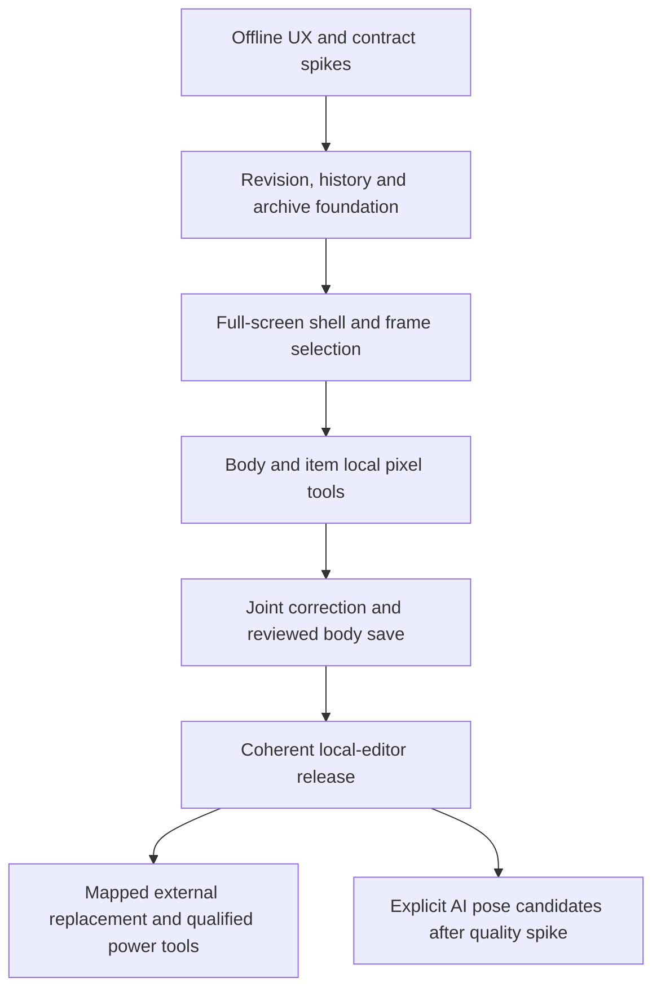

# Frame Editor delivery plan

Date: 2026-10-23. Planning only: every implementation/spike checkbox below is unstarted. This is the agreed target and execution sequence, not authorization to implement in this research task.

## Outcome

A separate full-screen editor embedded in PixelDoll edits both body and equipment frames using Move, Draw, Erase and Joints. One recoverable draft spans targets, tools and frames. Save publishes reviewed local changes; Done returns to the same character/outfit context. Body editing is required for the first coherent local-editor release, with fitting safeguards rather than a permanent lock.

Read [product/UX](README.md), [data and safety](data-and-safety.md), [research/spikes](research-and-spikes.md) and [consensus](consensus.md) together. Their contracts control the tasks below. The earlier repair mock-up is reference evidence, not the implementation skeleton or a completed editor phase.

## Planning completion checklist

- [x] User scope captured: separate embedded tool, body/items, per-frame alignment, drawing/erasing, joints and saving; no implementation in this task.
- [x] Existing “Evaluate pixel editing scope” chat consulted through a proposal/challenge round.
- [x] Independent editor challenger consulted; prior audit findings checked against current safeguards.
- [x] Primary sources, alternatives, data risks and bounded spike agenda documented.
- [x] Final same-package agreement recorded from both reviewers; see consensus record.
- [x] Documentation links/format and planning-only commit scope checked; implementation excluded.

The agreement records and documentation checks support the completed planning boxes. They do not mean the implementation checkboxes below have started. The coordinator performs the scoped documentation commit after these checks.

## Dependencies and release order

Foundational work may be developed behind an internal gate. An equipment-only intermediate build is not the promised complete editor. Avoid exposing body operations before the history/fitting/export contracts are integrated.

## E0 — Resolve and prototype the risky contracts offline

- [ ] Execute S1–S5 as isolated experiments with stored/synthetic frames: unified tasks, coordinates/mirrors, draft/archive/conflicts, body fitting and source palettes/overlap.
- [ ] Record observed results separately from assumptions; set a measured performance budget and bounded history limits.
- [ ] Verify current source seams before coding, because the checkout is evolving. Preserve existing structural guards, atomic `saveItem`, replacement-move invalidation, palette-repair records and candidate stamps.
- [ ] Refine editor labels/layout from task failures. Keep one document/session rather than adding a second novice wizard.

Exit: no unresolved contract blocker for body editing, source roles, conflict-safe Save or portable recovery. Failed optional custom-colour/IK/mask experiments can defer those enhancements, not the core body/item requirement.

## E1 — Revision and save foundation

Proposed owners: small `app/src/lib/editor/` pure operation/domain module and existing storage/import/export modules. Exact files should follow current closest patterns at implementation time. Do not create a generic command framework, second queue or backend.

- [ ] Stable cell addresses, source-cell resolution, declared read/write sets, project/session draft IDs and expected input stamps.
- [ ] Copy-on-write pixel edits, image hashing/caching and bounded editor-session history, reconciled with existing narrow colour-repair history.
- [ ] Recovery draft autosave separate from accepted data; checkpoint Save; Undo after Save creates a new dirty draft.
- [ ] Multi-target atomic publication through existing IndexedDB primitives; idempotent acknowledgement and meaningful overlap/dependency conflict detection.
- [ ] All publishing writers honor editor-sensitive revisions. Preserve unrelated nonoverlapping outfit/item work; late paid output remains a candidate if stale.
- [ ] Original/history/candidate reachability and loading; atomic history trimming and GC.
- [ ] Versioned editable-project envelope/migration, full accepted editable recovery and explicitly filtered engine projection, plus optional draft recovery export. Validate limits, no dangling references and old/new reader behavior.

Exit: body+item+metadata synthetic changes survive Undo/reload/ZIP/GC, and no target can be silently overwritten by another tab/job. No UI feature can bypass this publication path.

## E2 — One embedded screen and stable selection

Proposed owner: `app/src/studio/editor/`, sharing current sprite/composition primitives and app styling. Routing/navigation remains app-owned; do not create a separate site or iframe editor.

- [ ] Full-screen editor state/entry/exit integrated with the current Studio experience. Production currently renders Studio for non-dev routes; implement screen/history handling deliberately rather than relying on a hash that production ignores.
- [ ] Entry context from character/item/frame/issue; restore character/outfit/clip/facing/presentation/focus on exit. Unaccepted result entry visibly owns a candidate, and editor Save cannot bypass its original Keep/finish guards.
- [ ] Target list, body/item selection, visibility/solo, Parts disclosure, actual-cell filmstrip and visible scope; source/as-worn comparison.
- [ ] Shared canvas with exact palette rendering, integer physical-pixel scaling, pan/zoom, 1× check, grid/onion skins and draft playback with edits paused.
- [ ] Save/Done/draft state, dirty Back handling and targeted impact review. Use current app controls/tokens; no GlassKit, duplicate theme or new drawing dependency.
- [ ] Keyboard ownership, gesture cancellation, accessible target/joint lists and responsive sheets. Clear held world movement on entry; editor shortcuts cannot trigger gameplay.

Exit: users can select and inspect any valid body/item frame through one session without target ambiguity or lost return context. Missing skeleton data does not disable the canvas.

## E3 — Local tools on body and equipment

- [ ] Move selected item/body artwork, integer nudges/numeric input, known metadata translation and original comparison.
- [ ] Whole character/all wardrobe alternatives: stamped membership, complete pieces, source/mirror vector preview, one pending transform, and rejection of any member's clipping.
- [ ] Single-pixel Draw/Erase, source-role colour selection and picker, existing fixed source shades and B15 region-aware body writes.
- [ ] Minimal rectangular selection for bounded move/edit; explicit single-frame painting scope. General cross-pose stamping remains deferred.
- [ ] Restore from actual retained sources only. Logical fg/bg pieces move coherently; front/back transfer ships only after its union/composition tests pass.
- [ ] Clear reset/cancel and one-gesture Undo; untouched cells and palette roles remain byte-identical.

Exit: body-only drift, sword shift, stray pixel, missing contour and source-colour repair can be performed in one draft. Core source-palette limits are disclosed; arbitrary custom RGB is not silently approximated.

## E4 — Joints, fitting review and coherent local release

- [ ] Detected/corrected/desired/reference/attachment records remain distinct. Direct joint list/drag/numeric/keyboard editing is available without raster deformation.
- [ ] Manually rescue incomplete estimates from retained artwork and re-enable only eligible generation; no re-generation of successful art needed.
- [ ] Body diffs create truthful fitting/reference/observation impacts. Review affected gear against the final draft, repair it, mark Reviewed compatible, or preserve Needs fitting review.
- [ ] Conservative first export: unresolved affected items are excluded as whole items with explicit review, not silently accepted or discarded. Full editable recovery retains them. Ordinary preview suppresses affected unreviewed cells with an actionable note; explicit editor WIP comparison retains access, and unaffected frames remain available.
- [ ] Metadata-only correction preserves image bytes; known translations transform or invalidate dependent guides explicitly. No free operation issues PixelLab requests.
- [ ] Current QA, historical generation QA and human decisions remain separate. Structural failures are non-overridable.
- [ ] Full acceptance matrix below passes on the actual integrated snapshot and the required pinned toolchain. Fresh visual task evidence qualifies what has been tested.

Exit: release the coherent local Frame Editor, including Body. Publish accurate docs and limits; do not claim IK, general animation authoring, arbitrary RGB or paid single-frame repair if not qualified.

## E5 — Qualified power and external finishing

- [ ] Mapped PNG replace/export package with fixed geometry, stable target mapping, expected source stamps, source palette/ownership validation and diff review.
- [ ] Explicit range transforms, pose copy and occurrence-only cell duplication only after complete coverage/mirror semantics are validated.
- [ ] New fixed/custom colours or new material roles after the palette-ownership spike; no global ramp rebuild.
- [ ] Optional per-pair outfit masks only with complete compositor/runtime/export semantics.
- [ ] Optional finer per-cell export of partially reviewed items only with an audited portable coverage contract.

These extend the same editor. They do not add another document engine or turn project recovery into an unsafe sheet-edit hack.

## E6 — Explicit paid candidates within the same editor

- [ ] Run the separately scoped S6 quality experiment, rechecking current permitted REST contracts, tier and actual estimate/budget first.
- [ ] Desired pose drafting can exist free before generation is enabled. Optional two-bone IK assists only desired pose authoring.
- [ ] Request preview separates submitted poses/billing from approved replacement frames and identifies reference/target stamps.
- [ ] Candidate comparison preserves accepted body/items and neighbors; selection/publication is explicit and Undoable locally.
- [ ] Unknown/lost paid responses reconcile existing job IDs; no automatic resend, charge on dragging or completion-time auto-apply.

If single-frame pose replacement produces poor seams/identity, offer honest full-clip candidates and keep deterministic local fixes. This is a quality limit, not permission to claim old frozen-neighbor legacy endpoints are available.

## Acceptance matrix

| Scenario | Required result |
| --- | --- |
| Shift a sword by one pixel | Only selected item/source cells change; body/pivot/other items remain exact. |
| Repair a body contour and item grip in one session | Both stay in one draft/history; reviewed Save publishes together and identifies other affected gear. |
| Move Body alone | Gear does not move silently; effective guides transform/invalidate, fitting review is explicit. |
| Move Whole character | All stamped compatible alternatives/pieces transform once, even hidden; any edge loss or late member change prevents partial save. |
| Edit source/mirrored view | Linked vector reflection is visible; independent view materializes complete rows; no double transform. |
| Paint one of two deduplicated cells | Other addressed cell stays exact. Repeated logical occurrences disclose their linkage. |
| Correct a wrist with no complete estimate | No raster/paid call changes; original measurement retained; valid manually reviewed metadata can rescue readiness. |
| Draft a different pose | Old art remains; no charge until explicit Generate; desired versus detected values remain distinct. |
| Paint a recoloured shirt or outline | Correct source role/B15 identity retained; other ramps/variants/items unchanged. |
| Move fg/bg item or transfer a pixel | Defined visible union and occlusion result preserved; no slot-wide ordering surprise. |
| Inspect tucked hair | Source art stays independent of outfit mask; no permanent deletion to fit one hat. |
| Save, then Undo | Accepted project remains saved; Undo creates a dirty draft requiring Save to publish reversal. |
| Edit unaccepted result or shared fitted copy | Candidate Save cannot bypass Keep/finish; local copy changes cannot mutate immutable library snapshots or other characters. |
| Quota failure, reload or aborted save | No false Saved status; accepted revision intact; draft/recovery remains available. |
| Another tab/job changes target | Meaningful conflict preserves both results; no stale whole-item overwrite. |
| Editable export/import and GC | Current/original/required history and observations survive with identical hashes; unsupported versions fail clearly. |
| Engine export with unreviewed body-dependent gear | Clear whole-item exclusion; no silent stale output, fabricated pass or forced paid refit. |
| Keyboard/touch/320 px/landscape | Target/scope/Save usable; drawing versus navigation unambiguous; no physical-phone claim. |
| Large wardrobe drag | One pending transform, no encode/hash per pointer event; measured responsiveness meets the budget defined by the spike. |

Use stored shield, helmet and cape failures plus valid tiny disconnected detail. Verify current engine targets when their semantics change; do not substitute JSON validation for a native engine execution claim. Existing Unit/Playwright/toolchain commands remain authoritative; documentation-only work does not require rerunning unrelated suites.

## Current task exclusions

No application UI/code/schema implementation, dependency installation, PixelLab spend, credential access, production build/deploy, release or unrelated code commit. The only current deliverable is the reviewed research/planning package and its scoped documentation commit.
