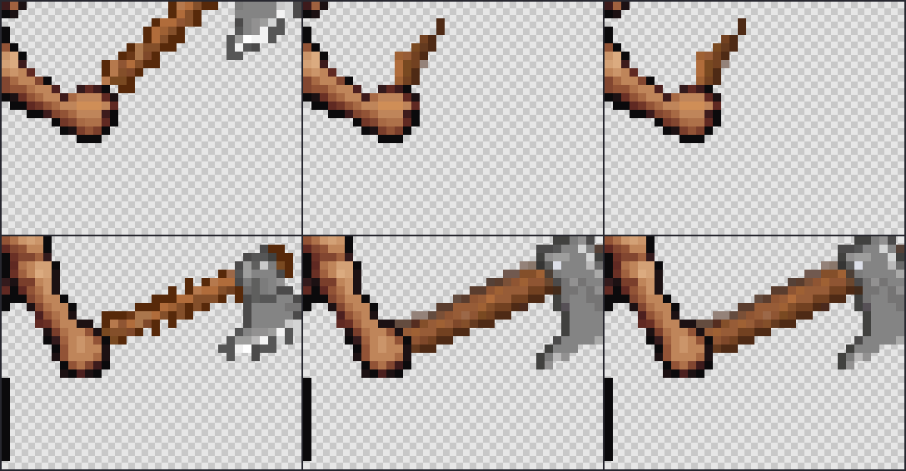

# Bounded clean-grip qualification

November 2, 2026, `codex/motion-lab`. This is a newly authorized continuation after the engineering review closure, not a reopening of resolved code-review disagreements.

## Authorization and spending before dispatch

The owner authorized up to **500 additional generation units** to prove or fix the remaining animation problems, with timely completion. This supersedes the previous no-generation instruction only for this bounded continuation. It is a ceiling, not a target, and does not authorize automated production quality retries.

The initial allocation is at most **75 units conservatively held**: one two-pose clean-source discriminator25, then one full-clip control25 and one repeat25 only if their preceding actual results pass review. Only the first profile is being prepared initially. Any materially different later follow-up within the owner's ceiling requires a new recorded allocation and evidence-based purpose, not an automatic reroll. No broader source/library/body/direction matrix is scheduled.

Historical actual usage is998 in the original campaign and153.25 in the earlier additional phase. The workflow ledger holds196 units across13 settled calls. Those receipts, holds, IDs, failed global equipment gate and old phase allowance remain unchanged. The existing pilot ceiling is amended from200 to **271 =196 historical holds +75 new planned holds**. Equipment allocation becomes250 =175 old +75 new; body allocation stays25 and replication stays0. Aggregate271 remains stricter than the275 sum of stage capacities, preserving the old unused4 body allowance without allowing it to expand this new75-unit batch. The historical1,000 phase and2,000 combined ceilings also remain as stricter outer controls. The new500-unit approval is tracked separately in this report and is not stacked with old unused funds to expand the planned batch.

## First discriminator

Use exact B-starV2 bare-body pixels for east frames3/4. Remove old sword geometry as an input cue. Construct a separate narrow permission around a complete, unscaled existing hatchet reference rotated to explicitly authored hatchet directions. This is a2D drawing control, not a claim of physical ground truth. All opaque body pixels remain protected; the two targets need an offline review confirming this behind-body/finger ordering is coherent before any purchase. Two actual prior design references remain protected.

The preparer must retain body/reference/recipe hashes, full and visible desired layers, mask provenance, input RGB/alpha and any occluded reference material. A complete head fitting in a mask is necessary but does not prove correct grip or desirable art. Reject the offline target if it needs an invented hand, impossible support or unreviewed scaling.

Actual-output checks: exact black-mask/body/reference preservation; uncropped raw prop evidence; recognizable consistent head/handle/material/chirality; visible contact on the unchanged body; no adopted new anatomy; declared export bounds and local target geometry. Existing extraction thresholds and diagnostics remain unchanged. A pretty green output alone is not a pass. A failed or unknown submission retains its receipt/hold and is never automatically resent.

If the initial two-pose control fails semantically, stop this route. If it passes, prepare the full supported clip within the documented512px endpoint bound, review actual contacts, occlusion and authored timing, then consider the one independent repeat. Do not assemble sparse successes into a professionally qualified preset. Body/action quality, hidden grips and production usability still need honest disposition even if the prop improves.

All paid requests must originate from explicit controls in the localhost agent browser. The saved OpenAPI `/inpaint-v3` contract was inspected before preparation: inputs32–512px, same-size white-generate/black-preserve mask, prompt maximum2,000 characters. No backend, new dependency, global cleanup rule, production MCP integration or default preset switch is planned.

## Tracking and current checkpoint

Existing motion-quality scope remains applicable. Active/archived/matching-card reads still lack project access, so board synchronization is pending. No scope expansion or card mutation was attempted. Independently authorized file work proceeds.

At preparation entry: **zero new requests and zero new billed units**. Offline readiness, final immutable packet, actual receipts and outcomes will be recorded here before advancing stages.

## Offline authoring before the first purchase

The original packet `0e2bd5a755c10f8dac83449f8f9279ed3b8f0f5049906d5cbf2528a87e440a2b` was rejected without submission. At native scale its frame4 handle met the fist only at a diagonal corner. It had zero prop pixels behind the fist. Mask fit and complete axe-head support did not establish a convincing grip.

One revised target translates only frame4's prop left1/down1 native pixel. The authored grip changes from observed `(91,81)` to `(90,82)`, within that landmark's declared2px uncertainty. Scale, rotation, body and frame3 stay fixed. This is an explicit drawing decision, not a correction to measured anatomy. The revised butt passes one pixel behind the unchanged fist and has full edge contact. Root and the independent reviewer approved only a single two-pose diagnostic, with no claim of closed fingers, general occlusion or animation qualification.

Approved packet: `516a48a77fea477e0c3bc7d39ba35bfad8d6ca78a9e169dfa70314ca60daba0c`, seed738, `288x288`, two144px targets plus two protected references. Both reference crops are checked against the retained completed733/736 result blobs and receipts. The desired prop is the complete existing736 frame5 hatchet with its previously identified white specks excluded, rotated at native scale to declared hatchet axes. All85 head pixels remain supported in each target. Target permission counts are261/257; every opaque body pixel is black in the mask. The source body is the exact B-starV2 recipe `4458544f88245b1a96db2c1781f857a2f306271014009574bf0ac11de5fb8fd8`.

Reproducible authoring: `spikes/api/mocap/prepare-clean-grip.mts`. Retained local evidence is under ignored `spikes/api/out/clean-grip-2026-11-02/`, including the rejected original, `frame4-contact-alternative/`, native composites, enlarged grip regions, fit measurements and `independent-readiness.md/json`. No generation was spent on either offline preview.

The dev-only submission path pins the revised packet, verifies its canonical identity, source receipts, actual result crops, frozen-body ancestry, exact input cells and binary masks, then uses the existing one-shot dispatch/receipt ledger. A previous receipt prevents a second submission. Import, preflight, reading and evidence export have no generation cost. This does not add a production retry or change Studio's animation route.

## Browser preflight and verification record

The approved actual packet and retained733/736 source blobs passed the runtime's real-crypto checks with dispatch mocked and no network. Focused runtime/receipt tests passed38/38; strict checking passed. The first real browser click nevertheless exposed a UI integration error before hashing, reservation or network dispatch: Svelte's reactive packet proxy cannot be passed directly to `structuredClone`. The UI must snapshot that proxy before calling the runtime, while retaining the runtime's defensive clone. This first click spent zero and created no receipt. It is not a failed paid request and does not authorize resending any unknown request.

The first full unit run passed127files,1,436tests with one existing skip. The UI correction requires subsequent checks; the above run predates it.

After the UI snapshot fix, strict checking passed with zero Svelte warnings/errors and both TypeScript projects passing. A fresh full unit run passed127files and1,436tests with the same one existing skip. The relevant `selftests` browser suite passed10/10 on isolated ports4281/5181 with keyless fixtures. Production build and dist guard passed. No source edits occurred during these final runs. The full166-test Studio suite was not repeated for this isolated dev-only addition; its previous engineering-closure result remains historical.

The corrected browser action created exactly one receipt, job `6ad0a9f8-1665-4740-b9bb-aa646cb18af1`, and raised retained holds196 to221. The button disabled after submission. Actual billing and artwork review remain pending at this checkpoint; a reservation is not a reported charge.

## Actual result and stop decision

The sole request completed for **15 billed units**. Its request hash is `a271a57fcf6c1f21fb6d000ff076b1a15f506012b5cb08f161eb20ced850448c`; remote job `e9eacd53-d265-4f6f-94fb-77b7681b5216`; result PNG SHA256 `5c61d8651a45ed46b4d9e4bb3ca8ec694f1677cdbe994653bce9727d1c20e819`. The submitted receipt and completed export are retained separately. The [full numerical audit](2026-11-02-clean-grip-results.json) records raw measurements and their limits.

| Check | Frame3 | Frame4 |
|---|---:|---:|
| Opaque body RGBA changes | 0 | 0 |
| New key-green pixels in editable area | 0 | 0 |
| Desired visible item pixels | 156 | 153 |
| Actual raw nonkey item pixels | 21 | 189 |
| Desired neutral head pixels | 85 | 85 |
| Actual largest neutral head component | 0 | 97 |
| Strict brown/wood pixel proxy, desired → actual | 71 → 21 | 68 → 90 |

All82,426 black-mask pixels and both protected reference crops are RGBA-exact. Neither body nor reference misalignment explains this result. Both complete desired heads fitted in their permissions, so the missing frame3 head was not clipped away by the allowed area. The failure exists in the raw provider output: frame3 is a short wooden stub with no metal head; frame4 has a recognizable head but a substantially thicker shaft and changed design. Shared `posed:false` research extraction removes zero raw candidate pixels here, so that cleanup does not explain this failure either. These are observations about this single configuration, not a claim that all AI or native2D authoring is impossible.

**Reject738 and stop this route.** No full-clip generation, repeat, new seed or further paid variant is authorized by its failed first-stage result. Existing737 remains rejected;736 and managedB remain research controls. No new animation preset or Studio default is qualified.



Rows are frames3/4. Columns are approved desired skin composite, raw candidate on the same frozen skin body, and shared extraction comparison. Enlargements use nearest-neighbor pixels. The original skin body is reused for comparison, while raw provider body preservation is measured independently above. Retained native [input](figures/2026-11-02-clean-grip-input.png), [mask](figures/2026-11-02-clean-grip-mask.png) and [raw result](figures/2026-11-02-clean-grip-raw-result.png) permit direct inspection without trusting a cropped composite.

Accounting after settlement: new allowance used15/500, unused485; conservative new hold25, unused initial planned holds50. Prior workflow actual153.25 becomes168.25; historical998 plus workflow168.25 equals **1,166.25 overall actual units**. Holds remain221, including all196 historical holds. No refund or release is inferred from billing below the reservation.

A second local UI issue appeared when saving rejection: generic candidate controls offered a motion review for this packed-grid research job, which has no MotionDocument reservation. Saving correctly refused with `Candidate reservation is missing`; the rejection was not persisted by that control. The fix is to show motion review/playback/export only for actual motion candidates, retaining raw inspection and experiment-specific evidence export for research grids. It must not invent a body reservation or qualify a grid as a motion clip. The documented rejection and exported receipt remain the authoritative result of this experiment.

## Independent result review and practical disposition

The independent reviewer inspected raw images before reading the preparer's measurements, then rechecked the receipt, approved packet/result hashes, protected pixels, both reference crops and bodies. It independently rejected the missing-head frame3 and broadened frame4 shaft. Its descriptive width measurements are not universal thresholds. Root, preparer and independent reviewer agree: stop at this failed first discriminator. The retained `independent-result-review.md/json` records this decision; no external Claude research cycle was reopened.

For the application, keep the completed mask-containment, cache-ownership, exact-coordinate and uncertain-response engineering fixes. This continuation adds a source-pinned dev diagnostic, bounded accounting, reproducible offline preparation/evaluation and two actual browser integration corrections. It adds no production animation default, auto-regeneration, backend or MCP dependency. The main checkout was not edited or committed.

The practical route to professional animation is a deliberately small supported set of native2D body/action/view assets, authored and reviewed once. For each supported body family, author the weapon's grip anchor and front/back order per frame, check feet against an explicit contact track, and review actual playback. Deterministic attachment can preserve design for simple rigid props, but perspective, hidden fingers and complex attacks still need hand-authored frames. Expand sizes, shapes and views only after the initial family passes. A prepared-art route is a product direction, not an implemented universal-rigging solution or a new paid experiment scheduled by this report.

The remaining broad goal is **not solved**: natural motion, convincing hidden grips and universal humanoid compatibility are still unqualified. No amount of preserving body pixels alone proves a natural animation. This bounded test is complete; its negative result avoids a further full-clip/repeat purchase. Board synchronization remains pending because project access is unavailable; no card status change is claimed.

## Final checks and local reproduction

The final source snapshot passes `npm run check` (zero Svelte errors/warnings and both TypeScript checks), `npm test` (127 files; 1,436 passed and one preexisting skip), and `npm run e2e -- selftests` (11/11). The new browser regression proves that a completed packed-grid research job without a motion reservation retains raw inspection but has no motion review, timing, clip export, foot or attachment controls; it creates no ledger and sends zero paid POSTs. Existing motion-candidate review/export tests still pass. Build and dist guard pass. Only a stale hard-coded200-unit description was changed after the previous run; these final checks include that correction. No app source changed during the final checks.

The full Studio browser suite was not repeated for these dev-only changes. No native-direction, full-clip or repeat qualification was performed in this continuation because the first-stage art gate failed. No automatic retry was added. The sole live result, not mocked tests, establishes the negative art finding.

The token-backed agent server was stopped. Port5199 now runs the ordinary credential-free preview, and the Lab was reloaded to verify `Offline lab ready` with generation disabled. A local evidence page is available at `http://localhost:5199/test-results-clean-grip-review/index.html`; its screenshot is retained under that ignored folder. The report, four key native/closeup figures and numerical audit are committed documentation; full original JSON receipts, source media and independent reviewer notes remain in the explicitly ignored evidence folder.

With the retained local inputs, run from the repository root using the pinned Node24 toolchain:

```text
node spikes/api/mocap/prepare-clean-grip.mts --frame4-contact
node spikes/api/mocap/evaluate-clean-grip.mts
```

Preparation reconstructs the exact approved packet; evaluation requires the actual completed `clean-grip-evidence.json`. Neither script calls PixelLab. Packet, receipt and result hashes fail closed on changed inputs. The final board read still lacks the required project scope; no credential scope expansion or mutation was attempted.
