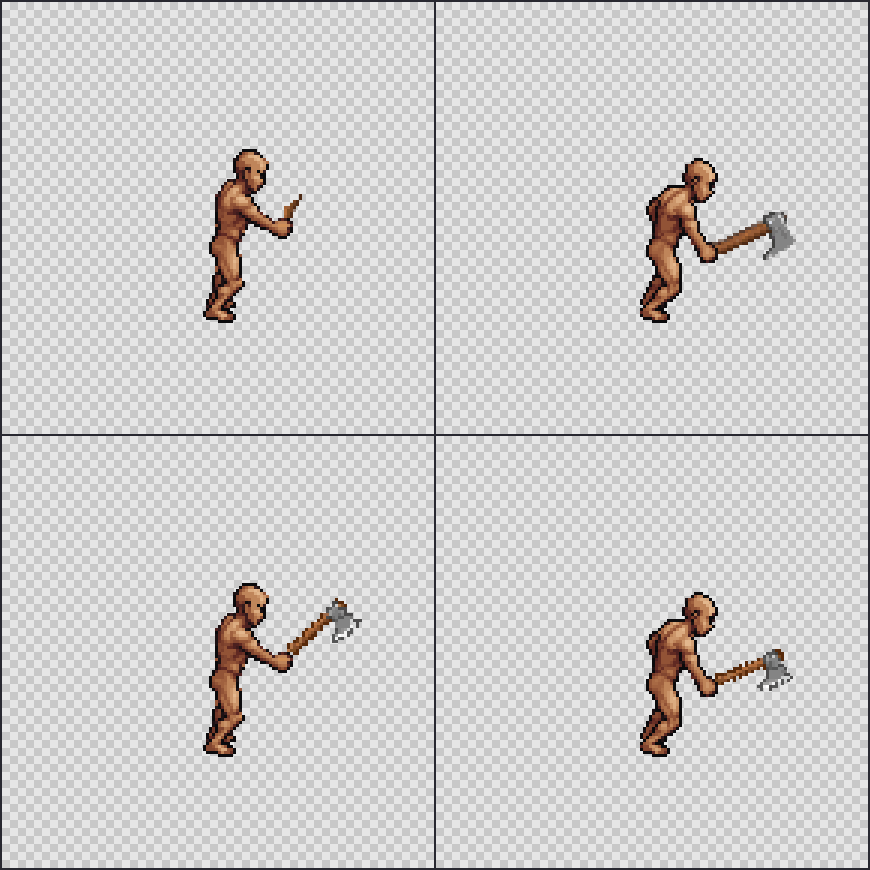

# Native frame authoring follow-up

November 2, 2026, branch `codex/motion-lab`. Follow-up to the owner's request to implement the next recommended fix. No broad research, new dependencies, external assets or paid generations were used.

**Later visual correction:** the owner correctly found that these two examples still had an unconvincing hand connection. Restoring the axe artwork did not qualify its grip. The [palm-centered follow-up](2026-11-02-palm-grip-correction.md) redefines the source attachment point inside the shaft, moves the target to the palm, reviews all eight poses and records the remaining limits. Do not treat the images below as accepted grip results.

## Problem and delivered behavior

The [clean-grip test](2026-11-02-clean-grip-qualification.md) failed even with correct body protection and a complete desired axe head inside the mask. The model omitted one head and changed the other shaft. Another generation is not required to repair those item pixels if native artwork is already available.

Before this change, Motion Lab's attachment editor could only rotate one directional source PNG around a grip and hide it behind painted body regions. Every frame therefore inherited that source's silhouette and perspective. There was no way to import a separately drawn pose into the same draft, preview and export workflow.

The editor now accepts an **Authored frame PNG** for the selected frame:

- The imported layer must match the exact padded native canvas. There is no resizing, alignment inference or new body drawing.
- The frame uses that artwork directly, bypassing source rotation and grip placement. Those placement fields are disabled while native art is selected. Switching frames retains each frame's independent choice.
- The existing body-only occlusion brush still applies, so original fingers or a foreground body region can cover the item. Painting cannot cut item pixels where no body exists.
- **Use source placement for this frame** explicitly removes the override and restores calibrated source placement. Other frames retain their art.
- Saving, reloading, document export and ZIP export preserve the authored frame. Export records the source mode and original authored PNG SHA256, retains body/layer/composite frames and timing, and remains `qualified: false`.

This is a dev-only authoring improvement. Studio's generation route, production defaults and paid-request behavior were not changed. No request, retry, credential access or generation reservation is part of this feature.

## Validation and rendering

`attachment.ts` supplies one `renderAttachmentFrame` function for both canvas preview and ZIP export. An authored PNG receives no rotation, scaling, palette replacement or cleanup. Both source-placement and native-art modes use the existing `occludeAttachment` behavior.

Native frame import rejects wrong dimensions, files over 2 MB and partial alpha. Partial alpha is also rejected when rendering an imported document, so malformed art cannot silently fall back to the old source. The attachment remains bound to the exact ordered body hashes, job identifier, direction, cell, padding and pivot.

The existing 5 MB document import limit now also applies to validation and export. Adding frame art checks the total document before replacing the previous frame. This avoids creating a large saved document that the same editor could not import. Storage failures remain visible.

Preview inputs are captured as reactive snapshots before asynchronous decoding, so changing frame art, grip, angle or occlusion invalidates an earlier render. A late preview cannot overwrite the new selection. Import captures its destination frame before asynchronous decoding; changing the whole attachment while loading produces an error.

Native-art clipping cannot be inferred after the artist has already cropped a PNG. A zero transform-clipping count means that no rotation clipped the art, not that the source necessarily contains a complete weapon. The UI explicitly asks the reviewer to inspect native bounds and missing details.

## Offline before/after control

`spikes/api/mocap/author-native-weapon-control.mts` uses the previously approved two-pose packet `516a48a77fea477e0c3bc7d39ba35bfad8d6ca78a9e169dfa70314ca60daba0c`, the retained failed result `5c61d8651a45ed46b4d9e4bb3ca8ec694f1677cdbe994653bce9727d1c20e819`, and the shared editor renderer. It checks their identities instead of requesting new images.

For this control, the authored PNGs are the previously reviewed native rotation guides made from the existing 154-pixel reference axe. They are explicit 2D drawing choices, not newly generated perspective art or proof of hidden fingers. The full body acts as the occluder. The script checks exact equality with the approved visible layers, preserves the skin body and exports a local two-pose ZIP with original provenance.

| Measurement | Pose 3, paid result → offline art | Pose 4, paid result → offline art |
|---|---:|---:|
| Visible item pixels | 21 → 156 | 189 → 153 |
| Neutral head component/pixels for this known design | 0 → 85 | 97 → 85 |
| Body composite pixels changed by offline art | 0 | 0 |
| Item pixels hidden by authored body occlusion | 0 | 1 |

The missing head and inconsistent shaft in these two controls are corrected without another paid call. The new output is exactly the previously approved visible artwork. These counts describe this known axe; they are not a universal head detector or quality threshold. See the [retained numerical report](2026-11-02-native-frame-results.json).



Top row: failed paid result on the original skin body. Bottom row: native authored item art on the same body. Columns: poses 3 and 4. This is a two-pose engineering control, not a completed attack animation.

Local evidence, including the ZIP, native frames and authoring document, is under ignored `spikes/api/out/native-weapon-control-2026-11-02/`. From the repository root with the pinned Node 24 toolchain:

```text
node spikes/api/mocap/author-native-weapon-control.mts
```

## Verification and remaining work

Final strict checks passed: zero Svelte errors/warnings and both TypeScript projects. Unit tests passed 1,439 tests in 127 files, with one preexisting skip. The relevant `selftests` browser suite passed 11/11; build and dist guard passed. The full Studio suite was not repeated because these changes are isolated to the dev-only attachment editor and its tests.

Unit tests verify exact native placement/colors despite changed rotation inputs, body-only occlusion, unchanged inputs, wrong-canvas and partial-alpha rejection, document size and exact body binding. The browser test imports a wrong-size PNG and sees its error, imports valid native art, checks an actual canvas pixel, saves/reloads, verifies exact layer and padded body pixels in the ZIP, checks per-frame metadata, switches frames and restores source placement. It observes zero paid requests.

No full clip, body family or professional preset is approved by this delivery. Body turning, silhouette, hidden hand anatomy and rendered foot planting remain separate art problems. Moving a weapon layer cannot fix a bad body frame or two independently sliding feet. Existing sole measurements remain the review method; they were not relabeled as a correction.

The next complete preset needs an accepted native body clip first, then authored weapon frames and front/back masks for every frame, followed by actual timed playback and visible sole review. This feature removes the rigid-source limitation from that process. It does not provide an automatic solution for arbitrary humanoids, and it does not promote these two control poses to Studio defaults.

Board reads for active and archived scope still fail because project access is unavailable. File work was explicitly authorized and continued; no card creation or status change is claimed. The main checkout was not edited. The ordinary localhost preview remains credential-free. Spending is unchanged: 15 of the latest 500 units used in the previous test, 485 unused; this follow-up used zero.
