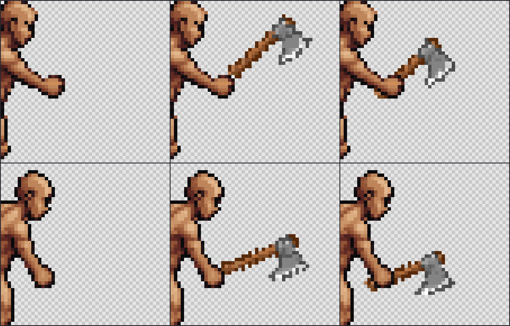
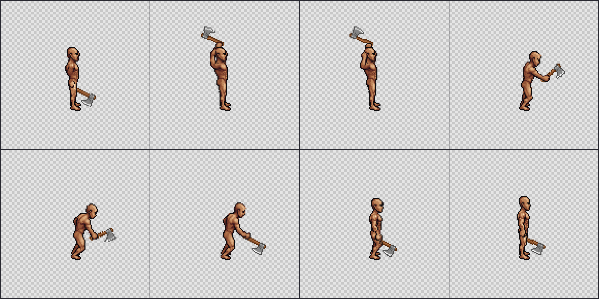

# Palm-centered axe grip correction

November 2, 2026, `codex/motion-lab`. Authorized continuation of the visible grip fixes. No new paid generation, dependency, external art, account, backend or broad research was required.

## Correction to the previous visual claim

The owner correctly rejected the earlier comparison: the old AI image lacked an axe head, while the subsequent native-art image restored the head but still made the handle look perched beside the hand. Exact artwork preservation did not make that grip acceptable. The previous report's word “corrected” applies to the item artwork, not a completed visual grip or animation fix. This report supersedes that interpretation.

The earlier source anchor was near the end of the handle, and the target landmarks were near the outer hand boundary. The shaft barely met the fist. A one-pixel edge contact and zero/one occluded pixels did not demonstrate a held weapon. The revised authoring uses a point **six native pixels into the source shaft** and separately picked palm centers. This is a new definition of the artist's attachment point, not a more accurate measurement of a skeleton joint or an adjustment claimed to remain inside the old uncertainty radius.

## Actual artwork change

The complete existing axe image remains unchanged. Its attachment anchor moves from `(93,82)` to approximately `(98.335,84.745)`, along the source shaft. The target points change as follows:

| Source frame, zero-based | Previous target | New palm center | Item pixels behind the body, previous → new |
|---|---|---|---:|
| 3 | `(93,73)` | `(90.5,75.5)` | 0 → 27 |
| 4 | `(90,82)` | `(88.5,84.5)` | 1 → 21 |

The handle now passes through the palm's location, and the existing opaque hand covers that part of the shaft. The other side of the handle can remain visible beyond the fist. No hand, finger, arm or other body pixels were generated or redrawn. This is a placement and occlusion correction using the existing clenched-hand artwork, not a new anatomical reconstruction.

The grip closeups now include the complete axe heads. Frame3 retains 85 neutral metal pixels. Frame4 has 83 after nearest-neighbor rotation at its new fractional placement, and all83 remain after body occlusion. The small count difference is already present before occlusion; it is not a head clipped away by the hand mask. These palette counts describe this known axe and are not universal quality gates.



Rows are source poses3/4. Columns are bare body, the previously shown native-art control, and revised shaft placement. The right column is a revised candidate for visual judgment, not a claim that the original broad quality goal is complete.

## Full eight-frame authoring and export

The correction was applied to all eight frames of the same east-facing B-starV2 body family. Every item layer comes from the same native154-pixel axe asset, using explicit per-frame palm centers and previously recorded hatchet directions. This avoids selecting sparse successes from additional AI generations. The body family retains its documented historical provenance; these bodies are not newly generated or reclassified as one original job.

All eight composites preserve every original opaque body pixel, and no source pixels clip outside the144px canvas. Occlusion uses the actual body alpha. For this particular view the weapon remains behind the hand/body where they overlap; this does not infer general front/back order for other actions. Angle and palm tracks are authored2D controls, not physical perspective ground truth. Full data, hashes and the export audit are in [the result record](2026-11-02-palm-grip-results.json).



Frames0–3 are on the first row,4–7 on the second. All frames are retained, including the raised-arm and recovery poses. The same body and shared pivot `(72,107)` are used throughout. The exported archive contains26 entries: eight native body images, eight transparent item layers, eight previews, an authoring document and a manifest. Timing is explicitly authored `[120,120,80,80,80,120,100,220]`ms, nonlooping, and is not presented as provider timing.

The script checks exact parity with the editor's shared renderer. ZIP extraction roundtrips every entry exactly. The archive downloaded through the browser matches SHA256 `2b753653143df05b8b2a08d9e940c19230d2fa405e87f679b964522e416b27f3`. A small [complete native candidate archive](artifacts/2026-11-02-gripped-axe-east.zip) is retained with this report so its bodies, layers and metadata can be reviewed without the ignored historical media. It remains experimental and unqualified.

## Visible foot review

Inspection of all eight native foot crops found the visible outer front-toe sole pixel at `(76.5,106.5)` in every frame. Each mark is opaque. With the root fixed at `(0,0)` and the shared pivot unchanged, its sampled displacement is0px. Frame holding at that fixed position does not move this pixel between samples either.

This position was already stable in the source body; the weapon correction did not fix or modify the feet. The observation concerns one artist-picked visible point on this exact stationary clip. It does not measure rear-foot contact, heel rotation, weight transfer, other body families, walking speed or an engine moving the character. No global body translation or hidden-foot inference was introduced.

## Application improvement

The existing developer attachment editor now lets the author click directly on the source image to choose the shaft grip or blade direction. A circle shows the source/target grip and a square shows the source direction point. **Show grip guides** hides these overlays for judgment of the actual artwork. Help text distinguishes an internal shaft anchor from the handle's end and a target palm center from its outer edge.

The markers are UI overlays. They do not alter source PNGs, item PNGs or exported body frames. Existing exact body binding, native frame overrides, size limits and manual body occlusion remain intact. This is a dev-only calibration improvement; Studio's default generation route, production preset selection, credentials and paid consent behavior were not changed.

## Live browser testing and outcome

The ordinary localhost viewer at `http://localhost:5199/test-results-grip-review/index.html` was used to play the full clip once at normal speed and again at half speed. Both reached frame8 and stopped. Frame stepping was checked on the disputed pose and the native archive downloaded and compared with its audit. Closeups, all eight frames and the remaining qualification limits are visible in that page. No agent-token server or PixelLab call was used.

Strict Svelte/TypeScript checks passed with zero errors/warnings. Unit tests passed1,439 with one preexisting skip across127files. The relevant `selftests` browser suite passed11/11; build and dist guard passed. The browser regression now verifies source grip/direction clicks, exact native coordinates, guide hiding, persistence and unchanged exported source art, along with native frame import/export. It observes zero paid requests. The full Studio suite was not repeated for these dev-only changes.

The misplaced anchor and edge-contact problem are corrected in this authored track, and the complete clip is available for visual review. It remains marked `qualified: false`: semantic naturalness, fingers hidden by the shaft, the rear foot, other directions and arbitrary body shapes are not certified by these checks. No full-quality preset was silently promoted. Source/skeleton fixes, body preservation and paid-response fixes from the earlier engineering review remain separate delivered work.

Reproduction with the retained local sources and pinned Node24:

```text
node spikes/api/mocap/author-gripped-axe.mts
```

The script calls no network API and writes only the separate ignored `spikes/api/out/gripped-axe-2026-11-02/` evidence folder. The old perched examples and all paid outputs remain unchanged. Active/archived board reads still lack project access, so synchronization is pending and no card mutation is claimed. Main-checkout changes were not touched. Spending remains15 of the latest500 units, with485 unused.
