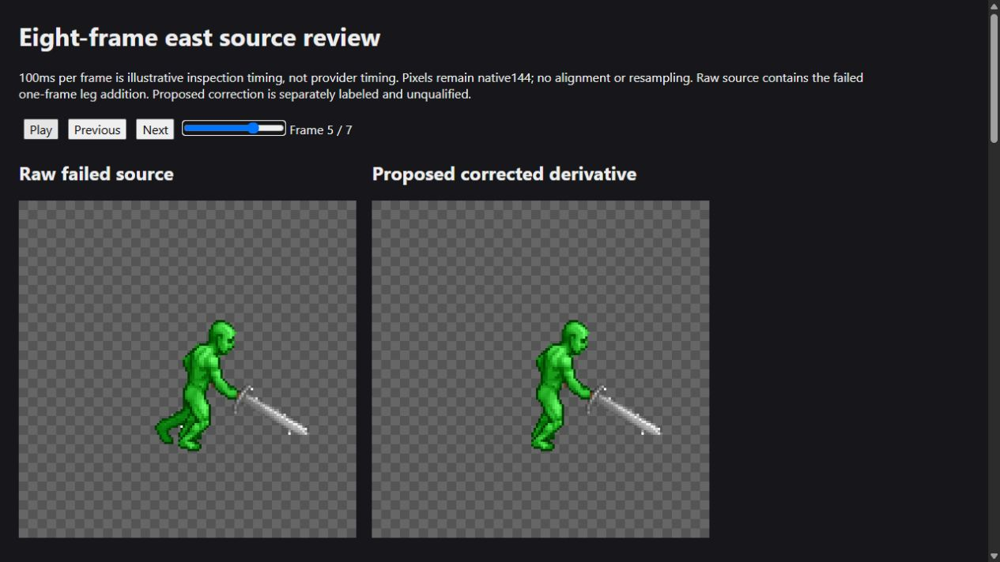
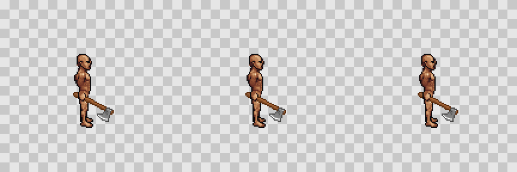

# Weapon-aware grip continuation

**Finding:** deliberately authoring the gripping hand before freezing the body improves the sampled composites. Production inpaint extraction now enforces its submitted mask, preventing protected pixels from leaking into equipment after extraction and repair. However, the final guided repair fixed weapon direction while damaging its head. No new animation preset is qualified or enabled in Studio. Stop broad rerolls; use reviewed body/action/grip families and explicit weapon design controls. The remaining allowance stays authorized and unspent.

## Scope and authorization

The owner's instruction to continue resumes the remaining animation-quality work on `codex/motion-lab`. It carries forward the additional 1,000-unit allowance, not a fresh allowance. At entry, 43.25 new units are settled, 46 are conservatively reserved, and 956.75 actual units remain. The earlier 998-unit campaign stays separate. No new paid request has been sent at this checkpoint.

The first masked custom-body equipment test remains failed. Its receipt, pinned packet and equipment-gate failure will not be cleared or replaced. A distinct hypothesis will start from stored frames that already hold a sword, remove the prop with a bounded edit, and evaluate a newly frozen bare base against the original armed target. This tests layer separation, not a causal comparison of the old motion source with managed custom V3.

The initial new probe may reserve at most 25 equipment units for one fixed disarm request within the existing 200-unit pilot and initial 100-unit equipment allocation. A second, separately priced weapon test is eligible only after review of that exact disarm receipt and output hash. Replication and production promotion remain blocked. The global failed equipment gate stays failed; no budget or gate is reset. The later internal reallocation is recorded below.

Stored source poses need an explicit eligibility review for this separation experiment. The earlier limited body pass applied to the managed B diagnostic; it does not professionally qualify these historical armed poses or another body. No new profile may infer a quality pass solely from that old flag.

## Required evidence before spending

- Distinguish confident weapon pixels, confidently visible hand/body pixels and unknown hilt/skin boundaries on exact source hashes. Unknown pixels are not certified as weapon or recovered skin.
- Keep visible fingers, protected anatomy and original transparent pixels black in the provider mask. A strict weapon-only mask and a bounded exploratory mask that includes explicitly marked unknown boundaries are separate experiments, not interchangeable labels.
- A new bare base may synthesize pixels hidden by the original weapon inside the edit mask. These are generated guesses, not recovered ground truth. The base is frozen once, and all later equipment must share it.
- Outside-mask RGBA must remain exact. The bare base cannot introduce alpha where the original armed target had none if a purely additive weapon layer is expected to reconstruct it.
- Exact reconstruction is necessary but insufficient: retaining the sword in the bare base or copying skin/body pixels into a weapon layer can trivially pass reconstruction. Review actual empty-hand appearance, independent weapon support, fingers, residual uncertain pixels and the final frozen-body composite separately.
- If the first disarm does not establish clean reusable separation, do not expand to more directions, repeat takes or additional weapons automatically.

## Tracking and execution

### Offline source selection

The first annotation pass used historical south1/east1 tan armed sprites and the hidden-grip east3 challenge. It produced disjoint weapon/body/unknown masks with exact source hashes. South1's sword is clipped; east3's broad uncertain boundary includes the head and is explicitly ineligible for a complete disarm call. Tan skin, dark outlines and brown hilts overlap in color, so these are useful controls, not a trustworthy automatic weapon segmentation route. No credits were spent on them.

A stronger controlled source is the **four actual green armed outputs of the failed November 1 test**. The new green hand that made the original frozen-body composite fail is now visible evidence in a proposed new source body. Adopting that source deliberately is different from claiming that the previous bare body was preserved. The experiment will use its native 144-pixel padded cells without realignment, and does not qualify the source's timing or export pivot.

The shared green key predicate is still not perfect semantic segmentation. Current frame 1/3/4/6 cells have 201/186/194/202 non-key pixels, with 0/16/11/46 over the old body's occupied pixels. Most are expected sword occlusion, but low-saturation green rim pixels can fall below the key threshold and be anatomy or spill. These need explicit body/unknown annotation; they must not silently become a weapon layer.

Body recoloring is a separate issue. Each original frame's known chroma colors has an exact per-frame inverse in this small control, but a global inverse has collisions because luminance normalization is per cell. Newly generated green colors have no guaranteed original skin mapping. Any skin-color restoration belongs to the newly authored base body, with ambiguity recorded, never a hidden skin patch in equipment or a claim of exact original skin recovery.

### Actual disarm control

The selected four-cell 288-by-288 request uses source frames 1/3/4/6 at their existing padded 144-pixel size. Its immutable packet hash, excluding its embedded `canonicalHash` field, is `834ba23d967c560dc61fd0d11dc17c2fa826c7f662e69b642f75f70447d4d341`. The runtime rechecks the original completed armed receipt and PNG bytes, all raw/derived frame hashes, exact grid contents, binary alpha, disjoint labels and mask protection before reserving or dispatching.

The target is explicitly derived C-prime: two independently confirmed isolated non-key white specks are removed at frame1 padded(63,55) and frame4(68,101). Original RGBA and coordinates are retained. No other source pixel is changed, resized or shifted. No exact-unmodified-raw-C claim follows from this correction. The twelve low-saturation green boundary pixels remain unknown during preparation, not automatically weapon.

The disarm completed in queue job `bfa261ad-c040-440e-9b37-af1ba7df2a96` for **15 actual units**, retaining its conservative 25-unit reservation. Provider result PNG SHA-256: `fdb39ef7aed956d2a7946985ccc841fb6137c3b6a7577ea4bce5d54f108bb1c0`. All **82,163 black-mask pixels remain exact**. No new base alpha exceeds the source target, and no opaque non-key prop pixels remain in the four bare outputs.

| Source frame | Confirmed weapon residual | Uncertain rim residual | Confirmed-weapon-only reconstruction differences | Known-body residual |
| --- | ---: | ---: | ---: | ---: |
| 1 | 198 | 2 | 2 | 0 |
| 3 | 182 | 4 | 4 | 0 |
| 4 | 189 | 4 | 4 | 0 |
| 6 | 200 | 2 | 2 | 0 |

Full residual reconstruction is exact but includes all twelve uncertain pixels. It therefore **does not pass the exact, pure-weapon reconstruction gate**. The evaluator preserves that failure and does not patch the provider result. The confirmed-weapon-only layer contains no copied body pixels, and its recomposition differs only at those twelve source boundary pixels.

Independent per-pixel review confirms only two uncertain samples as body rims: frame4(88,86) and frame6(69,85). Two more are tentatively weapon-associated and eight remain unresolved. These findings are in local `u-pixel-review.json` with colors, neighbors and enlarged crops. Assigning all twelve to the body merely to force exactness is rejected. No global rim repair was applied.

The separate skin preview preserves base geometry and alpha. Exact per-frame inverse dictionaries cover 642/635/658/500 pixels; authored nearest-green-level palette assignments cover 64/54/55/105 pixels. Every assignment, distance and tie is retained. The weapon layer is never recolored. This authors a new base; it does not recover the original skin behind the prop.

Both parent and independent visual review find the frame1 fist now visibly connected to the original sword, resolving the previous detached-fist mechanism for this **new** body. Frames3/4 look plausible; frame6 remains partly hip-occluded. These are four sparse poses, not full animation continuity, provider timing, pivot or another-body qualification.

### Bounded second-weapon eligibility

The existing disarmed base is eligible only for one different-weapon research diagnostic, conditional on binding the exact completed result hash and retaining the twelve-pixel uncertainty. This is a separate judgment about a usable newly frozen base and a visibly aligned confirmed-weapon composite, **not** a pass of the exact source reconstruction test or the global equipment gate. The first weapon's W-only composition and full W-plus-U residual stay separately labeled.

A source-derived foreground corridor is necessary: confirmed weapon overlaps newly filled bare-body pixels at 4/5/10/50 pixels in frames1/3/4/6. Protecting every bare-body pixel during the next edit would incorrectly force the weapon behind the leg, especially frame6. The next diagnostic must preserve visible source fingers/head/feet while allowing the reviewed foreground overlap corridor. The base remains immutable in final composition. Any new body geometry invented by the second weapon is not silently adopted again.

The candidate is a short one-handed iron hatchet with a brown wood handle, within the same grip family. It edits an existing weapon-bearing source, so no from-scratch Pro creation or new asset generation is required. The second mask/packet must be reviewed before a separately priced request; this limited result alone does not qualify wider directions, a full clip or replication.

### Actual same-body hatchet swap

The separate seed733 packet has unsigned canonical SHA-256 `287f215152db5ea978fd4319b1c3025344a9046a6c28b665f7e44402d261a56b`. It binds the completed disarm, its exact frozen body and the reviewed source masks. Queue job `ae4b858b-96a9-45dc-b412-7ca2f62b5200` completed for **15 actual units**, retaining 25 reserved. All **65,310 protected black-mask pixels** remain exact, including all confident body and uncertain source samples.

Visible grip passes in frames1/4. Frame3 is connected but points up-right where the source sword pointed down-right; the missing frames must resolve action continuity. Frame6's hand closure is hidden at the hip, although the weapon correctly crosses in front of 20 leg pixels. New green outside the frozen base is discarded, never adopted as another body revision. No gross weapon scale, palette or design break was observed in these four poses. These observations qualify a bounded continuation, not a production preset.

### Shared extraction boundary correction

The unbounded production extractor retained seven uncertain and two known-body pixels outside the authorized edit region. A new optional, transient binary stencil in the shared `extractCell` kernel now bounds both the equipment layer and its body cut. With a stencil, registration is suppressed because the permission mask uses exact input coordinates. The boundary is reapplied around clip post-processing so attachment/repair cannot regrow protected pixels.

**Actual application integration:** production inpaint-grid evaluation and accepted-item/new-move grid repairs now supply the exact originally submitted target-cell masks automatically. Restored jobs verify their saved mask's blob identity, hash, input attribution and canvas. Missing or corrupt masks block extraction with a clear G1 error instead of extracting without a boundary. The extraction cache includes mask identity. Only target cells need opaque binary permissions; unused tail cells are not treated as equipment. A minimal shared image-mask validator is reused by production and Lab code. Raw skeleton posing and dressing callers retain their behavior. This adds no user-facing option, manual annotation step, generation, prompt change or price increase.

For the original sword, confirmed-W stencils retain exactly 198/182/189/200 raw weapon pixels with zero K/U leakage. For the hatchet, an edit-region-only stencil removes all nine protected leaks but still admits five green pixels through the existing outline heuristic. The conservative caller intersects that region with the existing chroma predicate. Its areas are 142/136/136/137, with zero added pixels or protected leaks. Four isolated white pixels are removed by the existing component floor; retained RGB is exact and the 20 foreground leg pixels remain. Raw, unbounded, region-only and conservative results are all retained for comparison. No threshold was changed to force acceptance.

Unit coverage includes stencil copying and validation, protected fingers and unknown rims, permitted leg overlap, registration, body cuts, grip closing and dropped-frame repair. Production tests additionally cover submitted/saved-mask provenance, changed mask cache identity, invalid/missing masks, unused transparent tail cells and post-process containment. This is a concrete application improvement within a trustworthy submitted boundary. It does not turn color keying into semantic anatomy detection, fix incorrect grips inside a white edit region or eliminate uncertain source pixels.

### Complete-clip allocation checkpoint

After the second bounded test showed connected visible grips, the next useful discriminator is the missing east frames 0/2/5/7, rather than repeating four sparse poses. The pilot's internal allocation changes from body/equipment/replication **25/100/75 to 25/150/25**. The total remains 200, the additional allowance remains 1,000, and all prior reservations, bills, unknown outcomes and failed gates stay intact. Fifty units move from premature replication into completing the first grip family.

At this checkpoint, nine calls are settled for 73.25 new units, with 96 conservatively held. At most three new 25-unit equipment requests may complete the missing poses: armed source authoring, disarming to a new frozen base, and hatchet transfer onto that same base. Each step requires review of its actual source before the next. Their maximum combined hold is 75, taking the pilot to 171 if all are needed. No additional direction or second-body control follows automatically. Completing these frames is a test of this first family, not a claim of production qualification.

The first of those calls completed: seed734, queue job `b3ae338e-eef2-48ad-b563-a392e8c01348`, 25 actual/reserved units, native source indices0/2/5/7 and two protected armed-pose references. Its canonical packet SHA-256 is `2b468a4513c58953fcb1688e9988d4a1de618cba1c2bc4a80397358d5191f52e`. New-phase spending is now **98.25 actual / 121 conservatively held**, across ten completed submissions. This leaves 901.75 actual units of the additional allowance, or 879 against held reservations. Combined historical actual spending is 1,096.25.

**Full-sequence rejection discovered before another paid call:** frame5 invents a rear green leg/foot outside the original silhouette, causing a shape jump between frames4/5/6. Preserving the old foot pixels is insufficient because the transparent editable weapon corridor can also receive new anatomy. Seeds735/736 are held pending a separate offline source/body audit; neither has been submitted at this checkpoint. The raw seed734 output is retained as a failed source, not silently cleaned or promoted.

The independent component audit finds 114 newly opaque rear-leg-region pixels in frame5: 112 key-green, one undersaturated green and one isolated white artifact. Therefore a key-threshold-only cleanup would leave two residual pixels. This is a source-role problem: transparent space needed for a foreground weapon is not permission to redraw anatomy. Future qualification must inspect new body silhouette outside an explicitly reviewed hand region, as well as unchanged original feet and measured sole landmarks. Conversely, frame2's purposeful new fist lies 10-14 pixels from the old grip landmark; clipping every new body pixel to an old eight-pixel grip disk would recreate the detached-hand failure. Body and weapon permissions need separate semantic review.

An offline proposed derivative restores original transparent RGBA at exactly **144 individually retained correction pixels**: frame0 extra back-arm27, frame2 isolated white artifact1, frame5 rear-leg/artifact114 and frame7 extra back-arm2. No original opaque pixel is overwritten. The valid 20-pixel new raised fist in frame2 is retained; the brown rear handle/pommel in the resting poses is weapon, not an extra arm. The ledger records every old/new RGBA and the raw/derived hashes. This is explicitly authored source correction, not automatic cleanup or exact unmodified-provider output.

The coordinating reviewer inspected the full eight-frame source contact sheet and browser playback. The proposed derivative removes the obvious one-frame leg jump, and frames1/2 form a plausible raised windup. Head occlusion still prevents certifying the hidden forearm/wrist proportions. Illustrative playback is 100ms per frame, not measured provider timing or a production timing contract. These observations permit a bounded disarm diagnostic on the corrected source if its independent W/K/U labels and immutable packet checks pass. They do not pass the historical/global equipment gate or certify professional motion.

The completion packet uses seed735 and unsigned canonical hash `d7bb854ba6c6eb013e2541e6b3bc830ed50741f16aa7760cd41fdf26f8d5fbcd`. Its W/protected-K/U counts are 218/571/3, 200/680/1, 205/702/2 and 218/549/4 for frames0/2/5/7. Two adopted green contour samples deserve explicit limits: frame0(65,82) is connected to the posterior body outline and has no weapon neighbor; frame5(92,84) connects to the hand but touches steel, so body-rim versus weapon spill remains uncertain. Both stay protected in K as source key-colored geometry, not certified anatomical ground truth. K is an editing permission here; its color predicate alone is not semantic proof. Neither sample is silently put in W or recolored as equipment.

This selected, credential-free comparison is versioned with the report. Full raw grids, masks, per-pixel ledgers and receipts remain in the local ignored evidence directory.

### Actual completion disarm and another anatomy limit

Seed735 completed as job `564bfc22-d220-4811-bd8b-d6e48f886e76` for **15 actual / 25 reserved units**. Result SHA-256: `838f1262ce1b2c0bf6d94ef9d446ca3265c8fba459985379c28f874aef01c529`. All **82,093 black pixels remain exact**, with zero alpha excess beyond the corrected source. Full residual reconstruction is exact; pure-W reconstruction still differs at the separately labeled 3/1/2/4 uncertain samples. Across all eight poses, the original twelve plus these ten remain unresolved source boundaries. No uncertainty was reclassified to force a pass.

The extra foot does not return. However, frames0/7 now have a green posterior stub/fist where the brown pommel was. Both reviewers find no independently visible forearm establishing it as a legitimate far hand. Zero remaining non-key pixels therefore does not prove successful anatomical disarming: the model can turn a prop into body-colored anatomy. **Automatic adoption of the raw completed base is rejected; seed736 remains held.**

The next free comparison uses information already available. The original unarmed managed body I exists underneath the newly dressed weapon. There is no reason to let an edit guess its leg or waist outside the deliberately authored hand. A separately hashed candidate B-star can reuse original I outside a reviewed main-hand envelope H and retain the actual disarmed hand inside H. Visible protected source-K pixels, including explicitly adopted contour samples, must remain exact or receive a separately recorded authoring decision. The frame2 envelope must include its valid new fist rather than clamp to the old grip. This is a new offline body recipe, not a provider pass, a replacement of historical B or permission to reuse old joints as aligned.

B-star requires new full-body, sword and already generated hatchet composites, alpha/visible-K/purity counterchecks and the same source palette review before another paid call. The actual provider B, prior swaps, failed gates and every before/after image remain separate.

The explicit recipe is now prepared with canonical hash `b02d34dd62fad46236ffdcf75bbfffa103fe655b11ab9d795b3dd3d483d2405a`: source-K globally uses exact actual B/source C; non-K inside the reviewed old-grip8/new-grip8 union uses actual B; non-K outside H uses verified original I. The recipe changes only **17/0/0/0/1/0/0/14 pixels** in frames0 through7. All32 restorations use known original transparency. It preserves every visible source-K pixel, all20 new frame2 fist pixels and all feet. The posterior stubs disappear in the full eight-frame before/after view. The second reviewer independently found the same17/1/14 unsupported outside-hand fills before inspecting the recipe manifest. This is a new, auditable body asset, not an overwritten provider result.

**V1 remains insufficient:** independent inspection finds another18 preexisting source-K pixels in frame6, paddedx66-68/y70-77. They form a posterior torso/arm bulge absent from original I, outside both right-hand envelopes, above/adjacent to the rear pommel. No independent forearm/grip proves an intentional far hand. This is the same unwanted transparent-space anatomy mechanism as the removed frame0 back arm. Preserving every green source pixel globally would preserve that defect. A separately retained V2 source decision restores original transparency at precisely those18 non-weapon, non-U pixels and updates source K/body composition; all W/U, main-hand and foot pixels remain unchanged. V1, raw C6 and provider B are kept as rejected controls. Another generation remains held until V2 receives full-body, purity and prior-weapon review.

V2's canonical recipe hash is `4458544f88245b1a96db2c1781f857a2f306271014009574bf0ac11de5fb8fd8`. Its total actual-B-to-authored-B changes are **17/0/0/0/1/0/18/14**, or50 pixels. Every source-K addition outside original I and H is now rejected/corrected except the individually reviewed frame0 contour sample. The full frame6 before/after retains the brown pommel, main fist, foreground blade and feet. This distinguishes a semantically reviewed source from simply labeling all green output as trustworthy body.

### Offline export calibration

The app's held-layer size is dynamic, with 16-pixel padding: a 64-pixel base uses96, an 80-pixel base uses112 and a 112-pixel base uses144. A universal96 assumption is incorrect. Retained MCP direction metadata supplies no verified pivot/offset contract; arithmetic alone does not prove that its112 frame is an80 frame padded16. The lab's own112-to144 padding16 is known and exact.

An explicit **new authored coordinate contract** is geometrically lossless for the actual eight bare outputs and confirmed swords: crop the body from144 at(32,32) to80, with pivot(40,75); crop the weapon at(16,16) to112, with pivot(56,91). Both pivots resolve to(72,107) in the unchanged144 source, two pixels below the measured near sole at105. No body or confirmed sword pixels lie outside these windows. This matches existing dynamic80-to112 application geometry and requires no exporter workaround. It is an authored contract, not an inferred provider pivot, proof of foot anatomy or alignment of the old skeleton. B-star and any new hatchet must be checked again against it.

### Actual full-eight-frame hatchet completion

The initial completion draft `65d9fa6aae12ec5505b920762c8946abf465171f3e5b0cf3e62ac698545d9fe7` was rejected before submission because a text description alone did not bind cross-batch weapon design. The final seed736 packet adds two actual seed733 raw hatchet frames as protected design references. Their bodies are not adopted as new base geometry. The final432-by288 packet hash is `8fb5ba7f0464f71ebb622d704490d4b223eea09bdc43d1c2ee24ddda310ba9ce`.

Job `43f75ed0-adc1-483c-ac76-afb0ebf06a6f` completed for **25 actual / 25 reserved units**. Request hash: `fedb1752fa6880bcade232551a0c3e1074aa7bf11aa1a102fefb2736157d0224`; result PNG hash: `090ffeb35391d48e3b41291fc229fc768a20c93b48a70f58ac82d8c96325303a`. All107,254 black pixels, both references and every target K/U pixel remain exact. New key-colored pixels outside frozen B-star are12/0/4/1 and are not adopted into the body or conservative item layer. No new undersaturated-green candidate outside B-star was found by the recorded heuristic audit.

The earlier frame5 rear-leg region adds **zero** opaque pixels in actual736. A first small-grid visual impression of recurrence was incorrect; the enlarged comparison and exact ROI audit establish no recurrence. All eight frozen bodies and both props fit the authored80/112 windows without clipping or boundary contact. The opaque foot-region proxy is unchanged under both compositions. That is image occupancy evidence, not physical foot-plant certification.

The shared conservative extractor removes three isolated white samples in frame5, but also two plausible brown pommel samples in frame7, (67,79) and(67,80). A direct countercheck identifies `dropKeyOutline`, not the component floor: even `minPx:1` still removes them. They lie over dark base-body edge pixels, illustrating an ambiguity between body-outline noise and a thin weapon fragment. Both reviewers reject calling them proven noise. Raw candidate layers/GIFs and conservative alternatives stay separately available. No global pruning threshold or outline rule was weakened to force this probe to pass.

Visible grips now read at sprite scale in frames0/1/3/4/5/7; frames2/6 remain partly head/hip-occluded. The full family is materially more plausible than the old detached-fist composition, but choreography and perspective are not professionally qualified. The hatchet points up-right in frame3 while the source sword points down-right, and frames4/5 need reach/timing review.

### Offline axis calibration and final bounded authoring control

`calibrate-weapon-family.mts` verifies all eight actual raw candidate mattes against provider pixels and source permissions, retaining the two brown pommel samples. Its versioned script produces a measurement JSON, annotated overlay, separate authoring-guide PNG and inspection HTML. Calibration JSON SHA-256: `eea742e7f7e7699cbc5f83942d6f639bfb84a0ca5d4215e531ab40ec593c23d6`.

The observed source-sword blade versus hatchet wood axes differ by **82.93 degrees in frame3 and51.48 in frame4**; other frames differ by2.39-9.90 degrees. Across frames4/5, headward wood extent changes19.10 to27.75px (+45.30%), grip-to-head-center distance changes15.86 to22.99px (+44.90%), while neutral head area changes80 to85px (+6.25%) and source-sword grip-to-distal changes only5.08%. Total visible brown span instead shrinks9.63% because rear-handle visibility changes. These are projected geometry observations, not proof of uniform physical scaling, incorrect foreshortening or a hidden wrist angle. Nearest candidate-to-grip distances0.71-3.81px establish proximity only.

The guide uses source-sword headward axes and a common median **grip-to-distal reach21.92567px**, with across-shaft head width12.87216px. Distal is not head center. The first raster-mask draft placed head center17.42567px along the axis, with along-radius4.5 and across-radius6.436; shaft half-width2.5 and rear reach8. That illustrative ellipse was not a measured head shape. No actual output pixel is moved by the calibration script.

One final seed737 diagnostic targets only frames3/4. Its first draft hash was `a165620522bddc16c7c864fc28fb79970113f7673d6fa8cf90450eb8dd93a70c`, with68/76 source-transparent guide pixels. It was held before dispatch when a further design-fit check found that the actual reference head is one-sided: frame5 spans about12.09px along its shaft and transverse -1.63 to+10.95px. The symmetric9px-long ellipse could squeeze or truncate it. This is a preparation-geometry error to correct offline, not evidence that PixelLab cannot follow a valid guide. The replacement uses actual reference-head support translated along the chosen source axis so its distal reach stays21.92567px, preserving head dimensions and blade side.

The control keeps the actual source longswords as axis cues, edits all old W for removal plus only source-transparent guide pixels, protects all K/U and the112 window, and includes two actual protected hatchet design references. The old sword-removal mask and desired new-weapon support remain distinct. Evaluation must inspect raw item pixels outside the desired guide before any crop; erasing a sword or clipping a result into the guide is not a geometry pass. The common projected reach is a drawing-consistency hypothesis, not a claim about physical size, camera depth or optimal choreography.

Final empirical seed737 packet: `dc4a43c87bc995d99390d7b3b3c8779e2c39997a4d6ea757c2122dbf0353f160`. The actual frame5 reference head retains its12.09471-by12.57822 projected dimensions and one-sided blade support. Its along-axis bounds are translated to9.83096-21.92567; transverse bounds remain-1.63213 to+10.94608, with an explicit1px raster margin. All85 reference-head points fit the continuous support and actual editable mask for both targets; nearest-pixel rotation yields83/85 distinct permission pixels, without resizing or changing the reference artwork. Masks permit335/342 pixels: all182/189 old W plus153 transparent guide pixels each. All K/U and reference cells stay black. The prior wrong head is fully blocked in frame3 and only14/80 of its pixels are editable in frame4, so the complete old head cannot simply be reused; its entire locus is not claimed to be black. Two reviewers independently verified this final geometry before dispatch.

At this checkpoint12 new-phase calls are settled for138.25 actual units and171 held. The pilot allocation changes once more, from25/150/25 to **body25 / equipment175 / replication0**, still totaling200. Replication is deferred until the first family is qualified. This single additional25-unit reservation can take the pilot to196 held, with no gate reset and no additional allowance. Zero-cap stages must remain valid accounting inputs and reject all reservations even with approved prerequisites. This checkpoint schedules only that control. The owner's remaining additional allowance stays authorized; future spending needs an evidence-led experiment and ledger allocation, not another request for the same approval.

Acceptance checks for this bounded control are exact black/K/U/reference preservation; unchanged frozen B-star; headward axis within10 degrees of the declared source guide; distal reach within15% of the chosen21.93px control; a readable grip without another new hand; and explicit inspection of old-blade residue, off-guide item pixels and body-colored additions. These checks do not certify professional dynamics, all directions, other bodies or ground-truth perspective.

The active and archived board reads and matching card read were retried with saved GitHub CLI authorization. They still fail for missing project scope. No access expansion or mutation was attempted. Tracking reconciliation is pending; independently authorized file and test work continues.

This report will retain source annotations, rejected assumptions, before/after metrics, provider-reported costs and verification results. Raw images and full receipts stay in the ignored local directory `spikes/api/out/weapon-aware-2026-11-02/`; compact findings and reproducible scripts are versioned. Credentials and private transcripts are excluded.

## Actual final control, decision and verification

Seed737 completed once as job `6c4d5c1d-efa4-4028-b03b-9082a439b902` for **15 actual / 25 reserved units**. Request hash: `d10ff8c51f21304d25a2c2f158c3300996e6e6ed97d6b8dbf17ee98ed490a6df`; result PNG hash: `7080e41c41df8cc6d9e52672e98341bfe893435b37356165c68115483bae684c`. All 82,267 protected pixels and both references remain exact; K/U changes are zero. Frozen bodies, held-layer bounds and the visible foot occupancy proxy remain unchanged. None of those checks proves natural contact or timing.

**Reject both proposed replacement assets.** The axis control worked, but acceptable weapon design did not:

| Target frame | Axis error before / after | Largest neutral head component / reference | Raw item pixels outside desired guide | Head-centroid error |
| --- | ---: | ---: | ---: | ---: |
| 3 | 82.93 / 1.74 degrees | 24 / 85 | 41 | 11.56 px |
| 4 | 51.48 / 2.19 degrees | 54 / 85 | 42 | 5.07 px |

Frame3 visibly has a tiny chipped head with a detached fragment. Frame4 remains axe-like, but its head is undersized and displaced along the shaft. Replacing the two frames would introduce design and size popping. Color-selected neutral components are measurement proxies, not perfect semantic labels; independent visual inspection reaches the same failure verdict. The final guide accommodated all 85 actual reference-head pixels, so the rejected unrendered ellipse cannot explain this output.

All 41/42 off-guide item pixels fall inside the editable old-weapon footprint. Old-weapon removal permission does not instruct the model to leave that region empty. The observed head extends to 31.12/28.37 px along the source axis versus the declared 21.93 px distal control. No off-guide output was cropped away to force a pass. The shared extractor omits no raw candidate pixels in this control and changes one common RGB pixel in frame3, separately recorded. Baseline736, earlier results and six historical reproduction hashes remain unchanged. The full-eight-frame before/after media substitutes only frames3/4 for inspection, with qualification=false and illustrative 100ms timing.

This is a useful failure boundary: a hard edit mask defines where editing is allowed, not the desired final object silhouette. A possible future test would start from the audited authored bare-hand body and supply a narrow independent prop guide, avoiding the old sword as a competing shape cue. That is an untested hypothesis, not a qualified feature. No more paid calls are scheduled at this checkpoint. Hidden grips, camera-dependent shape, foot contacts and action timing still require review before another direction, body or replication batch.

Final billing: **153.25 actual additional units across 13 settled calls; 196 conservatively held**. Body/equipment/replication holds are 21/175/0 against caps25/175/0, total cap200. The previous campaign remains998 actual, making combined historical actual **1,151.25**. Of the additional 1,000-unit allowance, **846.75 actual units remain**, or804 against conservative holds. No unknown calls, automatic retries or gate resets were introduced. The unchanged failed global equipment gate remains failed. The final credential-free controlled-pilot export is retained locally.

Verification on pinned Node24.22.1/npm11.19.1: strict checking reports zero errors or warnings; all126 unit files pass with **1,403 tests passed and one preexisting skip**; production build and distribution guard pass; all **10 targeted selftest browser cases pass** after the final Lab additions. The preceding full browser run after production mask integration passed165 cases and failed one during module startup with `net::ERR_NO_BUFFER_SPACE`. Its trace is preserved, and its unchanged last-failed case passed on rerun. This is not described as a clean166-case single run. No assertions or thresholds were weakened.

Reproduce the offline evidence with the versioned `spikes/api/mocap/` scripts using the retained ignored source receipts: `calibrate-weapon-family.mts`, `prepare-weapon-axis-repair.mts`, `evaluate-weapon-axis-repair.mts`, then `package-weapon-aware-review.mts --axis-repair`. The original default four-pose scripts still reproduce their historical hashes. These scripts perform no paid generation. Raw receipts, correction ledgers, all discarded drafts, independent reviews and exact PNGs remain under `spikes/api/out/weapon-aware-2026-11-02/`; selected before/after media and the compact results are versioned. Private transcripts, credentials and `.env` are excluded.

The credential-bearing agent server was stopped after the final exports. The ordinary Vite preview now serves localhost5199. Reloaded Motion Lab reports offline readiness and disables generation without a connection; the agent tab was closed. The retained results tab is a credential-free static review at `test-results-weapon-aware-review/qualification.html`. Its [final screenshot](figures/2026-11-02-weapon-qualification-proof.png) is versioned. The main checkout's unrelated credential-tooling edits remain untouched and uncommitted by this work.

## Application implications and remaining work

- Keep the corrected conversion and offline authoring tools for measuring camera, bone proportions, depth, contact and hand anchors. The prior raw-mocap controls do not justify replacing the better managed custom-body candidate. A prompt change alone does not fix an incorrect hand/body or occlusion contract.
- Freeze a deliberately weapon-aware body once. Later equipment must fit that exact body, with separate visible-finger protection and foreground-weapon support. Newly generated anatomy from another item cannot silently redefine the base again.
- Use curated body/action/grip families with internally authored boundaries and reviewed full clips. Casual users should choose a proven preset, not annotate every frame. Arbitrary humanoid sizes, shapes and prop families remain outside the evidence.
- Production inpaint callers now enforce their own exact submitted boundaries. The new weapon-aware body/preset workflow remains in the development Lab. Wider production integration still needs reliable body/weapon permissions; the extractor fix is not an automatic semantic mask generator.
- Finish full-clip grip, anatomy, foot silhouette, authored timing and pivot review before expanding directions. Then repeat on another body and another compatible weapon. Hidden grips, directional asymmetry, repeatability, oversize export geometry and palette consistency remain qualification requirements.
- Preserve failed/unknown gates and all billing. Do not spend the rest of the allowance on broad rerolls or advertise professional universal retargeting from a few good stills.

The [compact results](2026-11-02-weapon-aware-grip-results.json) distinguish the actual application changes from experimental source authoring, billing checkpoints and unresolved limits.

## References

- [Reconciled workflow findings and failed grip](2026-11-01-workflow-reconciliation.md)
- [Original free rigging and animation sources](2026-10-27-animation-rigging-sources.md)
