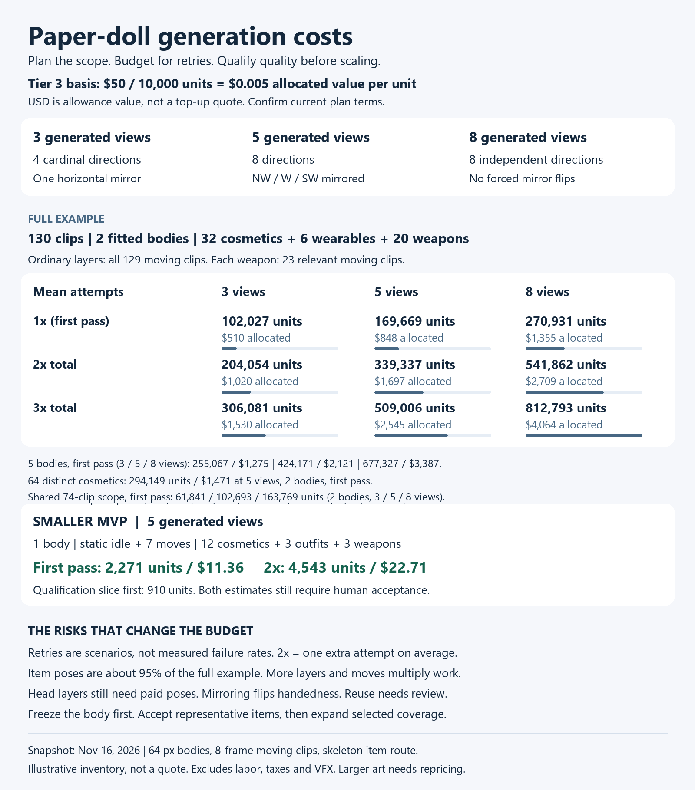

# Paper-doll generation cost risks

Research snapshot: November 16, 2026. These are budgeting examples, not quotes, measured failure rates, or promises of accepted artwork. Prices and implementation may change.



## Understand the cost before expanding

The main cost is fitting each item to its required animation frames. The budget grows with distinct body shapes, item designs, moving clips, generated views and attempts. You do not need to generate every possible clothing combination, but independently animated layers still need compatible artwork.

Accept one body and a small representative item set first. Check perspective, grip, occlusion and animation, then measure units per accepted asset and manual repair time. Set a spending ceiling before expanding coverage. Repeated seeds may not solve an unsuitable rig or incorrect perspective.

## Directions and mirroring

| Generated views | Result                                                | Risk                                                                                     |
| --------------- | ----------------------------------------------------- | ---------------------------------------------------------------------------------------- |
| 3               | Four cardinal directions; generate N/E/S and mirror W | Handedness and asymmetric details flip. Generating N/W/S and mirroring E costs the same. |
| 5               | Eight directions; mirror NW/W/SW from NE/E/SE         | West-side equipment and grips need review.                                               |
| 8               | Eight independent directions                          | Avoids forced mirror flips; generated consistency still needs review.                    |

Three generated views cannot provide eight distinct directions through horizontal mirroring.

## Tier 3 dollar basis

The planning basis is **$50 per month for 10,000 units**, or **$0.005 of allocated subscription value per unit** when the whole allowance is used. Confirm current checkout price, allowance and terms before purchasing. Dollar values below describe allowance consumed, not incremental cash charges or USD-credit top-up prices. Starting without a subscription still requires buying the subscription.

Units divided by 10,000 are allowance equivalents, not a delivery schedule. Separate USD credits have a different pricing basis; do not charge both bases for the same request. Estimates exclude labor, taxes, separate VFX, environments, portraits and icons.

## Full-scope reference assumptions

This illustrative catalog uses 130 total clips: 14 common moves including idle, 80 weapon attacks and 36 skills. Static idle reuses standing artwork, leaving 129 moving clips. Each moving clip has eight frames.

The inventory is **32 cosmetic designs, 6 wearable designs and 20 weapon designs**. Ordinary layers cover every moving clip. Each weapon covers 23 relevant moving clips: 13 common moves, its 4 attacks and 6 eligible skills. These counts are assumptions, not a recommended wardrobe or measured game requirements.

Bodies have distinct proportions within a 64 px canvas. Held items use the padded 96 px skeleton route. Larger canvases, longer clips and fallback routes need repricing. Two and five bodies are separate example scopes; five means five total.

Count distinct designs, not slots or images in a sheet. Several views may represent one design. Do not double-count apparel already included in cosmetics. Existing source art is not automatically a free fitted layer.

## Full 130 clips with retries

Each cell is **units / allocated USD**. An average of 2x means the original plus one regeneration per paid step; 3x means two regenerations. Factors apply to every paid step, including body work, dressing, measurements and poses. These are sensitivity scenarios, not expected acceptance rates or spending caps.

| Bodies | Attempts |   3 generated views |     5 generated views |      8 generated views |
| -----: | -------: | ------------------: | --------------------: | ---------------------: |
|      2 |       1x |   102,027 / $510.13 |     169,669 / $848.34 |    270,931 / $1,354.65 |
|      2 |       2x | 204,054 / $1,020.27 |   339,337 / $1,696.69 |    541,862 / $2,709.31 |
|      2 |       3x | 306,081 / $1,530.40 |   509,006 / $2,545.03 |    812,793 / $4,063.96 |
|      5 |       1x | 255,067 / $1,275.34 |   424,171 / $2,120.86 |    677,327 / $3,386.64 |
|      5 |       2x | 510,135 / $2,550.67 |   848,343 / $4,241.71 |  1,354,655 / $6,773.27 |
|      5 |       3x | 765,202 / $3,826.01 | 1,272,514 / $6,362.57 | 2,031,982 / $10,159.91 |

At five views, two bodies consume 16.97 Tier 3 allowance equivalents before retries. The exact first pass is 7,248.5 body units + 1,560 dressing + 160,860 item poses = 169,668.5 units. Item poses account for 94.8% of this example.

Other average attempt allowances scale the exact total: 1.5x gives 254,502.75 units / $1,272.51 at five views and two bodies; 5x gives 848,342.5 / $4,241.71; 10x gives 1,696,685 / $8,483.43. Neither a high multiplier nor a large balance guarantees usable output.

## How scope changes the estimate

Keeping two bodies and the reference inventory, sharing weapon attacks across six groups reduces the total to 74 clips, including static idle. The resulting first pass is 61,841 / 102,693 / 163,769 units at three / five / eight views, or $309.21 / $513.46 / $818.85. This is a smaller specification, not an automatic discount on 130 distinct clips.

If the catalog has 64 distinct cosmetics instead of 32, the full 130-clip, two-body first pass rises to 176,971 / 294,149 / 469,715 units, or $884.85 / $1,470.74 / $2,348.57. More wearable variants increase it further.

Weapon visibility also matters. For two bodies and five views, the full reference costs 166,068.5 units if each weapon covers only 17 moving clips, 169,668.5 at 23 clips, or 187,668.5 at 53 clips. The last case includes 13 common moves, 4 attacks and all 36 skills. Use the game's actual eligibility rules, rather than fitting every weapon to every attack.

## Use a smaller playable slice

A qualification slice uses one body, static idle plus walk/slash/cast/hurt/death, six ordinary designs and three weapons covering those five moving clips.

An illustrative MVP uses one body, static idle plus walk/slash/cast/hurt/death/thrust/interact, 12 cosmetics, three whole-outfit designs and three weapons covering all seven moving clips. Independent armor/pants/shoes/gloves, additional body shapes and the remaining skills are deferred. Whole outfits reduce slot independence.

| Generated views | Qualification first pass | MVP first pass |      MVP at 2x |
| --------------- | -----------------------: | -------------: | -------------: |
| 3               |              565 / $2.83 |  1,418 / $7.09 | 2,835 / $14.18 |
| 5               |              910 / $4.55 | 2,271 / $11.36 | 4,543 / $22.71 |
| 8               |            1,413 / $7.07 | 3,537 / $17.68 | 7,073 / $35.37 |

The exact five-view MVP is 2,271.25 units before retries or 4,542.5 at 2x. It fits within one otherwise-unused Tier 3 allowance under that scenario, but still requires human acceptance. Restricting its weapons to four relevant clips lowers first-pass MVP costs to 1,336.65 / 2,136.25 / 3,320.65 units at three / five / eight views.

## Rework and maintenance risks

Retry rates can differ between body work, dressing and poses. For the full two-body, five-view reference, body attempts at 1.25x and dressing/poses at 1.5x give 252,690.625 units. Adding dependency rework equal to 5% or 15% of the first-pass item budget of 162,420 units gives 260,811.625 or 277,053.625 units. These are assumed rates, not measured expectations. Count dependency rebuilds in the attempt allowance or separately, never both.

Current rigid head layers still require paid posing. A general free head-attachment workflow is not implemented. Translating frontal art cannot create three-quarter perspective. New anchors, occlusion work or manual art may save generations but introduce labor and tooling costs.

Restricted held-item refits can reuse accepted frames on compatible bodies. Unfitted copies do not establish correct alignment. Even if every duplicate weapon qualified in the reference catalog, each additional body would save at most 4,340 / 7,300 / 11,640 units at three / five / eight views. Do not assume free cross-body fitting for all layers. Pure palette variants with identical geometry may share exact assets.

The full two-body, five-view example contains 53,620 item clip-directions or 428,960 frames at eight frames each. Ten seconds of review per clip-direction would mean about 149 hours; that is an illustrative rate, not measured labor. Combination review and repairs are additional.

At five views, one more full-coverage cosmetic across two bodies costs 3,890 units before retries. One more body move across both bodies and 38 ordinary layers costs 1,196 units, plus 30 per visible weapon. Finalize body proportions and representative motions before expanding the wardrobe.

Long weapons may crop outside the padded canvas. Tails, wings, perspective, grip side, colors and occlusion need separate qualification. Fixed tribe traits baked into bodies, bundled outfits, shared skill motions and exact recolors may reduce work when their limitations fit the game. No general saving preserving the complete independent-swapping specification was established for this snapshot.

## Calculation basis

For S separately fitted bodies, D generated views, M moving clips, C cosmetics, U ordinary wearable designs, W weapons and k_w moving clips required for each weapon:

```text
H(D)  = 1 + ceil(max(0, D - 4) / 3)
Body  = S * [2.25 + D * (5.6 * M + 2)]
Dress = S * [10 * (C + U) + 10 * W * H(D)]
Pose  = S * 3 * D * [(C + U) * M + sum(k_w)]
Total = Body + Dress + Pose
Allocated USD = Total * 0.005
```

The body expression assumes described eight-frame motions plus the walk allowance. It is not a ceiling on accepted-output spending. Authored motion routes can cost less. Item poses dominate the reference total.

Ordinary 64 px standing dressing costs 10 units across three, five or eight views. Held dressing at the assumed 96 px canvas costs 10 / 20 / 30 units: the first call fits four views, later calls reserve one cell for a reference and add three. Eight views therefore require three calls.

The eight-frame skeleton item pose costs 3 units per clip-direction. Anchor editing and packed-grid fallback routes have different prices. Missing standing joints can add 0.1 units per view per body. Longer clips and larger canvases require repricing.

The MVP uses an authored/described motion mix: body 2.25 + 33.8D, dressing 150 + 30H(D), and poses 378D. The qualification slice uses body 2.25 + 22.6D, dressing 60 + 30H(D), and poses 135D. Retain decimals before display; whole-unit values here use half-up rounding.

## Sources and limits

- [PixelLab plans](https://www.pixellab.ai/) and [API pricing](https://www.pixellab.ai/pixellab-api): confirm subscription terms and separate USD-credit prices before purchasing. The indexed official page supported the plan basis; the live readable plan block did not confirm checkout pricing at research time.
- [PixelLab OpenAPI](https://api.pixellab.ai/v2/openapi.json) and [edit-animation documentation](https://www.pixellab.ai/docs/tools/edit-animation-pro): endpoint contracts and edit pricing.
- [Body and move estimates](../../../app/src/studio/create.ts), [standing coverage](../../../app/src/studio/itemRoute.ts), [item planning](../../../app/src/lib/items/items.ts), and [pose pricing](../../../app/src/lib/rig/clips.ts): implementation basis for this snapshot.
- [Held refits](../../../app/src/lib/equipment/refit.ts) and [accepted limits](../../known-issues.md): compatibility and quality constraints.

Inventory, eligible motions, actual frames, canvas sizes, qualified reuse, acceptance and repair time must be established for each project. Use the examples to identify exposure, then replace assumptions with evidence from a small pilot.
