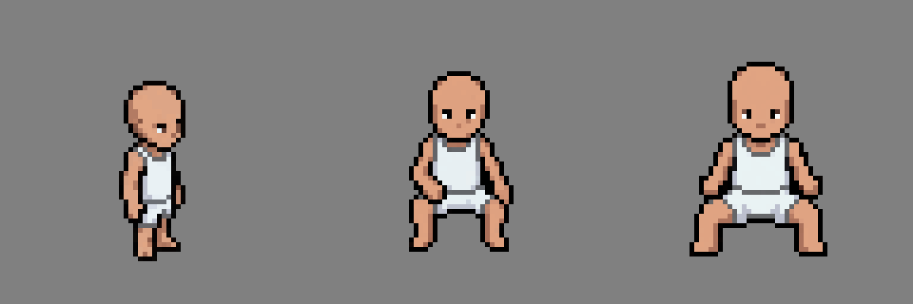
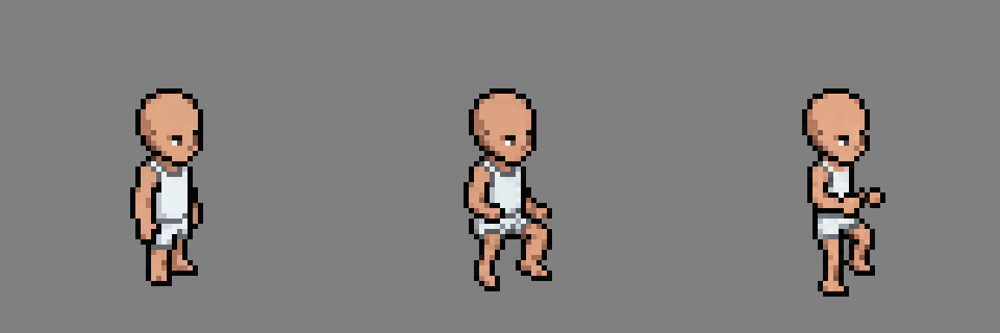

# Riding State MVP

November 21, 2026. Tracking: [Ride a mount with a saved Riding State](https://github.com/users/Shilo/projects/7/views/1?pane=issue&itemId=313789238).

A saved State can be the rider's pose on the Studio test mount. Create State offers an editable **Riding** pose idea. Its prompt is **not qualified**: both live probes below failed.

## Behavior

- **Create State:** with **Edit this pose** on, the pose ideas under the prompt include **Riding** (a prompt suggestion, editable like the others). Picking it fills the instructions, which stay editable, and an untouched name becomes Riding. The review shows a checklist under the prompt. A riding save says where to use the State.
- **Mount settings:** the paw icon opens the **Mount** page of Settings: a preview, Show mount, **Riding pose** and Hide leg, with no explanatory text. The preview always shows the mount walking and turning; with Show mount on, the open character (or the demo) rides it with the current settings. Clicking it pauses or plays, and it is removed when Settings closes. Riding pose uses the shared States and Moves picker (Moves left, States right). It lists every saved State and Move except Standing. A clip missing any frame for a rig facing, mirrors resolved, is listed but disabled with its missing facings named. Riding order: the chosen State or Move (when one is picked), the Ride Move, the Riding State, the Idle Move, then the Standing State. The first three show only for the exact facing; the default, Automatic, starts at the Ride Move. All three persist in this browser (`pixeldoll.mount`); the Riding pose is saved per character. Reset this page restores the defaults.
- **Preview:** mounting with a Riding pose selects that State or Move, and so does opening or customizing a character while mounted. Picking another move while mounted is respected; Top-down and Side-scroller keep the pose. Dismounting restores the earlier selection unless the user changed it in the meantime.
- **Top-down and Side-scroller:** while mounted, the rider follows the riding order for the exact facing and follows the mount seat. A Move riding pose plays its animation there. It is never turned to a neighboring facing. If a chosen State or Move is missing the facing, the next in order shows, with the existing missing-direction note and toast. The rider is not silently swapped.
- **Hide legs:** stays available for other moves but does not apply to a State Riding pose. The State is drawn seated, and generated States have no joints, so cutting legs from standing or estimated geometry would cut the wrong pixels. A Move Riding pose keeps the setting, like the other moves; a seated-looking move such as Ride is treated the same way because clip kinds cannot tell.
- **Seat contact:** uses the rig's hip anchor when one exists; States captured from a Ride frame and skeleton-posed Moves carry one. Otherwise the clip's measured hip joints are used, and without either the existing 0.45 standing-height estimate.

- **Seat position:** The row immediately below **Show character mounted** shows the offset for the preview direction in sprite pixels. It edits the selected character’s mount fit across all States and Moves, with the crosshair available when the rider is hidden. Opening the editor pauses playback. Closing restores its prior play or pause state. Change directions to adjust several views before saving. The center button returns the current direction to zero. Each facing has its own correction so a change to one side does not silently move the other. Existing reviewed artwork contact still supplies the pose’s baseline when available. The offset matches the exported `rig.mountSeatOffsets` value.

## Terminology

Moves are animations and take the base verb: Idle, Walk, Run, Ride, Attack. States are held stances and take the -ing posture word: Standing, Sitting, Riding. So the Ride Move and the Riding State are told apart at a glance.

## Cost

The original premise, that one still per facing is cheaper than a three-frame Ride, holds only for some models:

| Route                                                                 |                                                         Documented price | Source                                                                 |
| --------------------------------------------------------------------- | -----------------------------------------------------------------------: | ---------------------------------------------------------------------- |
| Old skeleton Ride, per drawn facing at 64 px                          |                                                          2.3 generations | [mount live results](../2026-11-16-mounts/live-results.md)             |
| State, default Pro (`edit-images-v2`), one batch at 256 px or smaller |                    10 generations, whether it carries one facing or five | `localStateCost` in `app/src/studio/stateGenerationPlan.ts`            |
| State, Pixen                                                          | 1 generation per packed sheet (all facings of a 64 px rig fit one sheet) | same                                                                   |
| State, Pro Flash                                                      |                                                   about 5 to 6 per sheet | [State routing](../2026-11-18-pixeldoll-states/live-routing-matrix.md) |

On the default Pro route, a three-facing State (10) costs more than a three-facing Ride (6.9); on Pixen it can cost 1. The case for a Riding State is a reviewed still, not savings, unless Pixen or Pro Flash qualifies.

## Live prompt probes

The spend was approved up to 15 generations, stopping at the first failed step. Both probes used the existing Pro Test character (64 px, East Standing), `/edit-image-pixen`, seed 4173, and one East image. The requests were built by Studio's `stateRequests` and sent through the Studio queue. They were a direct probe, not the Create State sheet. Each receipt reported 1 generation, with one attempt each.

- **A (owner's candidate, the first template):** "Change only the pose. Show the same character sitting upright astride an invisible mount, with one leg on each side. Bend the knees and let the lower legs hang down at the sides, not forward like sitting in a chair. Keep the elbows relaxed and the empty hands slightly forward. Preserve the character’s design, proportions, pixel-art style, and facing. Draw only the rider. No mount, saddle, reins, or props."
- **B (geometry only):** "Change only the pose and keep the exact same camera angle and facing direction as the input image. The same character sits upright with the legs apart, thighs angled down, knees bent, lower legs hanging straight down so the feet are under the hips. Elbows relaxed, empty hands held forward at waist height. Keep the character's design, proportions, pixel-art style and size. Only the character, transparent background."

Both failed in the same way. The East side view turned into a front view, and the pose reads as a wide squat or chair-sit, not astride. B's explicit camera-angle sentence did not help. Neither drew a mount, saddle or reins. This is one seed on one model, so it neither qualifies nor rules out the wording on Pro or Pro Flash. Following the approved stop rule, no South, Pro or full-set request was sent.

### Pro Flash follow-up

With the owner's go-ahead to continue within the same 15-generation approval, two more East probes used `/edit-image-pro-flash` (text), the same character, seed and 64 px cell. The free quote was 5 generations per image; each receipt reported 5, with one attempt.

- **C:** prompt A.
- **D (now the template):** the `riding` entry of `state.pose` in `app/src/studio/promptSuggestionDefaults.ts`, which names the side-view leg directly: near leg hanging almost straight down with the foot under the hip, hands forward as if holding reins.

Pro Flash kept the East side view in both, unlike Pixen. C still bends both knees forward like sitting on a stool. D has an upright torso, the near leg down the side and hands forward, but the far leg is raised and bent forward, so it reads partly as a step. Neither drew a horse, saddle or reins. D is the better wording on this sample; one image per prompt does not qualify it, and front, back and diagonal views are untested. The remaining 3 generations could not buy another Pro Flash probe, so spending stopped. Total spend: 12 generations (2 Pixen, 10 Pro Flash).

## Verification

- Unit tests: Riding pose resolution (exact facing, mirrored facing, missing facing, dismounted), option completeness, per-character scope, and the Preview mount and dismount selection.
- End-to-end: the existing mount test chooses a Riding pose built from a fixture State and from the fixture's Walk Move. It checks the shared picker's Move and State columns, Preview selection, Hide legs on each pose kind, Top-down movement, and dismount restore.
- Live browser (agent server, keyless after the probes):
  - Picked and edited the template on Pro Test.
  - Saved a free State from the stored East Ride frame on the isolated Mount trial E copy.
  - Mounted it in Preview and moved in Top-down.
  - Checked that the Ride or Standing default still plays the existing Ride Move in Side-scroller.
  - Dismounted and remounted.
  - Checked the menu at 360 px.
  - Checked a missing facing on an isolated copy of Pro Test with an East-only State: the option is disabled, and a stale choice facing South shows Standing with a note and toast.

## Not verified

- A convincing astride still. The only riding art on stage is the old chair-sit East Ride frame.
- The template on Pro, and any front, back or diagonal view on any model.
- Real mounts, gear on a riding State, and engine export of mounting.
- Seat accuracy for generated States without a hip anchor or fitted joints (fitted States now sit on their measured hips).
