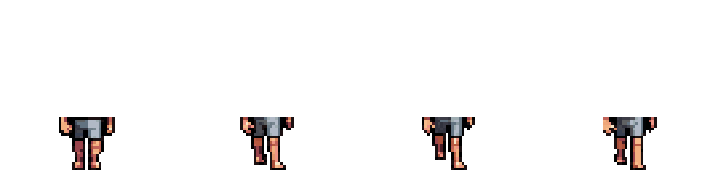

# Baked-frame split probe: what an upper/lower composite actually looks like

Date: 2026-11-24
Scope: offline pixel experiment on the bundled demo character. No PixelLab call, no app code changed, no test added.

## Question

If PixelDoll composited the lower half of a Walk frame with the upper half of an Attack frame at runtime, would the result clear the project's quality bar? This probe produces the actual pixels instead of arguing about them.

## Inputs

- `app/public/fixtures/s2/layers/body/base/main/walk.png` (512x192, 8 cells x 3 stored rows: south, east, north; west mirrors east)
- `app/public/fixtures/s2/layers/body/base/main/cross-punch.png` (384x192, 6 cells x 3 rows)
- Cell 64x64, pivot (32, 64). The demo character wears a plain gray shirt and shorts, barefoot, and carries no cape, coat, skirt, helmet or held weapon.

This is the easiest possible case for a split: a tight top, a horizontal short hem, no asymmetric equipment, no long hair. Anything that fails here fails harder on real outfits.

Reference frames are in `evidence/01`-`04`.

## Method

All images are 3x or 4x nearest-neighbor contact sheets of 64 px cells, written by a scratch Node script outside the repo. Alpha is binary in these sheets.

1. **Pivot aligned, hard horizontal cut.** Every pixel above row `s` comes from the attack frame, every pixel at or below `s` from a walk frame. Rows 40, 44, 46, 48, 50, 52 were tried (`evidence/06`).
2. **Hip aligned, hard cut.** The attack upper was translated by the difference between the two frames' crotch rows, then cut at the walk frame's crotch row.
3. **Leg window swap.** The attack frame is kept whole except a rectangular window under the hips (`x` 22-46, `y >= 42/44/46`), which is filled from the walk frame (`evidence/07`, `08`).
4. **Hem swap.** The attack frame is kept except where walk pixels exist below row 48/50/52/54, approximating "replace only below the garment hem" (`evidence/10`, `11`).
5. **Cross direction.** East attack upper over south walk lower (`evidence/09`).

The probe had no skeleton keypoints for this fixture, so it could not build the leg-shaped capsule mask that `mountLegs.ts` builds from HIP, KNEE and LEG points. Every cut below is therefore a rectangle, which is the worst version of a real mask.

## Observations

### 1. There is no seam row that suits both clips

`evidence/05` and `06`: the cross-punch's fists and forearms occupy rows 35-42 (columns 17-23 and 39-45). By row 44 the torso has narrowed to 10 px (columns 28-37), while the walk frame at row 44 is 25 px wide (columns 22-46). A seam below row 42 keeps the whole arm but cuts where the two silhouettes differ by 15 px. A seam above 44 matches nothing, and at 40-42 it clips the bottom rows of the fists.

The visible "floating fist" in the contact sheets is not only the cut: the punch itself draws the fist away from the torso with a thin connecting band, and the walk legs below make that band read as detached. The seam makes it worse, but it is not the sole cause. The accurate statement is that the attack's limb positions and the walk's hip width do not leave any row where a hard cut looks intentional.

### 2. The window and hem swaps preserve the arms, but expose a waist step

`evidence/07`, `08`, `10`, `11`: keeping the whole attack frame and replacing only the lower region removes the amputated fists. What remains is a visible rectangle or step at the hip, because the attack frame's waist is narrower than the walk frame's hips (the punch is mid-lunge and twisted; the walk frame's shorts are 25 px wide where the punch is 10-14 px). The shirt hem reads as cut, and the shorts appear as a separate band.

A keypoint-driven capsule mask would follow the attack's own leg contour instead of a rectangle, which removes the corner artifacts. It cannot remove the waist step: two poses authored with different hip rotation and different torso lean have different silhouettes at the joint. The seam can be hidden only where a garment (shorts hem, belt, tunic hem) already forms a horizontal line in both clips.

### 3. Cross-direction halves are not anatomically meaningful

`evidence/09`: an east-facing torso over south-facing legs loses the head and reads as a jumble. Even with perfect masks, the two halves are drawn in different projections (front versus three-quarter versus profile), so the shoulders cannot connect to the hips. Independent facing per half is a skeletal-rig feature; with baked directional frames it would require authoring every torso/leg direction pair.

### 4. What looks acceptable

Even in this worst-case (rectangle) probe, the same-direction leg window at row 44-46 reads at 1x as "a character punching while shuffling". It is not obviously broken at game zoom; the arms are intact and the gait is legible. It would not pass a close review at 3x, and it would fail immediately on a character with a cape or a long coat, since those pixels span both halves and nothing can decide which half they belong to.

### 5. Motion is untested here

These are still contact sheets. The artifacts that matter most in motion are:

- the seam flickering as the attack frame's hip moves relative to the walk frame's hip,
- foot sliding when the composite translates at travel speed but the legs step at a different cadence or direction,
- the pop when the walk gait resumes at its hidden phase,
- the exact moment the attack's own legs are removed (a frame where the attack leg is in front of the torso would tear).

A live spike must play these composites at 1x and at the Studio's zoom before any quality claim.

## Limits of this probe

- No keypoint masks, only rectangles (worse than the real candidate).
- One character, one outfit, one attack, south and east only.
- No cape, coat, skirt, helmet, two-handed weapon, long hair or asymmetric gear, which are the cases most likely to fail.
- No per-frame hip translation or bob compensation.
- No render-time alpha handling; the real compositor uses straight alpha and oversize held layers.

## Evidence

| File | What it shows |
| --- | --- |
| [01-walk-south-8frames.png](evidence/01-walk-south-8frames.png) | Reference: the eight south Walk frames |
| [02-cross-punch-south-6frames.png](evidence/02-cross-punch-south-6frames.png) | Reference: the six south cross-punch frames |
| [03-walk-east-8frames.png](evidence/03-walk-east-8frames.png) | Reference: east Walk |
| [04-cross-punch-east-6frames.png](evidence/04-cross-punch-east-6frames.png) | Reference: east cross-punch |
| [05-cut-seam48-over-8-walk-frames.png](evidence/05-cut-seam48-over-8-walk-frames.png) | Hard cut at row 48, punch upper over each Walk frame: detached fist and cut forearms |
| [06-seam-sweep-40-52.png](evidence/06-seam-sweep-40-52.png) | Seam sweep at rows 40, 44, 46, 48, 50, 52: every choice loses or keeps something |
| [07-leg-window-top42-44-46.png](evidence/07-leg-window-top42-44-46.png) | Leg window at rows 42, 44, 46: arms survive, a waist step remains |
| [08-leg-window-attack-cycle.png](evidence/08-leg-window-attack-cycle.png) | Six attack frames over Walk legs: the seam moves with the pose |
| [09-cross-direction-east-upper-south-legs.png](evidence/09-cross-direction-east-upper-south-legs.png) | East torso over south legs: projections do not join |
| [10-hem-swap.png](evidence/10-hem-swap.png) | Hem swap at rows 48, 50, 52, 54 |
| [11-hem-swap-attack-cycle.png](evidence/11-hem-swap-attack-cycle.png) | Hem swap across the attack cycle |

## Consequence for the design

The evidence supports, in order:

1. Do not ship a general "split any body at any line" compositor. The attack silhouette does not cooperate, and the seam is visible even on the simplest character.
2. If a split is ever exposed, define the split region by **anatomy or garment boundary, per cell, from keypoints and material colors** (leg capsule ending at the shorts hem), never by a fixed horizontal row, and only for outfits that pass a seam review.
3. Prefer generating a combined clip (mixed walk-leg and attack-upper keypoints rendered by skeleton-v3) over compositing two baked clips. That has no seam at all, and it is the thing a studio would actually do.
4. In the short term, fix the slide with a movement policy (lock, slow or free) that needs no art and cannot look broken.
