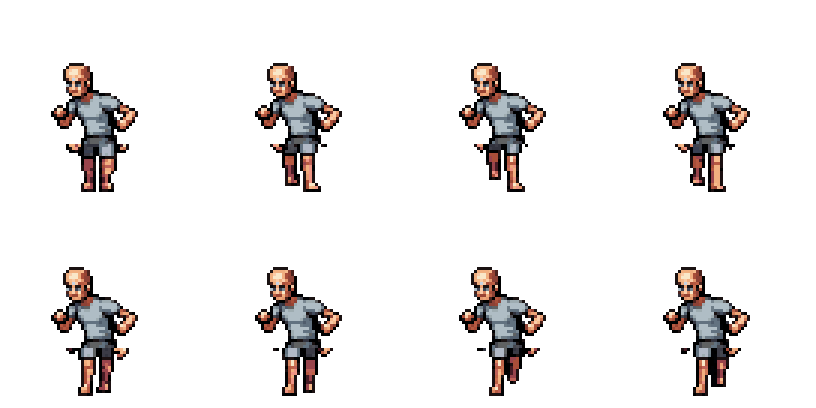
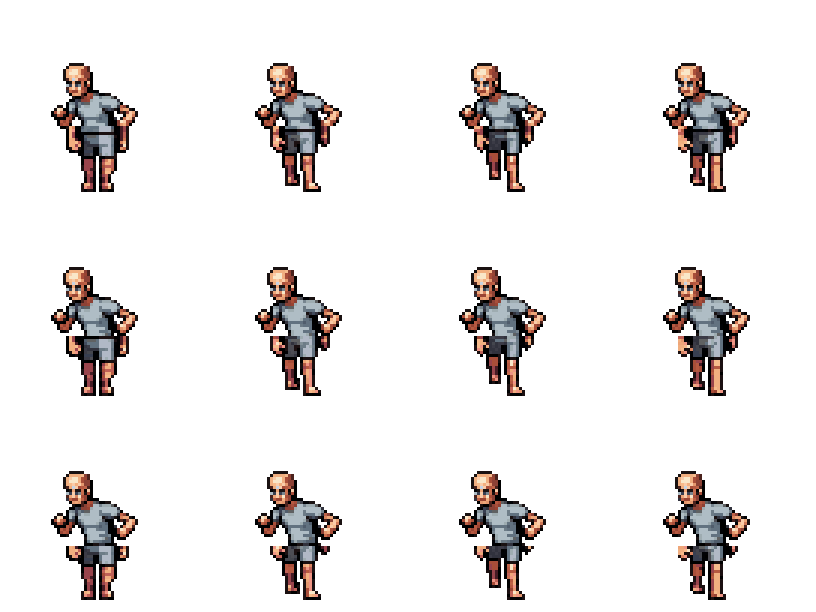

# Baked-frame split probe: what an upper/lower composite actually looks like

Date: 2026-11-24
Revised: 2026-11-24 after the independent GPT-6.2 Sol review. Two evidence errors are corrected below.
Scope: offline pixel experiment on the bundled demo character. No PixelLab call, no app code changed, no test added.

## Question

If PixelDoll composited the lower half of a Walk frame with the upper half of an Attack frame, would the result clear the project's quality bar? This probe renders the candidate pixels instead of arguing about them.

## Inputs and an important fixture limit

- `app/public/fixtures/s2/layers/body/base/main/walk.png` (512x192, 8 cells x 3 stored rows: south, east, north; west mirrors east). Every row is populated.
- `app/public/fixtures/s2/layers/body/base/main/cross-punch.png` (384x192, 6 cells x 3 rows). **Only the south row is populated; the east and north rows are fully transparent** (measured: rows 1 and 2 contain 0 opaque pixels).
- Cell 64x64, pivot (32, 64). The demo character wears a plain gray shirt and shorts, barefoot, and carries no cape, coat, skirt, helmet or held weapon in the body sheet used for the core probe.

Consequence: the fixture cannot demonstrate a cross-direction pair where both halves exist unless one half is reused from another row. The first version of this probe used the blank east punch row as an "east attack" upper, so its cross-direction image was invalid. It has been replaced with a populated test: **south punch upper over east walk legs**. That is the real cross-projection stress case available here, and it is what a game would actually attempt when a character has an attack only in some views.

This is still the easiest possible character for a split: tight top, horizontal short hem, no asymmetric equipment. Anything that fails here fails harder on real outfits.

Reference frames are in `evidence/01`-`03`.

## Method

Images are 3x or 4x nearest-neighbor contact sheets of 64 px cells, written by a scratch Node script outside the repo.

1. **Pivot aligned, hard horizontal cut.** Every pixel above row `s` comes from the attack frame, every pixel at or below `s` from a walk frame. Rows 40, 44, 46, 48, 50, 52 were tried (`evidence/05`, `evidence/06`).
2. **Leg window swap.** The attack frame is kept whole except a rectangular window under the hips (`x` 22-46, `y >= 42/44/46`), which is filled from the walk frame (`evidence/07`, `evidence/08`).
3. **Hem swap.** The attack frame is kept except where walk pixels exist below row 48/50/52/54 (`evidence/10`, `evidence/11`).
4. **Corrected cross projection.** South punch upper over east walk lower at row 46 (`evidence/09`).

The probe had no skeleton keypoints for this fixture (the fixture has no `measured` joints), so it could not build a leg-shaped capsule mask or a per-frame hip socket. Every cut below is a rectangle at the pivot, which is the worst version. The independent review later implemented a fitted per-frame graft with integer `dx,dy` and manual trims, which is a fairer upper bound; its findings are folded into the conclusions.

## Observations

### 1. Attack limbs cross the cut line

`evidence/05` and `06`: the cross-punch's fists and forearms occupy rows 35-42 (columns 17-23 and 39-45). By row 44 the torso has narrowed to 10 px (columns 28-37). A seam at 40-42 clips the bottom rows of both fists. A seam at 44 or below keeps the fists but cuts the torso where the walk silhouette is much wider.

An earlier version of this file compared that 10 px torso to a "25 px pelvis" on the walk frame. That comparison was wrong: the 25 px span includes the walking arms hanging at the sides, so it is a silhouette extent, not a pelvis width. The seam mismatch is real but smaller than that number suggested.

### 2. Same-facing registration is much better than a pivot-aligned rectangle

`evidence/07`, `08`, `10`, `11`: replacing only the lower region preserves the arms. The rectangle leaves a step at the hip because the punch's waist and the walk's hips differ in width and lean.

The independent review then fitted the upper action per frame: it trimmed dangling walk pixels outside hand-inspected shorts spans, used one overlapping junction row, and translated the action stack by integer anchor deltas. For the south pair it reached a **1 px median and 2 px maximum junction edge step**, down from 6/8 px for a fixed cut, with no detached fragments in most phase pairs. So same-facing compositing is not a dead end: it becomes reviewable with per-frame registration and manual repair. What remains is jitter in the upper translation and clothing that bridges the seam.

The review also found that silhouette continuity alone cannot validate a pair. East shows no disconnected pixels by its metric yet keeps old arm remnants under the punching arm, and north/south can score as well as south/south while showing the back of the trousers under a face.

### 3. Cross projection survives masking

`evidence/09` (corrected): a south punch torso over east walk legs keeps the head, which the invalid image did not, and still fails. The front-facing shorts and torso sit on a profile gait; the lower half narrows and the legs overlap, and one leg reads as belonging to a different figure. A detached fragment remains near the hip. Registration cannot reconcile a front-three-quarter torso with a side gait.

### 4. Equipment decides more than the seam

The review's equipment pass is the most important addition to this probe. With the real layer stack:

- A y46 threshold removes 77-87 sword pixels and 105-196 cape pixels per action cell, while removing almost nothing from vest, hair or helmet.
- Keeping the sword intact looks materially better than clipping it, which means the cut cannot be a blanket "everything below the waist" rule.
- The cape, moved as one piece, intersects 6-31 walk pixels below the junction in the eight aligned south samples, leaving holes and old outlines. A cape with foreground folds needs alternate occlusion or separately authored fragments.
- A missing wizard hat (walk only, no action sheet) shows why the whole recipe must fail coverage validation before any gear is dropped.

That narrows the earlier blanket claim. The seam is a QA problem; **equipment that crosses the seam is the real blocker**, and only some items fail.

### 5. Motion and reverse, measured

The review's motion test is the only moving evidence produced so far. It travelled 3 source px per 100 ms and used the rightmost foot alpha as a toe-bound support proxy:

- East walk cells 2, 3, 4 placed eastward give world x43, 41, 43 (2 px spread).
- Reversed and travelling west gives x37, 35, 37 (2 px spread).
- Reversed while travelling east gives x37, 41, 49 (12 px spread), i.e. the foot slides.

So a reversed side-profile walk is a plausible restrained backpedal, and reversing it while still travelling forward is measurably wrong. All 192 aligned bare grafts preserved the lower source pixels exactly, so a layered composite inherits the walk's existing contact behavior and any existing sliding; layering does not fix foot contact by itself. North/south reversal, perpendicular strafe, sustained lock and variable speed remain untested.

## Limits of this probe

- No keypoint masks in the original rectangle probe; the review's fitted graft is the better upper bound for same-facing.
- One character and outfit, one attack (south only), south/east/north walk rows.
- No cape-free versus cape-wearing acceptance test at motion speed, only stills.
- No long coat, skirt, helmet, two-handed weapon or diagonal facing.
- No render-time alpha handling beyond straight alpha; no tuck or held-weapon padding rules.
- The corrected cross-projection test still reuses a south attack with an east gait, which is deliberately the hard case; a character with attacks in every direction would not need it.

## Consequence for the design

1. Reject an automatic split of arbitrary clips. Fixed cuts lose limbs and equipment, and cross-facing pairs do not join.
2. **Accept same-facing action layering as a reviewed, opt-in pilot.** With per-frame integer registration, a fitted junction, and per-pair QA, the south pair reaches a 1 px median edge step and can look intentional. It needs a reviewed recipe per (gait, action, facing) and per allowed outfit, not a general algorithm.
3. **Independent aim needs authored art.** Either a torso drawn at the relative angle to the pelvis, or a strafe/backpedal gait, plus occlusion and depth for items that cross the join. Reusing two directional drawings cannot produce it.
4. **Coupled attacks still belong in one clip.** Attacks whose weight comes from pelvis, feet or flowing clothes should be generated as whole-body moving actions.
5. Pre-split cells baked at export are the right runtime shape: no engine performs mask math, and the caller supplies both elapsed times.

## Evidence

| File | What it shows |
| --- | --- |
| [01-walk-south-8frames.png](evidence/01-walk-south-8frames.png) | Reference: the eight south Walk frames |
| [02-cross-punch-south-6frames.png](evidence/02-cross-punch-south-6frames.png) | Reference: the six south cross-punch frames |
| [03-walk-east-8frames.png](evidence/03-walk-east-8frames.png) | Reference: east Walk |
| [05-cut-seam48-over-8-walk-frames.png](evidence/05-cut-seam48-over-8-walk-frames.png) | Hard cut at row 48, punch upper over each Walk frame |
| [06-seam-sweep-40-52.png](evidence/06-seam-sweep-40-52.png) | Seam sweep at rows 40, 44, 46, 48, 50, 52 |
| [07-leg-window-top42-44-46.png](evidence/07-leg-window-top42-44-46.png) | Leg window at rows 42, 44, 46: arms survive, a waist step remains |
| [08-leg-window-attack-cycle.png](evidence/08-leg-window-attack-cycle.png) | Six attack frames over Walk legs: the seam moves with the pose |
| [09-cross-direction-east-upper-south-legs.png](evidence/09-cross-direction-east-upper-south-legs.png) | Corrected cross projection: south punch upper over east walk legs |
| [10-hem-swap.png](evidence/10-hem-swap.png) | Hem swap at rows 48, 50, 52, 54 |
| [11-hem-swap-attack-cycle.png](evidence/11-hem-swap-attack-cycle.png) | Hem swap across the attack cycle |

The blank `04-cross-punch-east-6frames.png` reference was removed; it was a fully transparent sheet and is not evidence.

