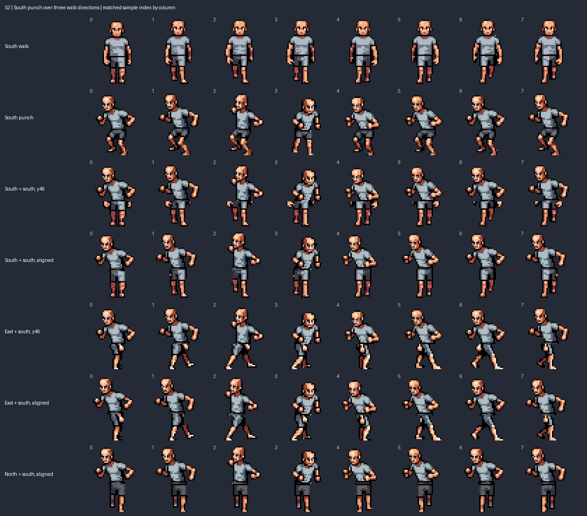
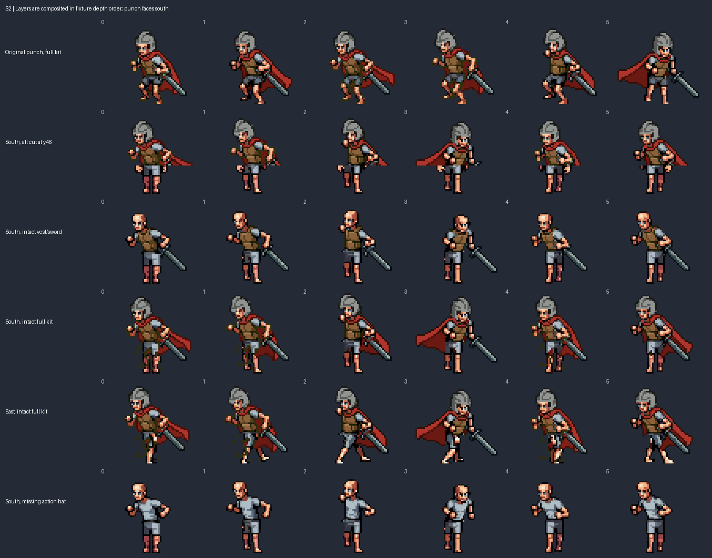
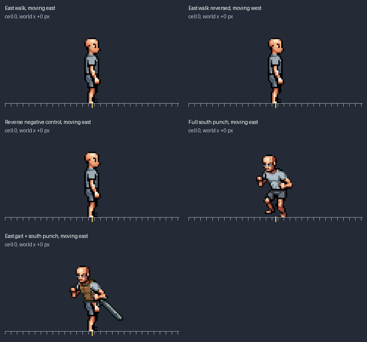

# Independent review of action layering on baked sprites

## Verdict

Ship opt-in **reviewed action layering** for specific characters, gaits, actions, facing pairs, and equipment. Start with one same-facing walk and upper action using separated PNG cells, integer attachment points, and ordered sprite draws. Preserve the locomotion clock and game-controlled movement. To claim independent aim in a release, include one reviewed off-axis pair or one same-facing action over a separately reviewed lateral/backward gait. Try a same-profile reversed walk for opposite travel in side view before pairing opposite-facing torso and legs. Reserve whole-body moving-action clips for attacks whose pelvis, feet, or clothes need to move together.

Reject a general automatic split on existing exports. South walk overlaid with South punch gets close after manual registration. East walk with South punch still shows projection errors and an old walk arm. North/South seams score as well as South/South while displaying the back of the trousers under a visible face. An intact sword looks materially better than a clipped one. The cape needs different occlusion or different art. These findings come from pixels. Quality comes from compatible authored parts, not the existence of two clocks.

## What games actually do

| Primary evidence | Verified mechanism |
| --- | --- |
| Teeworlds | Samples walk phase from world x, separately adds hammer/ninja attack animation from attack ticks, and uses the aim vector for hand/weapon rendering. Walk keys body/feet. Hammer keys the attachment angle. Authored feet, eyes and hand overlap the body, with no anatomical waist boundary. The walk is gated when direction and velocity oppose, so it gives no precedent for general reverse gait. [Player code](https://github.com/teeworlds/teeworlds/blob/5d682733e482950f686663c129adc4b751c8d790/src/game/client/components/players.cpp#L125-L182) · [Weapon/hand draws](https://github.com/teeworlds/teeworlds/blob/5d682733e482950f686663c129adc4b751c8d790/src/game/client/components/players.cpp#L205-L318) · [Authored tracks](https://github.com/teeworlds/teeworlds/blob/5d682733e482950f686663c129adc4b751c8d790/datasrc/content.py#L566-L625) · [Feet renderer](https://github.com/teeworlds/teeworlds/blob/5d682733e482950f686663c129adc4b751c8d790/src/game/client/render.cpp#L259-L285) |
| OpenRA | Turret sprite animation follows turret world yaw, with a mount position transformed from the body. Infantry use one body animation that switches between stand, move, and attack. A turret connection is geometrically simpler than a pelvis. The two approaches coexist in one renderer. [Turret](https://github.com/OpenRA/OpenRA/blob/b70cab2b43d831039b21528ac88f46180ae02b88/OpenRA.Mods.Common/Traits/Render/WithSpriteTurret.cs#L85-L114) · [Infantry](https://github.com/OpenRA/OpenRA/blob/b70cab2b43d831039b21528ac88f46180ae02b88/OpenRA.Mods.Common/Traits/Render/WithInfantryBody.cs#L127-L195) |
| Flare | Run and attack are states that select one named animation. Gear is given the same animation name and uses one facing for draw order. Separate gear images alone do not supply separately animated anatomy. [Avatar](https://github.com/flareteam/flare-engine/blob/4582b7ee1d83139bfbdd52adfa20c8809dcc4fd2/src/Avatar.cpp#L715-L824) · [Entity selection](https://github.com/flareteam/flare-engine/blob/4582b7ee1d83139bfbdd52adfa20c8809dcc4fd2/src/Entity.cpp#L743-L766) · [Entity renderer](https://github.com/flareteam/flare-engine/blob/4582b7ee1d83139bfbdd52adfa20c8809dcc4fd2/src/Entity.cpp#L856-L890) |
| OTClient and LPC | OTClient passes a shared phase and direction pattern to the creature and its color masks. LPC documents oversized weapon frames. Both are relevant equipment precedents. Neither code path shows an independent human full-body split. [OTClient](https://github.com/edubart/otclient/blob/dab86e610991092fe8b2471f7de55a7c986b3cd2/src/client/creature.cpp#L105-L162) · [LPC](https://github.com/LiberatedPixelCup/Universal-LPC-Spritesheet-Character-Generator/blob/86a3719ee4a7e2e9fb27c7c152e29a741d3e930a/README.md#L145-L175) |
| Spine, Unity, Godot | Spine higher tracks can override only keyed properties. Unity layers mask animated parts/properties and support override/additive modes. Godot AnimationTree filters tracks. Its cutout workflow separately sets up sprite parts, hierarchy and optional deformation. These facilities act on independently addressable inputs. One sprite-frame property gives them no independent torso and leg channels. [Spine tracks](https://esotericsoftware.com/spine-applying-animations#Tracks) · [Unity 6 Animation Layers](https://docs.unity3d.com/6000.0/Documentation/Manual/AnimationLayers.html) · [Godot AnimationTree](https://docs.godotengine.org/en/stable/tutorials/animation/animation_tree.html) · [Godot cutout source](https://github.com/godotengine/godot-docs/blob/4b22866ffab240404ffa3d5da43cd6590b0e2324/tutorials/animation/cutout_animation.rst#L67-L114) |

Teeworlds demonstrates a useful abstraction beyond two complete animations. Move the body and feet and apply an independently aimed attachment delta. PixelDoll could use that pattern for pointing or a narrow cast when the source has an independently authored arm or hand. It does not establish that arbitrary generated pixels can be separated at runtime.

## Offline pixel evidence

The fixture has 64×64 cells with bottom-center pivot (32,64), eight walk cells and six punch cells with 100 ms durations. Alpha inspection found eight nonempty walk cells each in South, East, and North, with West reflected from East. The only populated punch direction is South. The East and North punch rows are blank for body and available items. The wizard hat has walk pixels only in South and East and no punch sheet. The fixture has no measured joints and predates current rig output. [Fixture rig](../../../../app/public/fixtures/s2/fixture.json#L1-L109) · [Fixture body](../../../../app/public/fixtures/s2/fixture.json#L178-L196)

I compared a fixed y46 cut with an aligned graft. The graft trims dangling walk pixels outside hand-inspected shorts spans until y53, uses one overlapping junction row, and translates the action stack by integer anchor deltas. It adds no pixels and keeps the walk pivot fixed. Action layers stay intact in the second method. I measured all 48 independent phase pairs per direction and method, 384 comparisons. The join samples are the two adjacent rows of the fixed cut or the shared row of the aligned graft. Loss is 1 minus intersecting over union occupied x positions. The edge step is the larger absolute difference at the left or right endpoints. I also counted pixels outside the largest four-connected body component. These are geometry metrics, with separate visual review for limb ownership.

| Lower travel, South punch | Fixed loss median / max | Aligned loss median / max | Fixed edge median / max px | Aligned edge median / max px | Aligned contact min px | Fitted dx,dy ranges px |
| --- | ---: | ---: | ---: | ---: | ---: | --- |
| South | .450 / .500 | .083 / .214 | 6 / 8 | 1 / 2 | 11 | −2…0, −3…−1 |
| East | .385 / .539 | .321 / .462 | 4 / 10 | 2 / 4 | 7 | −4…1, −2…0 |
| North | .361 / .476 | .083 / .154 | 5 / 7 | 1 / 2 | 11 | −2…0, −3…−2 |
| West, mirrored | .333 / .467 | .321 / .462 | 3 / 8 | 3 / 5 | 7 | −4…0, −2…0 |



**Silhouette and limbs.** Fixed South often has two extra hands around the hips. Six of 48 pairs leave detached fragments, up to nine pixels. Aligned South largely restores a continuous shorts line, with small remnants such as column 7. Aligned East has no disconnected pixels by the metric, yet old arm remnants are obvious below the punching arm in columns 0, 3, and 4. In East the lower half narrows and one leg overlaps the other while the punch trunk leans across a front-quarter view. Registration helps without changing this projection. Aligned North comes close to South in its seam score, but shows the rear of the shorts under a torso with a visible face. A brief turning pose in a symmetric costume could pass at small size. The numbers establish that seam continuity alone cannot validate it. Image columns use walk cell w and attack cell (w + 2) modulo 6.



**Equipment and depth.** Thresholding y46 removes 77–87 sword pixels and 105–196 cape pixels per action cell. It takes zero or four vest pixels and none from hair or helmet. The intact sword follows the attack hand in the fitted vest/sword row. This is a punch with a sword held, so it says nothing about attacking with a sword or using two hands. In the eight aligned South samples the intact cape intersects 6–31 walk pixels below the junction that the translated original action body did not occupy. Holes and old figure outlines show through or around the alternate legs. A cape with foreground folds cannot be fixed reliably by moving the whole item behind the figure. Use independently authored fragments or repair alternate occlusion. The missing hat demonstrates why the whole recipe should fail coverage validation before it drops any selected gear. Long coats, skirts, scarves, and two-handed weapons are unverified.



**Motion and reverse.** The probe travels 3 source px per 100 ms. In East walk cells 2, 3, and 4 the rightmost y62–63 alpha x is 43,38,37. Eastward placement yields world x43,41,43 (range 2 px). Reversing those cells and traveling west yields x37,35,37 (2 px). Reversing while traveling east yields x37,41,49 (12 px). This is a toe-bound proxy for a short candidate support interval. Cell 4 joins foot silhouettes and the proxy does not prove foot identity. The South punch foot-band centroid changes only 0.5 px in sprite space over cells 0–4 and travels 12.5 px when the actor travels 12 px. All 192 aligned bare grafts preserve the lower source pixels in y53–63 exactly. Keeping the gait therefore retains both its contact behavior and any existing sliding. The reverse side profile reads like a restrained backpedal, with forward posture and reverse heel/toe sequencing. North/South reversed walk, perpendicular strafe, sustained lock, variable speed, and Studio's projected speed remain unverified. The GIF resets displacement at its loop boundary.

### Reproduce

I ran `python C:/Users/shilo/AppData/Local/Temp/opencode/pixeldoll-gpt62/probe.py` from repo root with Pillow 13.0.0 and NumPy 2.4.0. Scratch also holds `seams.csv`, `probe-results.txt` and the anatomy sheet. Use these source-pixel annotations in sheet order, with inclusive x endpoints. Keep all walking pixels y≥53. For the action keep y≤upper junction, dx = round((walkL + walkR − actionL − actionR)/2), ties to even, dy = walkY − actionY. Reflect East spans for West. Use straight alpha with fixture depths: body, vest, cape, hair, helmet, sword. This probe uses the fixture's existing 64 px layer cells. It does not implement current studio tuck or held-weapon padding rules.

| Sheet | Junction y | x ranges |
| --- | --- | --- |
| Walk S | 44,43,43,43,43,43,43,43 | 27–37, 26–37, 27–37, 26–37, 26–37, 26–37, 27–38, 27–38 |
| Walk E | 44,44,45,45,45,45,45,45 | 27–36, 27–35, 26–35, 27–36, 28–36, 29–36, 29–37, 29–36 |
| Walk N | 43 for each cell | 27–37 for each cell |
| Punch S | 46,46,46,45,46,46 | 29–39, 29–39, 28–38, 29–39, 29–39, 27–37 |

## Options and art requirements

Quality/readiness are independent judgments on a 1–5 scale. Quality assumes art appropriate to the approach. Readiness measures distance from the current runtime. Costs are incremental PixelLab gens and all useful routes can be switched at runtime once assets exist.

| Route | Quality / readiness | Art and runtime consequence | Incremental gens | Runtime toggle |
| --- | --- | --- | --- | --- |
| Fixed runtime waist cut with independent aim/travel | 1 / 4 | Fewest rules. Double hands, alpha cuts, lost blades, yaw mismatch. Writing a shader or native mask cannot fix those inputs. | 0 | Possible, fails quality review |
| Aligned same-facing split from existing cells | 3 / 4 | Per-frame upper socket, clean lower pelvis, verified short equipment. The South fixture justifies manual repair. Upper translation can jitter and clothing can bridge the seam. Pre-split sheets work with existing sprite primitives. | 0 manual | Yes, for approved pairs |
| Reviewed independent-facing torso and legs | 3–5 / 2 | Same runtime as aligned split. Needs compatible projection, occlusion, and palette at the join or an intermediate transition shape. Validate the actual relative angles, with separate handedness review. | 0 manual, paid repair optional | Yes, for approved pairs |
| Aim-facing whole body with backpedal/strafe legs | 4 / 3 | Author lower gaits indexed by facing and travel. Same projection and continuous stance. Reverse ordinary walk only for a reviewed opposite-travel pair. Reversal cannot generate side-stepping. | 0 reverse/manual, otherwise price new gaits and affected items | Yes, by reviewed gait selection |
| Full moving-action clips | 4–5 / 3 | Match pelvis twist and foot dynamics, long garments, smears or weight shifts within a single pose. Existing whole-body renderer fits. Entry and recovery may need alternative phase variants. A single combined clip cannot respond independently to both time inputs. | 3 per 4–12-cell pose per drawn direction/item, pending reference art | Yes, by clip strategy |
| Authored upper-only action over intentionally compatible lower gait | 4–5 / 3 | Most reusable baked format. Plan the rest junction and rendered overlap, and give a belt or hem one owner. Author the upper part and reusable walking pelvis separately in each supported view. | 0 authored, optional targeted generation | Yes, for approved parts |
| Separate arm/weapon attachment | 4 / 3 for narrow actions | Keeps most of locomotion intact. Needs shoulder/wrist sockets, a base with proper arm-free underpaint, alternate depth for cross-body aim, and an attachment per weapon. Useful for pointing/casting. Limited for large swings, transformed sleeves and two-handed action. | 0 authored, optional overlay/item repair | Yes, by attachment strategy |
| Repose existing pixels with keypoints | 2 / 1 | Sparse 2D landmarks can register or suggest a transform. Weights, separation, hidden surface appearance, occlusion and view yaw are unresolved. Pixel rotation/deformation can change outline and shading. A complete cutout rig is a separate authored asset format. | 0 for transforms, art extra | Yes with an authored rig |
| Pre-split per-frame export sheets | 4 / 4 with good parts | Shared export strategy for split routes. Bake alpha and chosen coverage variants once, then select frames and draw order. Bad masks can bake in the same artifacts. A texture per full phase pair trades runtime draws for atlas growth and less outfit flexibility. | 0 deterministic | Yes, by track selection |
| Authored overlap bridge or smaller region | 4 / 2 | Use a belt, sleeve or shoulder piece where it belongs. A tiny connector can cover normal registration variation. Large yaw changes or a cape crossing the join need distinct coverage/depth assets. | 0 authored, optional repair | Yes, for approved pairs |

A waist was a good experiment because this character already has a dark shorts boundary. Choose an exposed seam per art set. Legs need not be the only independent part, and all below-waist pixels need not belong to legs. A sword attached to a hand can cross both knees. A planted action may need pelvis ownership to stay with the action and use coupled art. Mask precision matters on a boundary that becomes visible. Inside a stable opaque overlap, an approximate mask can work. Conversely, pixel-exact segmentation cannot restore never-drawn skin behind a forearm or a cape painted around the original legs. PixelDoll's optional landmark tracks are normalized 2D coordinates for requested and measured joints, not skin weights, pixel ownership, hidden pixels, depth, or foot-contact intervals. Use them as annotation seeds. [Rig fields](../../../../app/src/lib/rig/rig.ts#L19-L50) · [Two-bone IK](https://www.ryanjuckett.com/analytic-two-bone-ik-in-2d/) · [Godot 2D cutout and deformation](https://github.com/godotengine/godot-docs/blob/4b22866ffab240404ffa3d5da43cd6590b0e2324/tutorials/animation/cutout_animation.rst#L373-L404)

Pre-generating all gait×action×direction combinations is unnecessary. Factor by lower gait and upper action. Reserve complete moving clips for coupled poses. Full directional coverage requires checking up to 64 aim/travel pairs on an eight-direction rig, even if art is reused between them. For the fixture's 8×6 phase combinations, a full phase-pair atlas uses 48 cells per direction pair per reusable layer. Separate tracks cost 8 + 6 before optional overlap pieces or depth variants. Store reviewed pair eligibility and a bridge lookup only when a few compatible poses require one.

## Portable API and implementation

Export an optional versioned recipe registry. A recipe maps locomotion clip, action clip and an ordered travel/aim pair to actual lower and upper facing rows, lower playback order, and compatible equipment coverage. Validate required artwork, available frames and variant combinations at export/load. Fingerprint source artwork so replacement invalidates review. First export can explicitly allow a kit or base-only, then generalize to independently composable approved item constraints. Each draw packet carries an item/palette owner, atlas cell/fragment, pivot-relative integer translation, and stable depth/tie order. Keep resolved tucks and base-cut variants appropriate to the visible pose arrangement. Reusing a full-body cut may remove pixels newly exposed by the recipe. Never clip padded held art to the body frame. PixelDoll already has pose-local variant and depth selection, per-layer pivots, mirrored cells and a variable-duration sampler. [Timeline](../../../../app/src/lib/runtime/timeline.js#L33-L52) · [Draw selection](../../../../app/src/lib/runtime/paperdoll.js#L419-L468) · [Composition](../../../../app/src/lib/runtime/paperdoll.js#L498-L514) · [Sheets](../../../../app/src/lib/export/sheets.ts#L1-L55)

```js
doll.getMotionCapabilities()
doll.setActionLayerEnabled(true)
doll.presentMotion({
  recipe: "walk-punch",
  locomotion: { clip: "walk", travel: "south", elapsedMs: 375 },
  action: { clip: "cross-punch", aim: "south", elapsedMs: 125 }
})
// { status: "layered" }

doll.setActionLayerEnabled(false)
```

Use those names in JS/Phaser and GDevelop, snake_case in GDScript, and PascalCase methods with typed inputs/results in C#. The same fields and behavior apply on each engine. List approved clip/pair/gait entries and their equipment restrictions, or no entries on an export without the registry. Legacy single-clip play remains available.

- **Time.** The caller supplies finite, nonnegative elapsed ms for the action and gait. One call yields a draw with no implicit ticking, scheduling, hit events, or root translation. Same inputs yield the same result for a fixed outfit and mode. Preserve lower phase across action start/end or aiming changes by supplying unchanged lower local time. Use the existing left-inclusive/right-exclusive duration sampling. Loop gait. An optional action is once-only, even if Studio preview loops it. At its total duration or when absent, render locomotion. Reversing means reversing the list of cell/duration records and, if authored, applying an explicit phase offset. This handles unequal durations and repeated cell IDs without sampling an exact-boundary cell from the wrong side. Cadence follows whatever local time or distance-based phase the caller supplies.
- **Fallback.** Default disabled. If art for an active whole-body action exists, return `fullAction` and a stable reason such as `disabled`, `noRecipe`, `unsupportedPair`, or `unsupportedEquipment` for combinations without approved layering. Draw the complete aimed action while active and locomotion otherwise. A whole-body fallback requires its own coverage for the selected outfit. Invalid clip/direction/time or no valid fallback returns `rejected` and preserves the previous presentation. A manifest or loaded-texture mismatch is diagnostic and invalidates the recipe. Never quietly remove gear or pick another aim. Apply the toggle on the next explicit sample without resetting time. Equip/palette updates re-evaluate the last valid input without advancing it. Legacy play exits manual mode.
- **JS and GDevelop.** Add a pure canonical resolver and explicit clock-driven draw packet. Studio and Phaser can share the JS implementation. Phaser stops the body animation driver during manual mode and selects atlas cells directly. GDevelop already samples time and selects named frames explicitly, so it bypasses its normal single-clip elapsed update during this mode. Frame resource management and sprite origins stay local. [Phaser play](../../../../app/src/lib/export/phaser.ts#L128-L147) · [Phaser sync](../../../../app/src/lib/export/phaser.ts#L193-L223) · [GDevelop](../../../../app/src/lib/export/gdevelop.ts#L66-L90)
- **Godot and Unity.** Port recipe resolution and sampling as a small native evaluator. For Godot, pause the body AnimatedSprite frame clock and set the ordered region sprites at the supplied offsets. For Unity, bypass the Animator's clock sprite during manual samples, and assign existing imported attachments to SpriteRenderers. Leave inherited actor transforms and classic playback in their existing paths. The native ports do no image masking or anatomical inference. [Godot playback](../../../../app/src/lib/export/godot.ts#L133-L166) · [Godot sync](../../../../app/src/lib/export/godot.ts#L283-L306) · [Unity playback](../../../../app/src/lib/export/unity.ts#L138-L152) · [Unity sync](../../../../app/src/lib/export/unity.ts#L191-L245)
- **Parity.** Check expected packet sequences, then real in-engine rendered pixels at integer origins against test images. Include repeated cells and unequal durations, exact completion and reversal boundaries, disable/enable mid-action, aim changes at unchanged gait time, fallback with unsupported gear, padded mirrored weapon, palette/depth/coverage, atomic rejection, and returning to legacy playback. Match software and native render outputs and verify imported assets are retained in a packaged build. Existing JS source identity and native checks supply the workflow. [Runtime conformance](../../../architecture/javascript-runtime.md)

## Phased build and generation budget

1. **Offline art gate, 0 gens.** Restore the same-facing pelvis/arm separation on stored art. Keep a steady buried overlap and test all phase pairs plus continuous playback at different action start phases. Review at source size and zoom, including torso motion during a planted step, precise seam/lower phase, attached sword and recovery. Require no exposed cut hand, duplicate limb, disappearing item, or dropped depth. Use 1–2 px seam variance as a review trigger, since some silhouette change is intentional. Include one genuinely independent aim/travel pair or an opposite-travel side-profile pilot with action art in that profile. The fixture alone cannot certify the latter. Exclude the cape pending alternate occlusion.
2. **Runtime/export pilot, 0 gens if the art gate passes.** Publish optional pre-split parts plus registry. Dogfood the canonical resolver in live view. Prove toggling preserves phase in all four exports with native render checks. Only advertise independent aim once suitable art has passed. Publish actual supported pairs at runtime.
3. **Expand art when needed.** A pilot 4–12-cell skeleton-v3 pose is quoted in the repo at 3 gens per independently posed layer and generated direction. For three drawn directions plus one reflection, body is about 9, and body with two independently posed items about 27, per gait or combined action. Four drawn directions are 12 or 36. Five drawn directions with three reflections are 15 or 45. A one-direction body-plus-two-items pilot is about 9 gens before repairs. One edit-animation-v2 adds 10/15/25 by quoted canvas tier. Inpaint is sized separately. These assume usable references, one successful pass, and reusable pose data. They do not establish that a model can render hidden skin, consistently separate parts, or preserve outfit coverage under reuse. Review one direction before budgeting expansion and quote redress and retries separately. [Pose quote](../../../../app/src/lib/rig/clips.ts#L219-L238) · [Edit/inpaint estimator](../../../../app/src/lib/items/items.ts#L753-L775)
4. **Add coupled variants selectively.** Accept a whole-body moving-action strategy for actions that depend on pelvis and feet or clothes that cross views. Specify designed gait phase at entry and recovery. A combined clip can be an authored alternate presentation selected by the same API. Consider a broader skeleton/cutout format only if authored attachment demand justifies a second asset pipeline.

## Execution and downloads

Repo inspected at `120465ccadcf66f8f87ea786284ee5bd466d1f95`. Ran Python/Pillow RGBA inspection, body/equipment composites, movement proxy, four-connectivity and row metrics, and an exact pixel equality assertion for all 192 aligned lower bare regions. No app install, server, tests, build, engine execution, credential requests or PixelLab generations. Diagonal attack, modern rig art, long outerwear beyond the fixture cape, strike timing, and real-engine parity remain unverified.

- Downloaded Teeworlds [players.cpp](https://raw.githubusercontent.com/teeworlds/teeworlds/master/src/game/client/components/players.cpp), [render.cpp](https://raw.githubusercontent.com/teeworlds/teeworlds/master/src/game/client/render.cpp), [content.py](https://raw.githubusercontent.com/teeworlds/teeworlds/master/datasrc/content.py). Also fetched [body](https://raw.githubusercontent.com/teeworlds/teeworlds/5d682733e482950f686663c129adc4b751c8d790/datasrc/skins/body/standard.png), [feet](https://raw.githubusercontent.com/teeworlds/teeworlds/5d682733e482950f686663c129adc4b751c8d790/datasrc/skins/feet/standard.png), [hands](https://raw.githubusercontent.com/teeworlds/teeworlds/5d682733e482950f686663c129adc4b751c8d790/datasrc/skins/hands/standard.png), [eyes](https://raw.githubusercontent.com/teeworlds/teeworlds/5d682733e482950f686663c129adc4b751c8d790/datasrc/skins/eyes/standard.png), [game atlas](https://raw.githubusercontent.com/teeworlds/teeworlds/5d682733e482950f686663c129adc4b751c8d790/datasrc/game.png), [skin JSON](https://raw.githubusercontent.com/teeworlds/teeworlds/5d682733e482950f686663c129adc4b751c8d790/datasrc/skins/default.json), and [license](https://raw.githubusercontent.com/teeworlds/teeworlds/5d682733e482950f686663c129adc4b751c8d790/license.txt). Inspected PNG dimensions and alpha extents to confirm separate authored textures. No external pixels were used in the composites. Initial monolithic skin file guesses `datasrc/skins/default.png` and `datasrc/skins/standard.png` returned 404. Used the public recursive tree to locate the assets.
- Downloaded Flare [Avatar.cpp](https://raw.githubusercontent.com/flareteam/flare-engine/master/src/Avatar.cpp), [Entity.cpp](https://raw.githubusercontent.com/flareteam/flare-engine/4582b7ee1d83139bfbdd52adfa20c8809dcc4fd2/src/Entity.cpp), and [legacy hero_layers.txt](https://raw.githubusercontent.com/flareteam/flare-game/master/mods/fantasycore/engine/hero_layers.txt). The Avatar reader marks the last format deprecated in lines 235–243. Flare game ref returned `c641d2ac2801617f6be3e327454de39250d489b9`.
- Downloaded OpenRA [WithSpriteBody.cs](https://raw.githubusercontent.com/OpenRA/OpenRA/bleed/OpenRA.Mods.Common/Traits/Render/WithSpriteBody.cs), [WithSpriteTurret.cs](https://raw.githubusercontent.com/OpenRA/OpenRA/bleed/OpenRA.Mods.Common/Traits/Render/WithSpriteTurret.cs), and [WithInfantryBody.cs](https://raw.githubusercontent.com/OpenRA/OpenRA/bleed/OpenRA.Mods.Common/Traits/Render/WithInfantryBody.cs). Also fetched [OTClient creature.cpp](https://raw.githubusercontent.com/edubart/otclient/master/src/client/creature.cpp), [LPC README](https://raw.githubusercontent.com/LiberatedPixelCup/Universal-LPC-Spritesheet-Character-Generator/master/README.md), [Godot cutout source](https://raw.githubusercontent.com/godotengine/godot-docs/master/tutorials/animation/cutout_animation.rst), and [Unity 6 manual](https://docs.unity3d.com/6000.0/Documentation/Manual/AnimationLayers.html). Other cited documentation was read through web lookup. Public GitHub commit endpoints supplied the SHAs used to link to lines. No broader gameplay behavior across these games was inferred from an unreviewed code path.

## Comparison with the existing analysis

I completed the independent verdict, experiments, API and budget before opening the four documents below. The pre-comparison document SHA-256 was `0e94e135411f7c274ee246cddec093f708f6a9478786010a1a3538819e860e0e`.

- **Summary.** I agree that one planted clip under translation causes visible slide, a fixed cut fails, projection mismatch survives masking, and a generated moving-action clip may have the best result for a pelvis-driven attack. I disagree with movement commitment as the first deliverable. It removes translation during a planted pose and does not create the requested visual capability. I also disagree with the universal claim that strafe is the only way for legs to walk under another-facing torso. Strafe is necessary for an aim-facing pelvis traveling laterally. An authored torso-to-pelvis turn or independent arm attachment is a different art contract. My South alignment result moved same-facing manual work above paid combined generation in the plan. The other report gives 5–12 gens per direction for the body. My 3-gen figure covers one successful 4–12-cell skeleton render only. The industry companion cites 7.6 gens per view including motion-source preparation and joint checks. That makes the estimates compatible when those steps are needed. Neither report has a paid confirmation of mixed-pose silhouette or foot contact. [Summary recommendation](../README.md#L19-L40) · [Summary budget](../README.md#L210-L226) · [Industry budget components](../research-industry.md#L166-L178)
- **Industry research.** I agree that melee weight often uses unified poses, skeletal authoring has access to more information, and an authored partial overlay is the credible split. I do not infer a universal convention from commercial pack listings, or claim Gungeon/Nuclear Throne implementation from those notes alone. Teeworlds supplies a directly inspected example of concurrently applied foot and independently timed weapon animation. OpenRA contrasts the turret and the infantry approaches within one source tree. Spine's reverse API limitation says nothing about the visual quality of reversing a walk. The measured East stance window and motion GIF support treating reverse playback as a reviewable side-view option, and leave other views and strides open. [Industry report on melee and twin-stick](../research-industry.md#L37-L55) · [Reverse discussion](../research-industry.md#L148-L164)
- **Architecture map.** I agree there are already independently sampled times, and a complete presentation clips together one outfit cell. I agree on stored phase/duration reuse and native conformance. Its per-engine notes assume a second autonomous animation driver and clipping. Pre-split sprite fragments selected from caller-supplied times need neither. The mount cut is evidence of selective concealment, where another sprite can cover missing art. It is weaker evidence of semantic body separation where that art is exposed. The summary's general N-channel region API, velocity input, phase/contact policies, disjoint regions, and same-pivot assumption add complexity before there is reviewed art. A lower socket and translated upper socket, overlapping transparent PNG fragments, and per-recipe eligibility cover this pilot. Contact expertise can remain in the game, and cape depth can use more than two draws without adding a gameplay-facing channel. [Existing clock analysis](../architecture-map.md#L291-L308) · [Port assumptions](../architecture-map.md#L360-L369) · [Existing channel proposal](../README.md#L99-L156)
- **Composite probe.** I reproduced the direction-independent failure of a fixed cut and saw the same class of hip steps. I found a concrete error in its cross-direction evidence. I opened the original evidence PNGs after forming my verdict. `04-cross-punch-east-6frames.png` is entirely transparent, and `09-cross-direction-east-upper-south-legs.png` shows only the lower area. The missing head there comes from feeding in an empty source row. My East walk/South punch uses populated frames and retains the head. Its thinner pelvis, stacked legs and visible old arm still justify rejecting generic cross-facing cuts, on different evidence. The old estimate of 25 px at the waist counts the baked walking arms within the silhouette extent, which makes that span a poor estimate of pelvis width. My fit trims by anatomical ownership proxy and closes the South join to a 1 px median edge step, though some hand remnants survive. The intact sword and damaged cape narrow the equipment claim to the actual failure cases. The old probe's own notes on approximate windows and untested motion are valuable, and remain warranted for silhouettes or speeds outside these samples. [Existing methods and observations](../composite-probe.md#L20-L63) · [Blank East reference](../evidence/04-cross-punch-east-6frames.png) · [Cross-direction image](../evidence/09-cross-direction-east-upper-south-legs.png)
