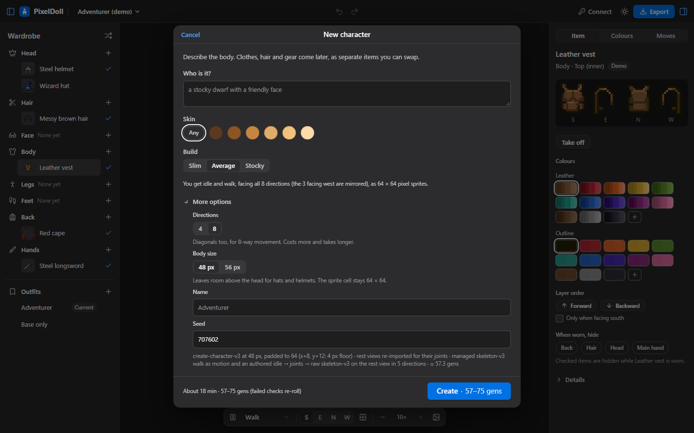
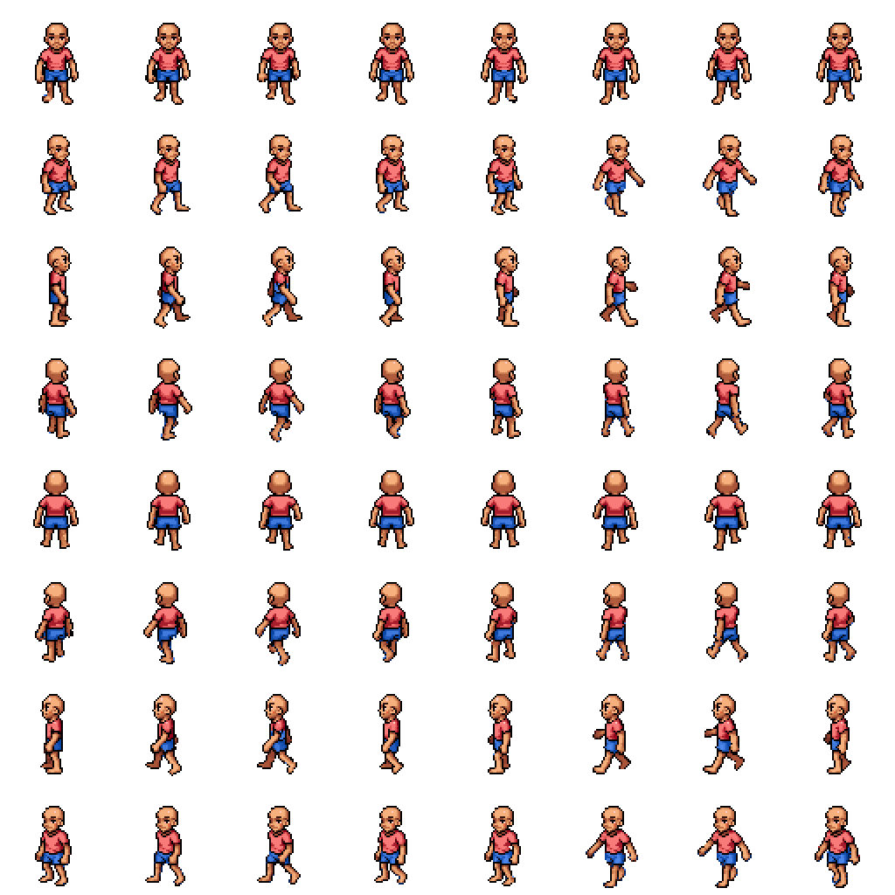
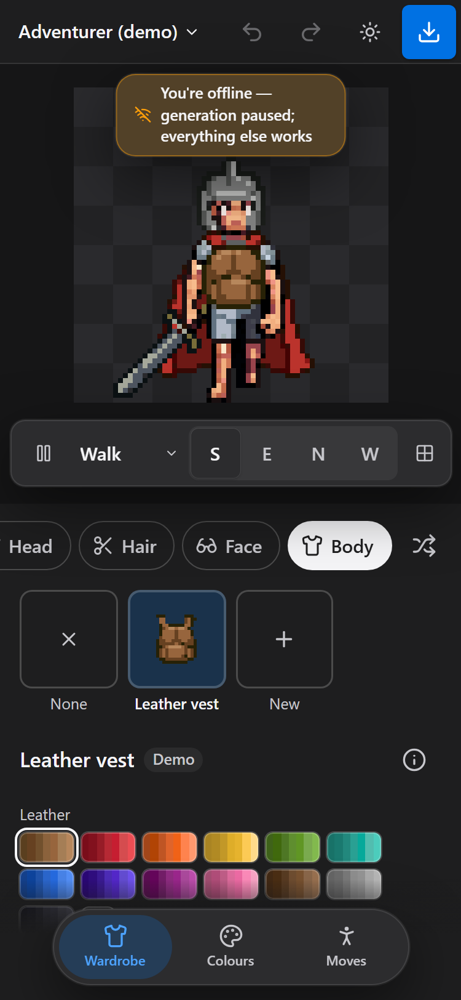
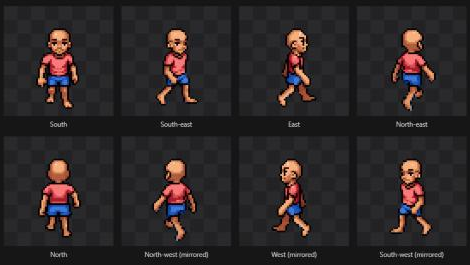
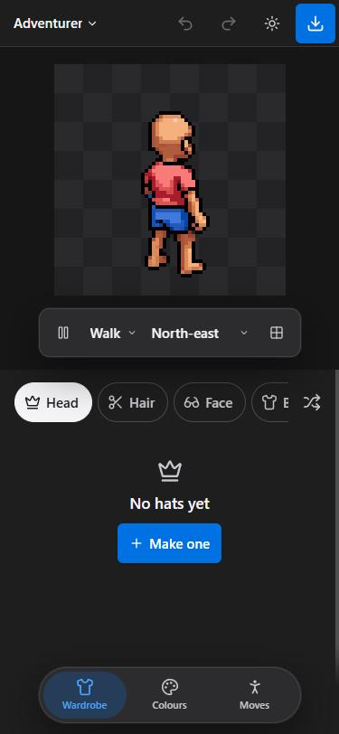
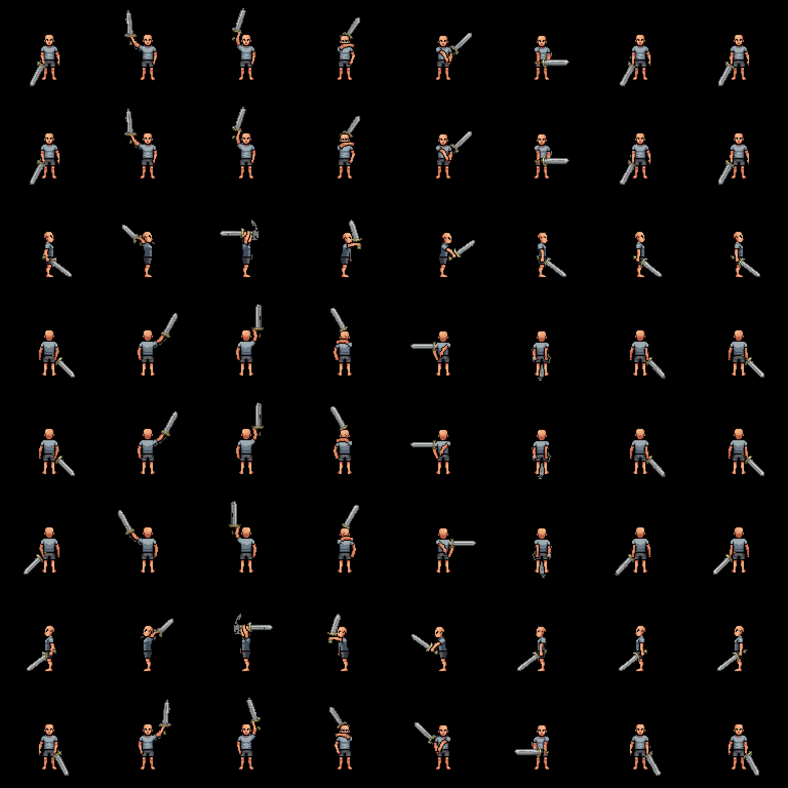
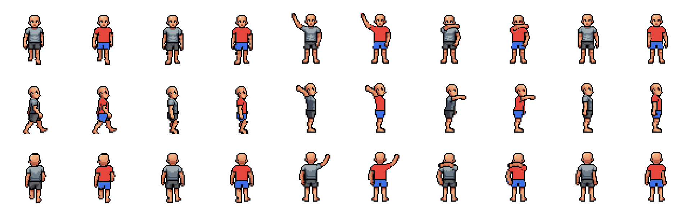
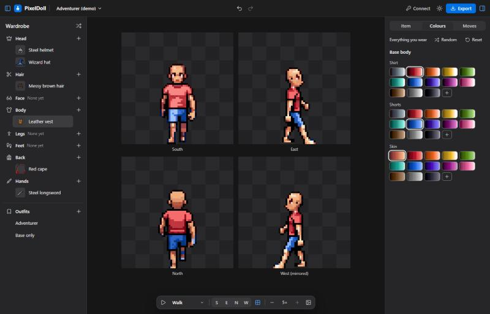
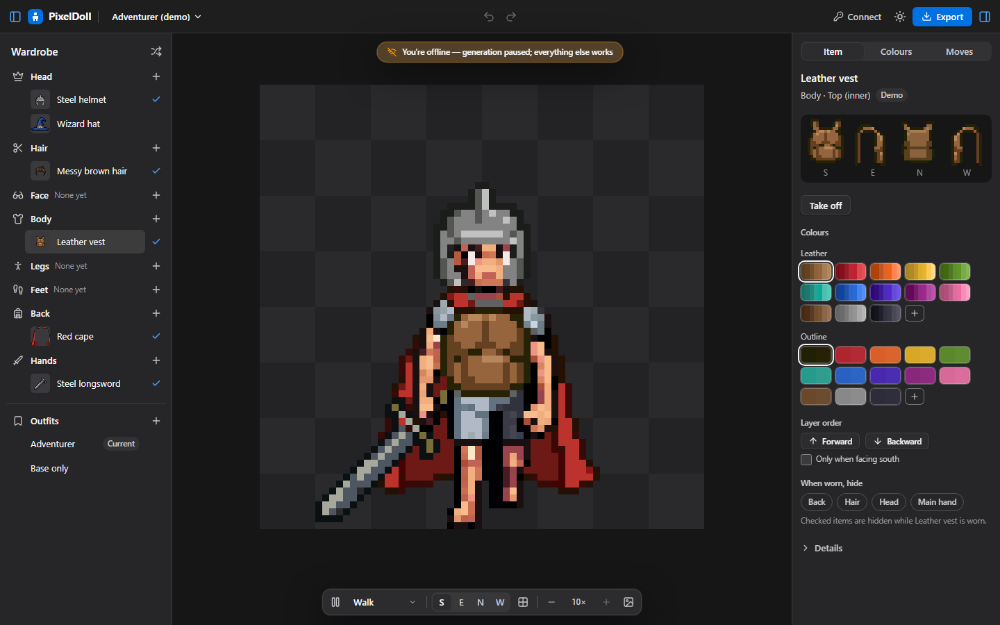

# B15: Create options (4/8 directions, 48/56 px), shirt/shorts colour regions, offline banner

Date: 2026-10-21. Builder: B15. Dev server `app-dev-b15` (:5177). **Spend: 57.25 gens** (one live 8-direction character,
estimate 57.3, no re-rolls). One POST was refused with 500 and cost nothing.

## Summary

| Task | Result |
|---|---|
| Create → **More options**: Directions 4 / 8, Body size 48 / 56 px, live price | Done. Folded away by default (4 directions, 48 px). The price moves from 35–50 to 57–75 gens as soon as 8 is picked.  |
| 8 directions through the whole pipeline | Live 8-direction 48 px character (idle + walk). All 8 directions are correct in the Studio, the baked sheets and Godot (0 px difference). Gaps fixed: Godot resource ids, the all-directions grid, the phone direction bar, diagonal pose tables and items wording / z. **One known gap: held items on 8-direction rigs (below).** |
| Shirt / Shorts / Skin recolour separately | Done for new rigs (prompt plus split) and for existing rigs and the demo (split only, nothing regenerated).  |
| Offline banner + queue pause | Done.  |
| Docs, check / build / selftest / e2e | User guide, architecture §3/§6/§7 and manifest-spec `Item.regions` updated. All four pass (e2e: 3 new steps). |

## 1. Create options and 8 directions

**UI (`CreateSheet.svelte`).** The old **Details** disclosure is now **More options**. It holds two segmented radios,
**Directions** (4 · 8) and **Body size** (48 px · 56 px), each with one line of help, plus Name and Seed. The line above the
disclosure updates too ("…facing all 8 directions (the 3 facing west are mirrored)"). `estimate(dirs)` drives the price,
in the footer and on the button.

**Pipeline (`create.ts`).**

- `genDirsOf(8)` = S, SE, E, NE, N. Rest views: W, SW and NW are flips of E, SE and NE.
- The re-import sends all 8 views (`n_directions: 8`). It cost 0.25, the same as 4.
- The rest keypoints of the diagonals came free from `skeletons["2d_references"]`.
- `buildRig(mode '8')` uses the existing 8-direction plan.
- **Body size.** 56 px pads by x+4, y+4, so the 4 px floor is kept.
- **Headroom check.** If a rest view has fewer than 6 px above the head, the create stops after the 2-gen drawing with a
  clear message ("Try again with 48 px or another seed"). This runs for every size.

**Moves (`poses.ts`).** South-east uses the south action tables. North-east uses the mirrored (north) tables, through the new
`backView()` helper; lean and death follow the same rule. Self-test: SE equals the south table, NE equals the north table.

**Gaps found and fixed:**

1. **Godot `.tres` ids.** `walk_south-east_0` printed "scene unique ID must contain only letters, numbers, and underscores"
   once per sub_resource (192× on the 8-direction S5 export). Resource ids are now sanitized; animation names keep the
   direction id (`&"walk_south-east"`). Animation ids with `-` (the demo's `cross-punch`) were affected too. Self-test added.
2. **All-directions grid** (`Stage.svelte`).
   - It used a fixed 2-column layout for 8 views (2 × 4, tiny sprites).
   - It now picks the column count with the biggest whole-pixel zoom, and ties go to a full grid: 4 × 2 at 3×.
     
3. **Phone direction bar.** Eight buttons pushed W, SW and the grid button off-screen at 375 px. Below 1024 px with more than
   4 directions it is now a menu ("North-east"). No overflow at 375 or 320 px. 
4. **Items (`items.ts`), surgical edits only:**
   - The pose prompt says "front three-quarter view" or "back three-quarter view" for the diagonals, not "side view".
   - Held bg over the cape also applies in SE and SW.
   - The north G4 exception also covers NE.
5. **Queue.** `500 "Failed to start any animation jobs"` (seen live once the concurrency was raised from 3 to 6) was marked
   `lost` and stopped the create. It is now a refusal: re-queued with backoff (self-test `notStartedTest`).

**Live test: rig-08110217d1a0** ("a young human adventurer with a friendly face", seed 186576).

| Step | Gens |
|---|---|
| create-character-v3 48 px | 2 |
| Re-import, 8 views | 0.25 |
| idle (authored) × 5 directions | 15 + joints |
| walk: managed motion + raw × 5 directions | 30 + joints |
| **Total** | **57.25** (estimate 57.3) |

- Freeze gate: 10 of 10 clip-directions passed on the first roll.
  - Arm adherence: 0.19–0.28 px on idle, 0.39–0.79 px on walk.
  - Palette fit: 1.0 everywhere.
  - Rig warnings: only walk NE / NW "feet drift 2 px" (locomotion, not gated).
- Visual check in the Studio, all 8 directions × idle / walk: correct facing and correct mirrors.
  - The managed walk motion holds the arms wide in SE frames 5–6. That pose comes from PixelLab's skeleton-v3 template, not
    from PixelDoll.
- The NE walk motion POST got the 500 above (0 gens). I re-queued it with the same seed; every other call re-attached
  from the ledger.

**Engines** (`checkouts/engine-tests/godot`, Godot 4.7.1, RTX 3070 Ti):

| Export | Import | Sync | Render vs PixelDoll |
|---|---|---|---|
| Live 8-dir rig, all engines (generic, Godot, Phaser, Unity, Aseprite), presets `default` + `recolour` | 0 errors / warnings | 1,440 ticks, 0 failures ([log](b8_engine_tests/b15_eight_sync.log)) | `default`: **0 px** differ; `recolour`: 15,709 px ([log](b8_engine_tests/b15_eight_render.log)) |
| S5 96 px sword widened to 8 directions (SE = S cells, NE = N cells, SW/W/NW mirrored, 0 gens) | 0 | 1,440 ticks, 2,880 oversize layer-ticks, 0 failures ([log](b8_engine_tests/b15_s5_sword8_sync.log)) | **0 of 2,359,296 px** differ ([log](b8_engine_tests/b15_s5_sword8_render.log));  |

- The 15,709 px on `recolour` are exactly the rig's garment pixels.
- The reason is that the Godot runtime (`paperdoll.gd`) does not apply material variants; the baked sheet does. This was the
  same before B15: the earlier Godot tests used presets without variants.
- So the mirroring of oversize 96 px layers in 8 directions is verified pixel-exact.

**Known gap: held items on 8-direction rigs.**

- The skeleton-pose item route dresses every generated direction in ONE `edit-animation-v2` call (`run.ts`: `d.calls[0]`).
- For held items that call runs on a 96 px canvas, where edit-animation-v2 takes at most 4 frames (PLAN: 16/9/4 by size).
  An 8-direction rig needs 5.
- Worn items (64 px, up to 16 frames) are fine.
- Fix (B14's files): split the dress call into ≤ 4-frame chunks, with the first dressed keyframe as the design anchor of the
  second chunk. Not live-tested (budget).

## 2. Base colour regions (Shirt / Shorts / Skin)

**Approach: both (position split + prompt), chosen on evidence.**

| Evidence | Result |
|---|---|
| S4 rig (old prompt "grey t-shirt + grey shorts"), positional split with keypoint hip lines | 23 garment colours, **9 used by both garments**. Exact-colour materials cannot separate them.  (grey = original, red = shirt, blue = shorts) |
| Same S4 rig, guessed line (60 % of the figure height, used for fixtures without keypoints) vs keypoint line | 99.9 % of 8,085 garment px agree |
| Live rig with the new prompt "light grey t-shirt and dark grey shorts" | The garments come out visibly different, but **11 of 18 garment colours still occur in both** (1,213 minority px, 7.7 %). The prompt alone is not enough. |

**How it works (`lib/dress/regions.ts`).**

- **Garment greys.** Colours with chroma C < 0.04 and lightness L ≥ 0.18 count as garment. Skin is warm and the near-black
  outline is excluded.
- **Components.** Garment pixels are grouped into 4-connected components; outline and skin separate shirt from shorts.
- **Position vote.** A component goes to the shorts when at least 75 % of it lies at or below hip − 1.5 px, measured along
  the neck → hip axis. The axis comes from the rig's anchor tracks; fixtures use the guessed line.
- **Straddling components** are cut pixel by pixel.
- **Line fitting** (live finding, walk/east/1).
  - Problem: the patch-tracked hip sat 4 px below the shorts, so the shorts went to the shirt.
  - Fix: colours that are clearly one garment over the whole rig (≥ 75 % of their pixels) now vote. Each cell's line may
    move up to 6 px up or 4 px down to where most of those pixels agree; ties stay at the anchor line.
  - On the S4 rig the fitting changes 14 of 8,085 px.
  - Self-test: a deliberately low anchor fails without the fitting and passes with it.
- **Storage in the pixels.** The region is written into the pixel itself: shirt greys get an even blue channel, shorts greys
  an odd one (a 1/255 nudge, invisible).
- **What this keeps working:**
  - Materials stay exact-colour and pairwise disjoint (spec inv. 5).
  - `deriveMaterials` makes **Shirt** (even greys), **Shorts** (odd greys), then **Skin** (`autoRamps` on the rest).
  - Export validation passes, and an engine swap shader still works.
  - The split is **idempotent**: classification ignores the region bit, and the votes come from the anchor lines.
- **When it runs.** In `openProject`, for every project.
  - Studio rigs are migrated once and saved (`saveSplit`): new cell blobs, base cells, `regions: 'shirt-shorts'`, base
    materials, `baseHash`, and the items made for the old hash move to the new one.
  - The demo fixture is split in memory on each open.
- **Not changed.** The rest views (first frames for future moves) stay as they are. A new move's frames are split on the next
  open: `startMove` re-opens the project.

**Results**

- Demo (S2 base, never regenerated): the Colours tab shows **Shirt, Shorts, Skin**.
  
- Live 8-direction rig: Shirt 18, Shorts 11 and Skin 23 colours. Crimson shirt plus azure shorts are clean in every frame
  and direction: 
- **Limitation:** a garment grey of 1–3 px outside the clothes (a toe highlight) recolours with the garment the line puts it
  in. This was the same with the old single "Clothes" material.

## 3. Offline banner

- **Queue (`queue.ts`).**
  - New `paused: 'offline'`.
  - It is set when `navigator.onLine` is false (checked every tick, before anything is sent).
  - It is also set when a request gets no answer: `isNetwork()`, a fetch failure that is not a timeout.
  - While offline nothing is submitted or polled, so no paid POST can be lost to a dead connection (B13 marks those `lost`).
  - A failed result download no longer counts as a try while offline.
  - **Resume:** the leader probes a free `GET /balance` every 15 s and resumes on any answer. A follower tab, or a tab
    without a key, trusts the browser.
- **UI.**
  - A non-blocking pill under the toolbar (`pointer-events: none`): "You're offline — generation paused; everything else
    works".
  - Activity and the item card say jobs continue by themselves.
  - The Studio also listens to the window `online` / `offline` events, so a follower tab shows it too.
- **Tests.**
  - Self-test `offlineTest`: offline → nothing sent; back online → probe, resume, submit; no answer → paused, the next job
    stays queued; probe fails → still paused; answer → resumed.
  - e2e uses `context.setOffline(true / false)`: banner shown, `paused === 'offline'`, the wardrobe still works; then the
    banner is gone and the queue resumed.
  - Screenshots: desktop , phone (above).

## 4. Checks

- `npm run check`: 0 errors, 0 warnings. `npm run build`: ok (334 kB JS). `npm run selftest`: all passed. New and extended
  self-tests: `dress/regions`, the region materials in `dress`, `offlineTest` / `notStartedTest` in queue, 8-direction poses,
  Godot resource ids.
- `BASE=http://localhost:5177 node app/scripts/e2e-studio.mjs`: all passed (21 steps). New steps:
  - base colours Shirt / Shorts / Skin;
  - Create More options: folded by default, defaults 4 / 48 px, 8 changes the price live to 57–75, 56 px detail text;
  - offline banner via `context.setOffline`.

## Files

- **New:** `app/src/lib/dress/regions.ts`.
- **Changed:** `studio/create.ts`, `CreateSheet.svelte`, `Stage.svelte`, `Studio.svelte`, `Colours.svelte`,
  `ActivitySheet.svelte`, `GenCard.svelte`, `state.svelte.ts` (openProject: split + save), `model.ts` (prompt), `icons.ts`,
  `studio.css`; `lib/rig/poses.ts`, `lib/dress/{dress,project}.ts`, `lib/image/chroma.ts` (`components(…, four)`),
  `lib/pixellab/{client,queue}.ts`, `lib/export/godot.ts`, `lib/items/items.ts` (3 one-line edits), `lib/store/manifest.ts`
  (`Item.regions`), `lib/selftests.ts`; `scripts/e2e-studio.mjs`; `.claude/launch.json` (`app-dev-b15`).
- **Docs:** `docs/user-guide.md`, `docs/architecture.md` (§3 directions, §6 base regions, §7 offline / not-started),
  `docs/manifest-spec.md` (`Item.regions`).
